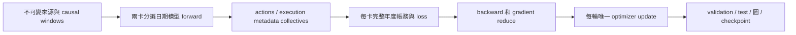

# Vastai1T 訓練 GPU 利用率：現場診斷與結構優化

目前可優化的主要方向是減少 CPU 提交、重複帳務與同步等待，再改善 GPU 上的
資料布局和融合範圍。現場確認 GPU 有大量空檔；下一版的確切瓶頸比例與加速倍率
仍須以同一設定的完整 fold 比較確認。本次只做唯讀診斷，沒有改動正在執行的消融。

## 現場觀察與實驗身分

2026-10-14 16:27:49–16:29:52 台北時間，對雙 RTX 5090 做 41 次、間隔 3 秒的
NVML 採樣，共 122.93 秒；同時讀取訓練 PID、thread CPU time、I/O 與可見 cgroup
counter。沒有啟動新的 CUDA profiler 或另一個訓練。採樣有少量外部觀察成本。

| 指標 | GPU/rank 0 | GPU/rank 1 |
| --- | ---: | ---: |
| GPU 利用率樣本平均 | 27.17% | 24.10% |
| GPU 利用率樣本中位數 | 14% | 16% |
| 樣本範圍 | 0–100% | 0–100% |
| GPU process memory | 23,042 MiB | 22,996 MiB |
| 功耗平均 | 104.79 W | 99.88 W |
| 最高溫度 | 47°C | 46°C |
| 訓練 process CPU time / wall | 106.19% | 104.63% |
| process 實體磁碟 read bytes 增量 | 0 | 0 |

CPU 100% 約等於使用一個邏輯核心。上述平均約一個核心包含 main thread、autograd
worker 與小量其他工作，不能單由此判定 Python GIL；它支持 host orchestration 的
工作高度集中。沒有觀察到此窗口被實體磁碟讀取或 OOM 主導。GPU 顯存占用是容量，
不代表 GPU 持續計算；低功耗和溫度也不能單獨證明所有硬體限流都不存在。

可見 cgroup memory 為 204.81 / 241.76 GiB，OOM/max event counter 為零；CPU quota
為 53.76 核心時間，窗口有 88 / 1,229 個 period 發生 throttling（7.16%）。這是
共享範圍的突發限流證據，不可把累計 thread throttled 秒數當成訓練 wall time 損失。
現有量測不足以把它歸因於某個程序；增加 worker 數不是已驗收修正。

此次實際載入的 source 是
`artifacts/code_releases/tw_frontier_training_20261014/20261013T181731227710Z-4beacac6b8a9/build-source`，
release SHA256 為 `4beacac6b8a9823e0a6f8097ae4f423a74e9e271ba713502c64e73462fc0b2c1`。
以 `/proc/PID/cwd`、command、resolved config 和 11 個責任模組 SHA 核對，沒有把主
工作區的較新版本冒充遠端實際執行版本。四個不同版本的模組另外保存於證據目錄。

正在執行的是正式 v8 的 `optimizer__muon`，FinancialTransformer d32、lookback32、
4 heads（head_dim8）、16 latent / 16 market tokens、last-only temporal query。
global train batch256 / local128、eval16，14,726 logical features、2,757 symbol slots。
其 1,133,582 個 FP32 master parameters 約 4.32 MiB；大部分顯存用於資料、activation
與帳務。d128、lookback256 仍是 catalog 的其他消融項目，沒有更改研究維度。

16:36 的獨立回讀：正式 baseline 在 epoch208 留下 fold11 completion marker；Muon
到 epoch275，正式 queue 繼續執行。epoch275 MAX rank 為 84.01 秒，train MAX 為
72.25 秒；每輪一次 optimizer update、零 zero-gradient batches、零新增 Dynamo graph。
另一個較早的 epoch270 是 92.66 秒，其中 train81.01、validation11.41 秒；另一 rank
的 test7.43 秒與 validation 重疊。階段 timer 未開 CUDA 同步，不能把 model/loss/
backward enqueue 秒數當成各自 GPU elapsed，再相加得出精確瓶頸比例。

## 第一性原理：GPU 適合哪一種工作

GPU 效率來自同一時間有足夠多、規則且相互獨立的運算，並且資料能留在 device。
端到端時間由計算依賴圖的 critical path 決定，CPU、copy engine、GPU 和 collective
可能重疊。對這個模型，應同時降低呼叫數、等待、重算與搬運，而非只提高 FLOP rate。

[NVIDIA NVML 定義](https://docs.nvidia.com/deploy/nvml-api/latest/api/structnvmlUtilization__t.html)
中的 GPU utilization 是採樣期間有 kernel 執行的時間比例。它不是 Tensor Core
效率或所有 SM 的 occupancy；collective 等待 kernel 也會占執行時間。當前 100%
尖峰的具體來源未重新追蹤，不能全部指認為 NCCL，也不能當作算力已滿。

目前可觀測的依賴鏈：

`trainer.py::_route_ddp_batch_replicated` 收集 actions；
`_train_epoch_windowed_tensor_ddp` 在每個 rank 綁定完整 global batch 的 physical loss。
因此模型日期運算分攤後，兩卡仍各自執行完整金融 trajectory。
`distributed_replicated_ledger_local_metadata=false`，所以 immutable execution metadata
目前也走 collective；共用免傳路徑已實作但未由這份 baseline 帶入。先用目前配方
重測它，再評估更大的 ledger ownership 改動，不只調 collective buffer 大小。

年度內存在 `state[t+1] = F(state[t], action[t], source[t])`：NAV 影響整股 sizing、
融資、費用、claims 與後續存活狀態。每日 flat 不能推出每日資金獨立。整股取整及
分支也讓這個 recurrence 不能直接改成一般可結合的 prefix scan。
同一天不同股票、來源中已證明可掃描的 FIFO 容量、以及已重置的不同年度 episode
才是可利用的獨立軸。整個帳戶的資金約束與 NAV reduction 仍需有正確的同步邊界。

## 已有 profiler 證據：用於定位，不混作現場比例

[2026-10-13 的完整紀錄](frontier_kernel_optimization_2026-10-13.md#真正的瓶頸與新的融合試驗)
保留 fold10 native baseline 的 120 秒 Nsight trace：

- 共 5,148,965 次 CUDA kernel；兩卡 kernel 時段聯集為 10.04% / 20.88%，包含
  collective 等待及 profiler overhead。
- 4,504,551 次 `cudaLaunchKernel`，API 累計 25.42 秒、平均 5.64 µs。
- 114,488 次 `cudaMemcpyAsync`，API 累計 27.82 秒。
- 49,311 次 H2D 中，44,664 次只有 16 bytes 以下，占呼叫數 90.58%；大傳輸仍占
  大部分 bytes。不能把小傳輸呼叫比例解釋成同等比例的傳輸時間。
- FP64 fill / where 等常見單 kernel 約 0.7–1.0 µs；launch、tensor construction、
  autograd dispatch 和同步成本因此值得優先調查。NCCL 也占相當 kernel 累計時間。

這份 trace 早於目前完整加速配方、資料範圍也不同。不能把其 515 萬次或 10% 當成
當前 fold11 的精確值，亦不能將跨 rank/thread 的 API 秒數加成可刪除的 wall time。
目前來源與現場觀察支持相同的結構問題；新版占比須另做短、具 phase 標記的 trace。

## 建議的改動順序與責任入口

| 順序 | 結構改動 | 移除的成本 | 共用責任與驗收重點 |
| --- | --- | --- | --- |
| 0 | 重測現成 immutable execution metadata 免傳路徑 | 重複傳送兩 rank 已持有的 returns/masks/calendar/capacity | `_route_ddp_batch_replicated`；目前 flag=false，先比較相同 source/config 的完整 fold，保留全域 action 的 autograd gather |
| 1 | 按獨立年度 episode 分派多卡，保留每輪一次全域更新 | 每卡重複完整 ledger、逐 batch action gather 及冗餘梯度同步 | `trainer.py` + `day_trade_carry_bridge.py`；configured period ownership、有效日期權重、global gradient/clip/step、原 BPTT 和完整輸出 |
| 2 | 固定大小的帳務 execution block，融合準備、sizing、NAV 與 commit | 每天大量小 kernel、Python dataclass/dispatch、暫存 allocation | `tw_day_trade_carry.py` + `tw_day_trade_inventory.py` + `tw_inventory_scan.py`；固定 actions oracle、source-failure 原子性、FIFO/fees/default、既有 backward 契約 |
| 3 | 靜態 device metadata、固定 workspace、連續欄位布局與有界雙 buffer | tiny H2D、反覆建立 tensor、strided field 讀寫及 copy 等待 | `PreparedDayTradeCarryBatch` + `factorized_panel.py`；source bytes/units/clock、neutral padding、stream lifetime 和 VRAM |
| 4 | 針對已驗證 execution block 管理 CUDA Graph replay | 小 kernel 的 host launch 與 orchestration | 固定 address/shape、forward/backward lifetime、實際 graph node/replay 證明；保留 pending backward 失敗紀錄 |
| 5 | 再融合 compact stem 的 RMS/LayerNorm 統計、projection 和 temporal 算子 | 寬輸入 normalization、窄 GEMM、checkpoint 重算 | `factorized_input.py` + `financial_transformer.py`；保留 omitted-zero affine/variance、全部 feature 參數與 source，量測實際 shape |

### 年度分派是新的結構假說

目前 `day_trade_training_annual_episodes=true` 且
`day_trade_optimizer_step_per_trajectory=true`。bridge 的年度邊界本來就重置帳戶，並
拒絕丟棄持倉、未付 claims 或 invalid state；年度由 `reset_period_contract` 定義，
不能自行改用 1 月 1 日或切掉 lookback context。
`test_day_trade_training_episodes.py` 已有獨立年度 loss reference 和邊界測試。
目前沒有 episode-sharded physical DDP 實作或遠端加速驗收。

新分工可讓 rank0 擁有部分完整年度，rank1 擁有其餘年度，各自跑 model + ledger。
GPU 內仍用 local128 的 NN microbatch 或更小有界 slab，避免一次展開整年 activation；
保留原本金融 state carry 與已宣告的 detach 邊界。若改變 BPTT，必須明列為 gradient
實驗、新 fingerprint/root，不能自稱 scheduling 等價。

對本次可分解 log-utility 的概念寫法是 `L = sum_y (N_y/N) * L_y`；實際實作須
沿用 canonical loss 的有效列與各項 penalty 權重。每個 rank 的 local contribution
要使用全域分母；一般 DDP 的 mean 會額外除 world_size，必須用正確縮放或 SUM。
全域 reduce 後才做一次 clipping、optimizer 和 scheduler step。
11 個年度的負載不齊，不能讓不等數 backward 直接觸發逐 batch collective。
已有 trajectory no_sync/reduce 可重用，但其 presence guard 假定兩 rank 使用相同
parameter 集合；episode 分派需正確處理 local unused、globally unused、尾端與缺席
rank，不能讓零梯度意外觸發原先不應有的 weight decay。

這個分工可消除帳務複算；神經計算總量和每輪 eval/report 仍存在，加速倍率未知。
單純延後 gradient sync 過去已測，沒有勝出；此次是改變 ledger ownership，需分開驗收。

### 帳務 block 與資料布局

目前 funding preparation、calendar cache、commit 和 FIFO 內核已有編譯；外層
`_run_day_trade_carry_sessions_core` 仍由 Python 按日呼叫。checkpoint block16 管的是
記憶體重算，對 admitted flat-terminal fast path 可能是 no-op；它不是融合 16 日
execution 的實作。調 checkpoint block 不等於消除 daily launch。

新 block 應以 device tensor descriptors、logical length/mask 與固定 capacity 傳入，
讓多天的 state transition 在 device 端保持順序。一天內平行股票/FIFO 事件，整個
帳戶 reduction 完成後才推進下一天。persistent kernel 需要真正的跨 block 同步及
resource/occupancy 證明；不能讓每個股票 block 自行推進而重複消耗同一資金。
可先融合單日的多個邊界，逐步擴到 bounded block，避免編譯整年巨大 unrolled graph。

目前 cohorts 是 `[cohort, symbol, field]` 的 FP64 tensor；各 field 的 strided view
值得比較內部連續欄位或 SoA 工作區。對外 checkpoint ABI 可維持原表示並在邊界
轉換。不能將帶 gradient 的 quantities 直接 cast 成 int64，或將 FP64 financial
reduction 改成 BF16。現有 `_require` 已把 CUDA validity predicate 留在 device，
fixed-action source/default/mask/fee/整股測試和安全提交都必須繼續存在。

`tw_inventory_scan.py` 的 native scan/index/layout 邊界曾修正實際 Torch2.11
SplitScan 編譯與 Compute Sanitizer 問題。新的 fused scan 必須替換這些邊界的工作，
通過實際 shape、adjoint 和 memory-safety 驗收；不能只刪掉 custom_op 去追求融合。

compact stem 另有可驗證的靜態工作假說：目前沒有 window RMS/basis，fold 的 causal
RMS scales 固定，LayerNorm 的每列 mean/variance 只取決於 immutable feature values。
可比較按 physical row 快取這些統計，再於 forward 套用仍會學習的 gamma/beta 和
projection，避免每 epoch 與 checkpoint backward 重算統計。cache 必須綁定 fold、
normalizer、完整 logical F、原 FP32 reduction/eps 與 source identity；raw input 需要
gradient、IG perturbation 或動態 feature overlay 時沿用原計算。不能快取跨 optimizer
update 的 learned embeddings，也不能忽略 omitted-zero 的 affine/variance 項。
這項 cache 尚未實作或測速；應比較其預處理、host/VRAM 成本與完整 fold 收益。

## 已完成的工作與應延後的選項

目前已有 NUMA affinity、48 GiB/rank decoded host cache、compact packet cache、
source prefetch、batched transport、BF16 temporal、QuACK softmax、funding preparation
v3 和 Gregorian cache。這些不是尚未開啟的建議；更多 threads、全 retention、FP8、
DeepGEMM、FA4 bridge、DDP bucket 與 graph flag 的舊結果見 kernel 報告。
例如 FP8/FA4 未取得端到端加速，財務 CUDA Graph 的 pending backward 未通過。

[CUDA Graph 的官方機制](https://docs.nvidia.com/cuda/cuda-programming-guide/04-special-topics/cuda-graphs.html)
能攤提重複 launch 的 CPU 成本；此項可行性與目前 Torch graph/autograd lifetime
相容性是兩個問題。新 block 尚未驗收前，不直接打開既有失敗的 graph flag。

九組 optimizer 短測目前都通過 lifecycle。AdamW control / repeat 的穩態 MAX
分別 76.45 / 72.40 秒，前後差 5.29%；Muon78.06 秒。這不是 paired 速度結論。
每 epoch 只做一次 update，optimizer 的主要研究價值在所需更新數與泛化，而非
消除數十秒的帳務、資料與 dispatch 成本。FSDP/ZeRO 對 4.32 MiB 參數不是主要
容量改善；d128/L256 的算量提升也不能當作維持 baseline 的加速。

## 下一版的量測與交付條件

先重測已存在但未生效的 execution metadata 免傳，再實作 episode ownership，接著
測 execution block / device metadata / graph，各有獨立 config/fingerprint 和 root。
先用固定 actions、年度 ownership、全域梯度與單次更新
oracle 檢查機制，再做相同最後 fold 的完整 A/B/B/A；不重跑全部套件 inventory。
保持 d/L、features、fold、batch 語意、PIT、fees、FIFO、ruin、validation/test、
每輪圖表、checkpoints 與 final backtest。只在實測 OOM 時依既有許可調容量參數。
速度以 epoch3+ MAX rank 和完整 fold 判定；profile 僅定位，不納入速度排名。
另記有效 rows/s、kernel/host call 數、collective waiting 和 memory headroom。

GPU 利用率上升不是驗收條件：少做重複帳務也可能讓 utilization 下降而 fold 更快。
本次分析沒有實作或宣稱上述新分工的加速，亦沒有更改正在執行的 formal v8。

## 可回讀證據

本機與遠端均位於
`artifacts/operations/gpu-utilization-diagnosis-vastai1t-20261014/`：

- `initial-live-state.json`：source/config SHA、resolved flags、curve snapshots。
- `live-telemetry.json`：完整 41 樣本與 PID/thread/I/O/cgroup 前後讀值；SHA256
  `c1e1452b2da9a189b8f389b3feaabc212ac7f5f01482f358f3a84a9bf5f6368b`。
- `cpu-contention.json`：另一次 8 秒 process CPU 觀察；command credential 已遮蔽。
- `closing-live-state.json`：baseline completion marker、Muon275 與 queue running。
- `loaded-source/`：四個與目前主工作區不同的實際 source 模組。
- `diagnosis-manifest.json`：本次證據、責任檔案和報告的獨立 size/SHA 回讀。

舊 Nsight JSON/CSV 保存於
`artifacts/operations/frontier-kernel-optimization-vastai1t-20261013/`。
所有當前數值是上述窗口的觀察；不同 fold、parameter trajectory、host 負載與後續
版本應重新測量，不把此報告當成 GPU 物理最優或投資結論。
