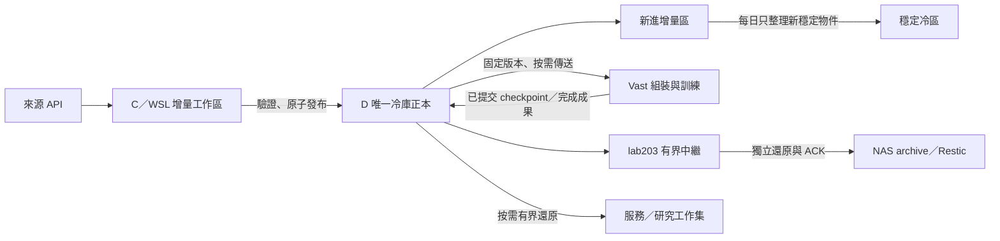

# 分工儲存、穩定冷區與可移轉訓練（2026-10-25）

本次依使用者 2026-10-25 的要求實作。工程任務為
`storage-single-authority-20261025`。本文件區分目標、已部署狀態及驗收證據；
設定存在或服務 active 不代表完成遷移。

截至 2026-10-26 23:50 台北時間：WSL 已擴至 3,000 GiB，原 ext4 reserve
已恢復。TAIFEX 的 50 檔工作副本已完整冷存並退休，刪除後再次從固定 D
版本還原全部原件通過；C／WSL 實際回收 4,036,501,504 allocated bytes，
D 編碼暫存另回收 99,090,432 bytes。兩批既有 round7／11 保全仍在執行，
未算入已回收。五批私有救援已收到全部 paired NAS 檔案還原 ACK；Penguin
另用固定 v3 原始離線驗證器讀回全部 1,275 檔、19,465,967,303 bytes，
完整 SHA 與記錄中的 run／checkpoint／context 綁定通過，來源繼續保留。
lab203 尚待實際採用 v3 並驗證其 NAS 還原資料；新 GPU 續訓尚未驗收。
全來源 reader／writer 遷移尚未完成，原目標維持 active。
round8 原 owner 已於 21:33 台北時間完成：70,871 個原件逐檔冷還原驗證、
精確來源回收、刪除後 D 全檔讀回及 stage 清理均通過；WSL 內實際釋放
13,010,243,584 bytes 原工作副本與 2,774,450,176 bytes 暫存。這是 ext4
可重用容量，不代表 VHDX 已縮小或 Windows C 實體可用量增加相同數字。
另已修復 unattended native 容量檢查，原 intraday timer 與 FinMind free 已實際
恢復請求；auxiliary 完全未變更時不再先清點整個 transport。封存 verifier
的固定工程 A/B/B/A 與完整回歸已完成，證據已獨立封存到原 D CAS，細節見末節。

## 架構決策

| 位置 | 正式責任 | 可保留內容 | 回收條件 |
| --- | --- | --- | --- |
| Penguin C／WSL | 下載、增量修訂、服務、控制與備份協調 | 可續傳 ingress、目前可變來源狀態、ledger／SQL、必要服務投影及按需研究工作集 | 固定 D 版本全檔還原、來源 writer／reader 已切換、無程序／租約／傳輸引用後回收精確名稱 |
| Penguin D | 唯一本機原始內容權威庫 | 不可變內容定址物件、完整版本清單、發布 provenance、封閉成果、可續訓 recovery context | 不因容量不足自動刪來源或歷史；D 缺盤不回落到 C |
| Vast | 可替換的計算節點 | 當期固定來源、遠端建立的 panel／tensor／cache、尚未驗證回傳成果 | 來源可再取用、無當期依賴；正式成果回傳及還原驗證後，仍遵守七日保留 |
| lab203 | 有界接收、整理、獨立驗證、轉送 NAS | 在途封閉批次、復原驗證 scratch、必要控制收據 | NAS 原值驗證及 paired ACK 持久化，且當前程序／傳輸均不再引用 |
| NAS | 獨立備份 | immutable archive、原始 manifest、加密 Restic code/config/SQL 等備份 | 依獨立保留政策；不得把中繼清理當成 archive prune |

D 的「正本」與同一顆 D 上的「備份」不構成兩份獨立災難復原副本。
NAS 才是跨機器副本。相同 digest 的來源內容只存一份物件；版本只保留完整清單和引用。
服務、訓練及 NAS 複本各有目的與上限，不把 hardlink 名稱重複計為實體容量。



## 沿用的 owner 與必要修正

沿用 `packed_snapshots`／完整 manifest／8 MiB CAS、既有 source catalog、
Temporal／Syncthing／rclone／lab203 relay、`training_return`、`training_rescue`、
`materialized_cache` 與容量租約。不另外建立一套下載、備份或訓練 executor。

1. 修復 completed-return 實際失敗與不透明錯誤，再驗證 discovery、傳輸、D 原值
   還原及遠端保留。持續 checkpoint 與 complete-only 回傳是不同流程。
2. 監控容量每分鐘取樣，分類掃描可部分顯示、有界重試；不可因巨型樹掃描失敗
   丟掉已取得的容量或誤報零用量。
3. 增量／穩定冷區採既有 CAS 之上的 tier 清單，保持物件名稱、原值與舊 manifest
   相容。每日只處理新穩定 cohort，不每日重壓整個 lake。先測檔案系統透明壓縮；
   已壓縮 Parquet 若無收益就略過。若要轉可攜封裝格式，須先部署所有 reader，
   不直接覆寫 `.blob` 為不同 bytes。
4. C／WSL 歷史來源不能先刪再修 collector。逐一列出 collector state、完整冷版本、
   服務例外、現存引用；冷來源 reader／增量 writer 通過恢復與修訂驗收後才退休。
   不以 symlink 掩飾整份歷史仍在 C，或讓 HDD 上 SQL 取代 SSD 可變控制資料。
5. Vast 回傳已提交的完整續訓上下文：model、optimizer、RNG、epoch、配置、
   source/code/runtime 身分與 curve。採用既有 rescue fence、固定 bootstrap 及
   strict CUDA 驗收；遠端硬故障時最多回退到最後已驗證提交點，不宣稱零損失。
6. lab203 持久 payload/cache 應收斂為有界中繼，先查 NAS exact recovery 與引用再
   回收。無管理入口時交付固定版本的 Codex 指令，透過原收據通道回報；不另開傳輸。

## 驗收順序及可衡量邊界

- 先保命：目前 WSL headroom、D 實體容量、進行中 owner／FD／傳輸；不足則暫緩
  新工作，不能降低原本容量 floor 來讓測試通過。
- 固定樣本 benchmark 記錄原 bytes／allocated bytes、壓縮與完整讀回時間、SHA、
  CPU 與來源格式。分別量測掃描、下載、處理、發布、傳輸與恢復，保留負結果。
- 每次源端退休必須有完整清冊、D 固定版本、每檔原值 SHA 還原、當前引用與
  pin／lease／同步／quarantine gate，最後量測 `st_blocks` 實際回收。
- 續訓先驗完整上下文可獨立還原；實際換機須有使用者指定目的地與舊 worker
  fence，且新機 CUDA 配置／kernel／synchronize 通過。未做實際移轉不可寫成已完成。
- 監控分開顯示 observed time、掃描完成度、unknown／stale、增量與穩定區、在途
  與已 ACK，不把 catalog 註冊或 HTTP 200 當成資料完整性。

## 初始觀測（非固定容量設定）

2026-10-25 約 22:55 Asia/Taipei：WSL 可用約 4.60 GiB；D 約 421.74 GiB。
現有 observer 的 NAS 回執顯示可用約 11.33 TiB，lab203 已分類內容約 163.4 GiB，
其中 cache 約 127.6 GiB；它們各有較早 observation clock，不等於本機即時量測。
complete-artifact 回傳最近一次失敗，rescue 只有一個既有 enrolled run 且最近有
失敗紀錄；這些均須由實際 readback 修復，不能以 timer active 宣稱健康。

實作、測試、部署與未解項目將以本任務的 `artifacts/operations` 收據及本文後續
證據段落為準。對仍受硬體、來源、權限或遠端入口限制的環節明確列出，不承諾
消除物理限制或從小樣本推論全系統最佳。

## C／WSL 容量死結的可審查處置

2026-10-26 01:41 Asia/Taipei，根檔案系統可用空間降到接近零，
Syncthing 因既有資料庫保留空間而暫停掃描；因此原本要求同步健康的精確退休
也無法繼續。已讓 registered-data 下載入口在不足原有 25 GiB floor 時暫緩，
不呼叫來源 API；未降低應用程式或同步服務的保留空間。

使用者已明確同意的暫時方案：核對 `/` 的 ext4 裝置、UUID
`b37fb7b3-fe96-4301-a5ba-0e5363ff854c` 與原始保留區後，把 ext4
保留區由 5,368,709 個 4 KiB blocks（20.48 GiB）暫時調為 1,048,576
blocks（4 GiB）。這只是提供約 16.48 GiB 的可用餘裕讓同步與既有退休流程
恢復，沒有刪除資料，也不代表 Windows 已回收實體空間。

精確命令由唯讀計畫中的裝置身分綁定，當前為
`tune2fs -r 1048576 /dev/sdd`；恢復命令為
`tune2fs -r 5368709 /dev/sdd`。執行前後均保留裝置與容量收據。
完成經驗證的檔案退休、且恢復原保留區後仍有至少 25 GiB 可用時，才恢復原設定。
此方案已於 2026-10-26 08:41 台北時間執行，保留前後讀回；使用者後續完成
擴容，已於 10:07 恢復原 5,368,709 reserved blocks，未降低應用程式 floor。
擴容會按比例調整暫時 reserve，恢復時核對同一 UUID、精確新舊 block count、
原暫調比例及恢復後至少 25 GiB。這次容量來自使用者擴容，不記成檔案退休。
遵守 [storage contract](agents/storage.md) 的明確授權及身分讀回。
原唯讀計畫見
`artifacts/operations/storage-single-authority-20261025/wsl-reserve-bootstrap-plan.private.json`。
套用與恢復分別見 `wsl-reserve-applied.private.json`、
`wsl-reserve-restored.private.json`，均位於同一工程目錄。

## 實作與實測讀回（2026-10-26 01:45 Asia/Taipei）

| 範圍 | 已完成與證據 | 仍未成立的結論 |
| --- | --- | --- |
| completed Vast 回傳 | 原 owner 使用 D 獨立 scratch；修復 DrvFS 時間精度及錯誤診斷；等待 NAS 的舊成果與下一份成果保全分開，有界 pending queue 為 32 | pending 不是 NAS 已驗收；七日精確退休仍要完整 ACK／引用／還原 gates |
| 08:45、09:00 進行中訓練 | 各自用不可變 run ID 被動登錄，timer 持續回傳完整 checkpoint，不接管訓練；兩次獨立 D 讀回各 18 檔，包含完整 optimizer、2 rank RNG、global batch 128 及相同 epoch 曲線 | 當前期貨任務尚未完成全部固定 raw 輸入／builder 重建與新 GPU 續訓驗收 |
| 原 runtime／source | 5 個私有 D 物件共 4,483,895,485 bytes；runtime archive 的 39,732 成員、7,895,332,601 解碼 bytes、1,154 內部 links，以及 source ZIP 的 1,855 成員均獨立驗證 | 私有救援物件尚未有 NAS 獨立還原證明；不當作可自動換機 |
| 中斷續傳 | 原 4,455,174,291-byte capsule 已有 2,480,766,976 bytes 的 partial；新管線核對不可變來源、prefix SHA、私有 intent、物件鎖與完整 D SHA，只補 1,974,407,315 bytes，沒有重抓整份 | 不從任意 partial 猜來源，不以 prefix hash 取代最後完整 SHA |
| checkpoint D 讀回 | 固定 18 檔的 ABBA：逐檔 native 呼叫平均 78.17 秒，分批 native 完整讀回平均 4.93 秒，全部原 SHA 相同；這一階段約 15.86 倍 | 不推論 WAN 速度、完整訓練速度或全系統加速 |
| 穩定冷區 | 原 CAS 位元組與路徑不變；03:00–07:00 台北時間每日有界整理已穩定 6 小時的新物件。5 分鐘 timer；每輪最多 8 GiB／1,024 objects，保留 D 64 GiB | 不每日重壓整庫，不新增第二份 raw 正本 |
| 真實壓縮與重播 | 2 個已入庫樣本的 allocated bytes 由 25,644,291 降至 6,193,152；原 SHA／native 及 Linux 讀回、再次執行均通過；已壓縮 Parquet 收益太小的候選未採用 | 75.85% 是這兩個樣本，不是整庫估計 |
| 儲存監控 | 已採用 v4 頁面與 observer；增量／穩定區、觀察時間、分類不完整與未知分開呈現。桌機／手機共 9 項真實瀏覽器案例通過，未呼叫 provider API | partial 掃描是已量測下限，不當作整個磁碟分類完成 |
| 下載入口容量 | registered-data daily／intraday／features／backfill 共用原 25 GiB floor 及 backing-volume 檢查；不足在讀憑證／呼叫來源前 exit 75。當時的 intraday 已安全停寫並驗證暫緩，原 timer 保留 | 這是 dispatch admission；不宣稱所有獨立 provider writer 均已有逐次寫入租約 |
| 來源 layout | 33／33 版本入口可讀；實際 native workspace 遷移驗收只有新聞 1 項 | head 存在不等於 C 歷史已退休；本任務截至此時原有 C 副本回收為 0 bytes |

Vast 的 runtime 全成員驗證採串流，沒有在 C 展開大副本。
舊 capsule proof 曾用 `Path.readlink()` 正規化 link 拼法，其中 1,038 筆與 tar
原字串不同但指向相同位置；原始 tar、原始 proof 均保留。新 capsule 使用
`raw_readlink_v2` 保存字面目標，舊版 reader 依原版本規則驗證，不改寫歷史證據。

本次重試／prefix／物件鎖／SSH 診斷／link 相容性及 bootstrap 來源身分邊界的
**172 項測試通過**。`seal-bootstrap` 只保全 runtime／source，不執行 builder；
新版回報明確保持 `source_inputs_rebuilt_on_remote=false`，並在傳輸前後核對
enrolled 主機／boot 身分。不得把這份保全證明當作當前期貨資料已可重建。
容量、面板及無人值守 guardian 的 **138 項相關測試通過**；先前冷區、回傳及
公開面板的各組測試另有原 run 收據，不把重疊測試相加當作唯一個數。
首輪 link 測試與 browser lazy-toggle 驗證曾失敗，修正後的新 run 通過；舊失敗
紀錄保留，不覆寫終態。

精確、可機讀的證據均位於 `artifacts/operations/storage-single-authority-20261025/`：

- `current-checkpoint-independent-readback.json`：08:45 固定 epoch 255 的獨立讀回；timer 之後仍可前進。
- `current-0900-checkpoint-independent-readback.json`：09:00 固定 epoch 80 的獨立讀回。
- `current-runtime-source-preservation.private.json`、`current-runtime-independent-decode.json`：私有原件保全與獨立全成員解碼。
- `checkpoint-readback-abba.json`、`tier-replay-readback.json`、`compression-native.json`：實測、完整 SHA 與重播範圍。
- `taifex-web-retirement/progress.json`：50 檔、約 4.04 GB 工作副本已有 D 固定版本；因 Syncthing 容量 gate 未退休，來源保留。
- `source-layout.json`：33 項 metadata-only 觀測，不代表 payload 或 writer 遷移完成。

lab203 的 [固定接手指令](lab203_relay_storage_handoff_2026-10-25.md) 已交給使用者轉交。
截至上述觀察時間，原 paired receipt folder 尚未出現 `storage-relay-audit.json`；
不從 Penguin 的同步 idle 推論 NAS 整理完成。這個原目標保持 active，後續依原 owner
完成 C 副本退休、逐來源 writer／reader 切換及遠端重建驗收。

## 接手包與後續保全（2026-10-26 02:15 Asia/Taipei）

固定接手包已由原 control publisher 發布至
`/srv/stockagent-backup-ingress-lab203/tools/storage-relay-20261026-v1`，
含 24 個來源檔案、完整儲存 skill 與適用契約；封閉傳輸目錄共 27 檔、632,811 bytes。
獨立讀回核對 envelope 內 25 檔、627,938 bytes 的完整 SHA，envelope 身分為
`8dfe57bf88da82954c57622025338d7d9ec472631e5455147b3660c03d426038`。
原掃描通知回報 HTTP 錯誤，狀態保持 `deferred_to_existing_transport`；
這不是 lab203 已部署或 NAS 已驗收。該版本封閉後不覆寫；本文後續更新也不
假稱已包含在這份固定包中。接手包 CLI／完整內容／不可覆寫等 12 項測試通過。

已完成 workflow round 6／7／11 的原始完成收據現在可供原退休 owner 辨認。
驗收核對原 acceptance bytes、獨立 readback hash、完整證據清單、13 個測量階段
及原作用範圍；沒有把它們升格為全工作流測量或硬體極限證明。477 項既有相關
回歸通過，之後含新增 quarantine 身分案例的 137 項 focused 回歸通過；兩組有重疊。
所有失敗 trial、原始量測及 payload 仍須完整封存，只把三份小型完成收據留作熱證據。

兩批正在保全的精確來源如下；這是 inventory，**不是已回收容量**：

| 精確來源 | 檔案數 | 原始 logical bytes | 唯一 inode allocated bytes | 當時狀態 |
| --- | ---: | ---: | ---: | --- |
| `benchmarks/workflow_speed_optimization_20261021/round7` | 78,393 | 14,304,597,454 | 14,506,184,704 | 原 owner 在 D private scratch 建完整 archive；C 來源保留 |
| `benchmarks/workflow_speed_optimization_20261021/round11` | 59,686 | 13,250,419,794 | 13,404,770,304 | 同上，準備可並行，正式發布仍由共用 owner 序列化 |

證據為 `workflow-round7.inventory.json`、`workflow-round11.inventory.json` 及各自
`*-retirement/progress.json`。截至上述時間，兩批 `reclaimed_allocated_bytes` 仍為 0，
必須待 D 原值重建、當前引用／同步／quarantine／精確 unlink 全部通過才更新。

目前期貨配置與 factorized manifest 的唯讀 provenance 稽核另見
`current-futures-rebuild-inputs.private.json`：只讀 1 份約 2.46 MB manifest，
沒有改 producer、跑 builder 或掃描 raw payload。該 manifest 仍引用既有固定來源，
不需要再複製一套相同 raw；當前 v3 execution-clock 的完整 dependency binding
仍須另驗，不能把舊 margin scope 的重建收據挪作這次的驗收。

### 當期共用 tick 原件保全（2026-10-26 02:44 Asia/Taipei）

已從 09:00 固定 clock manifest 清點兩個時段共同使用的原始輸入：
3,826 個 FinMind tick 物件、1,159,334,664 筆，日期 2011-01-26 至
2026-09-24；連同原收據、inventory、16 份官方盤後鉅額來源及一份 NMFR1
補充 tick 的資料／收據，共 7,672 個原件、4,125,574,234 bytes。

這份來源集合以固定 plan SHA
`26df88bc414b119a5284131f6380b7bcdd1bdfa527a6a96df270cf60a2dff3dc`
綁定，只建立一份兩時段共用的私有 recovery capsule；沒有逐 run 複製原件、
改 producer、重新呼叫 API、在 C 展開 payload 或接管訓練。
沿用 `training_rescue` 的來源 boot／instance fence、物件鎖、有界容量及原值
SHA 傳輸；封裝、回傳與 D 讀回合計 368.20 秒。

D 上 capsule 為 3,307,555,554 bytes，完整 encoded SHA 為
`e642e29ced312084472d35a566485210f4c93524227e611fec033652b687a3f8`。
另一個獨立程序從 D 串流解碼所有 7,672 原件，逐檔核對 SHA／size／mode／
奈秒 mtime，並核對整個 encoded SHA，123.12 秒通過。source plan 與 proof
本身也保存在同一私有 D CAS；C 只新增小型控制清單及證據。

證據為 `current-tick-input-preservation.private.json`、
`current-tick-input-independent-readback.private.json`；6 項本地故障 fixture
另驗重複名稱、越界、錯 SHA、覆寫與整組來源變動。第一次預檢因官方原件另位於
已存在的 `stock_futures_block_audit_20261021` 而拒絕，未寫遠端／D payload；
核對六份原件的官方 provenance 後才加入精確來源範圍，原失敗收據保留。

這是原件備份還原驗收，**不是**當期 financial／factorized 依賴已全部可重建。
全圖 builder、新 GPU 續訓及 NAS 備份仍未驗收，兩個當期 enrollment 仍不得
以此變成 `recovery_prepared=true`。這份 D 內副本屬有明確恢復目的的備份，
不另發布金融來源 head；後續優先比對既有固定 D 清冊，避免再複製已有 raw。

### 財務來源先比對再補缺（2026-10-26 03:00 Asia/Taipei）

當期 financial rules 的固定 manifest 原件為 19,124,648 bytes，列出
56,540 筆來源記錄、56,539 個不同路徑，實際只有 55,545 個不同 SHA，
共 4,237,580,045 bytes。依來源字串逐項下載會把相同內容及既有冷版本再複製。

先串流比對三個**固定** D snapshot 的完整 inventory，沒有跟隨 moving latest。
26.49 秒內辨認出 55,541 個已存在內容、4,177,206,050 bytes；只缺四個當期
准入證據／context-prefix Parquet 或 JSON，共 60,373,995 bytes，沒有把它們
稱為新的官方原始觀測。四個缺項與兩份固定 financial manifest 共六檔、
79,508,428 bytes，已沿原 rescue 物件鎖／原 SHA／私有 D CAS 保全，47.63 秒完成。
既有四 GB 內容沒有重新向 API 或 Vast 下載，C 未產生 payload 副本。

metadata 比對收據為 `current-financial-D-reuse.private.json`；補缺保全收據為
`current-financial-closure-controls.private.json`。metadata 相符不等於 cold 原值
已讀回，因此另以 `verify_financial_D_originals.py` 逐個既有 pack／blob／chunk
獨立解碼。它重用正式 manifest 與 native immutable reader，最多 256 MiB
pack buffer、每批至多 16 物件，不產生 C／D materialized tree；完整 encoded
SHA、所選原件 SHA／size、ZIP CRC 與 native 前後身分都必須通過。
八項實際故障 fixture 已通過，包含短讀、錯 SHA、錯 size、重複名稱、越界及
記憶體上限。大集合的獨立驗收也已通過：55,545 個不同 financial originals，
加上兩份 manifest，共 55,547 個內容、4,256,714,478 decoded bytes；
重用既有 55,541 個原件，完整讀取 95 個 pack／blob 及兩份 chunked 原件，
325.82 秒完成。收據為 `current-financial-originals-independent-readback.private.json`，
整個驗收沒有 C／D payload 寫入。第一次啟動因 `nice` 無法執行 Bash function
而在任何資料讀取之前 exit 127，改用 canonical Python launcher 設定該程序
的 nice／ionice 後通過；原失敗收據保留。

此驗收只涵蓋所選 financial originals，不能當三個舊 snapshot 全部檔案的
驗收，也沒有提升原 manifest 的 research-only、PIT 或全市場完整性聲明。
完整 factorized／clock 重建及實際新 GPU 續訓仍是不同驗收。

上述原件定位、讀回證據與驗證程式共 26 檔、61,588,413 bytes，也已沿同一
私有 D CAS 封閉並做獨立 native batch SHA。immutable index 為
`27197ebb6548e040b44be7f0a40958211a805f4f3e5537142555eeb5ccf0ad92`，
私有 D 的 `evidence/storage-single-authority-20261025/` 有同名小型 anchor。
因此 D 不只剩無法定位的大 blob；C 損壞時仍有固定清單與校驗方法。封存收據為
`current-recovery-evidence-seal.private.json`；這是此次指定依賴的保全，不能
當所有 C 控制狀態或 NAS 最新備份已完成，也不刪除原有 C 控制清單。

### FinLab 容量入口修正

FinLab 主要 refresh wrapper 原本沒有共用 dispatch 容量檢查，普通 SDK
同步可能在 WSL 低於控制庫保留空間時繼續啟動。現在在 SDK 啟動、讀取憑證
及任何來源操作之前呼叫既有 `check_acquisition_capacity.py`，沿用 25 GiB
floor 及 Windows backing-volume 判斷；沒有改變 FinLab 的追新流量政策。
systemd 的來源 template 與本機 drop-in 都接受 exit 75 為正常暫緩，原 timer
保留，容量健康後可自行重試。它是每個 pass 的 admission，並非所有 provider
逐次寫入的容量租約。

四份 FinLab／容量測試共 **133 項通過（12.54 秒）**，包括真實 Bash wrapper
在 75／2 時不啟動 SDK、不建立來源目錄及原本 general→minute→tick→research
的順序。正式主機直接驗證可用 1,429,213,184 bytes 時 exit 75，零 provider
操作；`finlab-capacity-guard-deployment.json` 保留 wrapper／drop-in SHA 及觀測。
正式 unit 已再次依原條件啟動，實際 exit 75、`Result=success`，且 PID 回到 0；
`finlab-accepted-capacity-state.json` 保留套用前後狀態。沒有終止一筆既存交易，
也沒有關閉原 timer。

### 凌晨正式冷區服務驗收（2026-10-26 03:10 Asia/Taipei）

首次進入 03:00 工作窗口時，systemd 沒有互動終端的 Windows PATH／WSL
enrollment 環境，兩個 cohort 在任何 native payload I/O 前被拒絕。
不是來源原值錯誤；失敗收據與原物件均保留。`run_cold_tiers.sh` 現在先呼叫
既有 `ensure_enrolled_wsl_identity`，沿正式 enrollment、受檢查 init socket
與既有 Windows reader 建立背景環境，沒有新增 shell shim 或降低 mount guard。

165 項冷區、runtime、native I/O、監控回歸通過（6.59 秒），含真實 Bash
初始化順序及 enrollment 失敗時不得啟動工作的案例。接著正式 unit 在
03:08:53–03:10:57 執行，exit 0／`Result=success`；一輪 30 物件、
786,093,491 logical bytes，allocated bytes 實際減少 554,732,771（約
529 MiB），零失敗 cohort、零原件刪除。每個物件的 native 完整原值 SHA 及
Linux inode／size／mode／mtime 均通過原 guard。123.68 秒是此輪實測；
120 秒為批次間的軟限制，不把它聲稱為可中斷一筆 native 交易的硬 deadline。

證據為 `cold-tier-unattended-before.json`、`cold-tier-unattended-after.json`。
此輪實體節省不表示 C 已回收空間，也不是 NAS、全庫壓縮率或冷重啟驗收。

### 續訓準備判定修正

原邏輯在 `data_sources=[]` 時略過輸入驗證，因此 checkpoint-only 登錄若日後
保全 runtime，可能誤顯示可以移轉。現在 `status`、`plan`、已批准 plan 的執行
共用同一條件：來源綁定必須非空，且完整原值讀回收據的 `spec_sha256` 必須與
當前 spec 相同。空集合的 `verify-sources` 不再產生成功收據，空集合的 restore
在任何目的機動作前拒絕。此修正不改寫既有 checkpoint、輸入或 enrollment。

回報契約為 `pinned_sources_and_runtime_v2`。相關 rescue／Windows I/O 回歸
**177 項通過（40.63 秒）**，包含缺 bindings、缺 proof、錯 spec、metadata-only
proof 及空集合驗證；測試舊 plan 也不能繞過新條件。收據 run 為
`rescue-pinned-input-readiness-20261025T181933-0ca67590`。
正式唯讀入口證據 `rescue-status-readiness-v2.json` 顯示目前 08:45／09:00
回傳點分別為 epoch 265／155；兩者 `recovery_prepared=false`，保全繼續，
不以此狀態假稱完整原料重建或實際新 GPU 續訓已驗收。

### 台股原始來源的完整讀回與有界 RAM reader

當期期貨 context 引用的台股來源版本為
`tw-daytrade-panel-sources-20261004-gapre-20261004T163754531166169Z-l0-penguin-6160c54fa6faa702`。
已沿原 canonical verifier 從 D 完整解碼 **5,917 個原檔、5,303,374,780 bytes**；
86 個 encoded objects 的完整 SHA、每個原件的 SHA／size、pack CRC 與來源
前後身分都通過，沒有建立 C materialized tree、呼叫來源 API 或修改另一視窗
負責的 factorized producer。

封裝 manifest 的 SHA 是
`ad0ed2f1154e98fc957581612774d43c1b0a1fea6c6542668b545a4a65354b8a`；
內含原始 `source_manifest.json` 的 SHA 是
`167190ad3e17d43aa590bdb4160e8f9c26e5ffe9951e7d9f9069683e0280811f`。
兩者分屬傳輸封裝與原始來源身分，不能互相比較後誤報毀損。原始 manifest
的 producer SHA 也與已保全 code bundle 一致；這僅確認版本可定位，尚未
執行從 raw 到全部訓練輸入的獨立重建。

低 SSD 餘裕時，舊大型 pack 路徑會先完整 native SHA，再經 DrvFS 做大量
ZIP seek。現在在原 `_native_pack_source` 增加 **最多 128 MiB、每次一個 pack**
的暫時 RAM 路徑，沿既有 Linux／可見祖先 cgroup 的 headroom 觀察，要求
至少 `4 × encoded bytes + 512 MiB`。未知／不足仍走原路徑；沒有降低 SSD
reserve、增加常駐 cache 或改變 CAS 位元組。RAM 路徑在 native child 成功退出、
EOF、encoded SHA／size 及來源身分全部通過後，才把 buffer 交給 ZIP consumer；
consumer 結束仍再次核對來源，buffer 隨 context 釋放。

同一個實際 76,563,466-byte／405 原件 pack 的 ABBA，完整原值解碼平均
**5.9353 → 3.0038 秒，該階段約 1.98 倍**；四輪均驗每個原件 SHA／size，
沒有 C／D payload 寫入。此為共享主機的 warm stage 測試，不能推論整個
來源版本、WAN 或完整訓練加速。證據為 `stock-context-pack-decode-ABBA.private.json`。

接著完整版本的正式 verifier 也通過：**150.75 秒**，16 個 pack 都使用有界
RAM，portable D seek／其他 staging 均為零。較早完整舊路徑為 568.75 秒；
兩次背景負載不同，這組耗時只作觀測，沒有當作全版本 ABBA 加速比。
前後證據為 `current-stock-context-source-independent-readback.private.json`、
`current-stock-context-buffered-independent-readback.private.json`。
新邏輯已由這次實際 verifier 採用；沒有為此重啟長駐 publisher／Temporal，
不能宣稱所有既存程序已載入新 reader。

相關 native reader、packed／chunk、容量、跨來源 binding、遷移與退休生命週期
回歸共 **970 項通過（141.52 秒）**，run 為
`native-pack-complete-acceptance-20261025T194306-075d39d4`。
涵蓋短讀、超量、錯 SHA、native 失敗、前後來源改變、RAM 不足／未知、SSD
fallback 及原件完整還原。先前延伸測試兩輪失敗紀錄保留；修正的是舊測試
假設大型 pack 必走 SSD，以及少量 synthetic fixture 受正式主機暫時容量
影響。測試只固定其成功路徑的觀察容量；正式容量不足拒絕案例仍執行，
正式 25 GiB／32 GiB reserve 均未降低。封閉驗收收據為
`native-pack-reader-acceptance.private.json`。

這次已驗收的程式與證據另以 **26 檔、507,221 bytes** 的小型工程增量封閉，
沿原私有 rescue CAS 保存並逐檔 native 完整 SHA 讀回，130.40 秒完成。
增量 index 為
`99accf7098f4e693906c119cf704976de6d45be1097c8a23cc36635b63f12d3b`，
鏈至原 `27197ebb6548e040b44be7f0a40958211a805f4f3e5537142555eeb5ccf0ad92`
index；兩個 immutable index 與原件均保留，沒有重寫舊證據或新開資料 head。
新小型 anchor 同樣位於私有 D 的 `evidence/storage-single-authority-20261025/`。
收據為 `current-recovery-delta-evidence-seal.private.json`。
這是所選工程增量與來源驗證證據，不是完整可執行 bootstrap、全 C 控制狀態
或 NAS 最新備份；原資料、enrollment 與 C 工作副本均未因此退休。

### 當期恢復階段清冊（2026-10-26 03:34 Asia/Taipei）

`current-recovery-closure-worklist.private.json` 綁定六份固定證據及原 code receipt。
runtime／code、台股來源、tick／clock 與 financial 原件已各自完成獨立 D
解碼；這些計數的粒度與範圍不同，不直接相加作為全庫去重分母。

| 剩餘階段 | 當時狀態與完成條件 |
| --- | --- |
| 固定完整重建 recipe | 尚未 qualified；須綁定全部所選來源、原 builder／config／ABI 與精確 argv，受另一視窗管理的 producer 維持唯讀 |
| 遠端 raw → 所有訓練輸入 | 尚未執行；須由固定原件獨立重建，不能沿用舊 prepared tree 充當證明 |
| 新 GPU 移轉續訓 | 尚未執行；仍需指定目的機、舊 worker fence、strict CUDA 與 checkpoint／resume parity |
| NAS 獨立恢復 | 等待 lab203 新鮮 paired receiver／稽核回執；D 與本機發送成功不能代替 |
| C 舊來源及工作副本退休 | 容量／傳輸 gate 未通過；原 round7／11 精確保全繼續，尚未 unlink |

當時兩份不可變 enrollment 仍是 checkpoint-only，08:45／09:00 的回傳點為
epoch 265／288，兩者 `recovery_prepared=false`。這是帶時間的觀測，不是
持續最新值。新增原件證據沒有私自改 enrollment、啟動訓練或提升 readiness。
因上述條件尚未解決，總完成 ETA 維持未知，不以局部讀回速度編造全程完成時間。

### 2026-10-26 04:34：當期原始重建參數與恢復入口缺口

已沿原 enrolled SSH 身分只讀核對當期 request，保存 **48 份**佇列固定的 code／config／control、**15 份**準備參數（另明確記錄一份不存在），並由既有 D code ZIP 只讀取出 **3 份**原 builder。股票特徵準備設定的 **10 層** base config 與財務計算的 **6 個**實作檔，均與固定 code receipt 的 SHA 相符。沒有修改另一視窗管理的 factorized producer，也沒有執行新 builder 或訓練。

原 selected factorized manifest 與 v2／v3 execution quarantine 共 **3 檔、2,468,874 bytes**，另沿原私有 rescue CAS 保存並做 native 完整 SHA 讀回；沒有將 payload 放 C。這些原 manifest 在獨立重建與 exact member oracle 通過後，才能交由原 `reconcile_prepared` 恢復其原始 bytes，不能先改輸入或 enrollment 宣稱可續訓。

現在已找到原財務命令：2011-01-03～2026-09-24、slots 2816、`all_twd`、整合固定 rule delta、保留 whole-contract empty prefix 與 **0.5** 成交參與率。股票特徵是 `value_only`，不是把原來的四通道一起輸入；時鐘是固定 08:45／09:00、1／30 分鐘 entry windows 與 11 個已審查的 quarantine contract-days。原財務最低 160 GiB RAM／32 GiB disk 是歷史 admission，並非新節點的現時容量證據。

`current-fixed-preparation-recipe.private.json` 保存三階段候選 argv、原始資料／設定身分與明確未驗收項目；128 MiB block size 是原 builder default，沒有冒稱找到歷史 argv。候選尚未 enrollment，也未經完整 remote rebuild。

當時原恢復 owner 的 `validate_spec`／`prepare_step` 只接受 `--output-root`，財務及 clock builder 使用 `--output`；`reconcile_prepared` 也只針對 factorized manifest。這兩個入口缺口已由下節的 typed oracle 修正；完整股票、財務、tick／block、quarantine、config 與原 manifest 依賴綁定、遠端獨立重建仍待完成。不能另開恢復管線，也不能只放寬 output flag 就聲稱財務／clock 可恢復。

相同一輪也修正了儲存監控的根目錄進度、排序與重複祖先查找；341 項測試、10 項瀏覽器驗收及固定 metadata 約 7.22 倍階段吞吐的範圍見 [監控實測](storage_fleet_monitor_2026-10-25.md#2026-10-26背景進度與解析成本修正)。原 round7／11 保全、NAS 稽核、完整新機恢復與 C 退休仍未完成，原五階段清冊繼續有效。

### 2026-10-26 05:09：財務／時鐘發布介面的原件驗證

原恢復 controller 已支援兩個原 builder 的 `--output`、分離的 step output、
固定 SHA 的完整檔案 oracle、kernel step lock 與活躍 writer 檢查。數值原件
逐檔 exact SHA；JSON 語義及型別相同才恢復原 bytes，只有已知財務摘要的
建置時間／耗時和驗證後的輸出路徑可不同。詳細 ABI 見
[CPU 重建驗證](vast_training_rescue_2026-10-13.md#財務與決策時鐘的-cpu-重建驗證2026-10-26)。

最初對整個財務工作目錄的驗證碰到十萬檔上限，未執行 builder 或修改原件。
其中包含整合來源與編譯中間副本，因此改為固定「完整發布介面＋必要建置證據」
範圍；不是把部分工作目錄冒稱成全部檔案。收據保留原失敗及明確 scope：

| 原始驗證 scope | 檔數 | 完整原檔 bytes | 傳回並保存於 D 的清冊 bytes |
| --- | ---: | ---: | ---: |
| financial：全部 release＋四份 accounting/build controls | 56,549 | 6,009,545,736 | 13,907,001 |
| clocks：全部 clock outputs | 23 | 198,400,242 | 10,205 |

原機分別用 15.50 秒／0.16 秒逐檔 SHA 及前後樹身分核對；未將 6.21 GB
prepared payload 搬回 C。兩份固定 oracle 在既有 D 私有 rescue CAS 各存一份，
獨立 native 全 SHA 讀回通過。401 項共用回歸與真實八份 JSON 正例／八個改動
拒絕案例通過；這些數字分別是測試與 metadata oracle 驗收，不是資料重建速度。
後續也涵蓋「builder 已啟動但 output 尚未 mkdir」的重試競爭，403 項同範圍
回歸通過；D 封閉版與新版的原件清冊生成／驗證 AST 相同，原實體證據沿用。

證據為 `current-prepared-original-oracles.private.json` 與
`typed-preparation-milestone-readback.private.json`；補充競爭驗收見
`typed-preparation-writer-guard-readback.private.json`。前一輪的監控與參數證據
另以 `storage-progress-evidence-seal.private.json` 保存 117 檔、9,147,229
bytes 並做完整 D SHA 回讀。兩個當期期貨 enrollment 仍是 checkpoint-only，
沒有改 enrollment、啟動 GPU 或退休 C 原始資料。完整 recipe 的來源還原接線、
原 config 路徑／ABI、真正遠端 raw→prepared、新 GPU 續訓及 NAS paired ACK
尚未驗收；本目標仍 active，五階段清冊繼續有效。

### 2026-10-26：新機原件清冊交付

補上新機恢復容易漏掉的控制依賴：所有 pinned 原件清冊先在 D 完整核對，再用
既有 no-overwrite receiver 交付，之後才傳大型來源。重複目標只送一次；任何
缺檔、損壞、過大、symlink 或跨 step output 參照都拒絕。來源就緒證據新增
清冊的 path／SHA，舊的 source-only 證據不能替新 pinned 清冊背書。

418 項相同範圍回歸通過。當期三份原件清冊共 16,377,669 bytes 的 D 原值
預檢、八份真實回執正例／八個語義改動拒絕案例通過；收據為
`reference-delivery-milestone-readback.private.json`。未複製 prepared payload、
修改兩個當期期貨 enrollment、啟動 GPU 或退休 C 原始資料。完整 raw source
restore bindings、原 config 路徑／ABI 和實際遠端重建仍是下一階段，不能把
三份清冊到齊當成完整訓練資料已可恢復。

### 2026-10-26：原始輸入與相容路徑的恢復閉合

重新從原 builder 的 `--sources`／`--integrate-rule-delta` 實際目錄清點，
不是以已發布財務成品的 provenance 代替輸入。原 base 固定在 2026-10-17
版本，delta 固定在 2026-10-23 版本；57,061 個檔案、6,014,389,669 bytes
全部與既有 D 清單逐一吻合，再從 D 全數解碼、核對原件 SHA，耗時 1,734.84 秒。
沒有新增原始 payload 副本或在 C 解壓；證據為
`original-raw-D-independent-readback.private.json`。這與先前 55,547 個「已發布
財務來源及清單」是不同範圍，不能混作同一完整度分母。

`training_rescue` 已修正三個真正影響恢復的缺口：

1. Packed source 還原沿用 canonical `materialized_cache`、七日租約與固定版本；
   支援 full／subtree 原路徑，先檢查全部衝突，再傳大型 payload。不能忽略 fetch
   回傳路徑、覆蓋原資料，或讓舊 GC 誤判新的 subtree lease。
2. 既有 tick capsule 接入相同恢復 owner。完整驗證 encoded SHA／gzip CRC／EOF、
   精確成員集合、原件 SHA／大小／mode／奈秒 mtime。Vast 共用單份工作樹，
   沒有新增冷庫或自動 GC；七日保留提示仍不是刪除許可。
3. 原 config／quarantine 控制檔固定 SHA，與 original oracle 全部先在 D 預檢。
   舊 prepared 路徑只在對應 step 全原件比對通過後、持有同一鎖時建立相容連結，
   保持原訓練設定和 builder 的身分。

952 項恢復、cache、checkpoint、packed 生命週期回歸通過。在原 Vast C4 凍結
程式下，實際還原 7,672 個 tick／區塊原件、4,125,574,234 bytes，首次含
全檔驗證 42.78 秒，再次讀回 5.79 秒且所有 inode 沿用；原訓練輸入、程式和
enrollment 不變，沒有啟動 GPU。收據為 `real-tick-capsule-remote-recovery.private.json`；
最新版控制器另以同一工作樹重新驗證，不增加第二份 raw 工作副本。

完整 proposed spec 已預檢：三份固定 packed source、一份 tick capsule、
12 份 config／quarantine、三份 original oracle、三個 prepared 相容路徑，
所有小型 D 物件 SHA 通過。保存於
`complete-fixed-raw-recovery-spec.proposed.private.json`，**沒有登錄或啟動**。
真正三步 raw→prepared 原值比對仍待執行。最新容量檢查取容器 cgroup 的有效
headroom，不以主機約 289 GB 的 MemAvailable 代替；當時約 69.4 GiB，低於原
財務工作要求的 160 GiB，所以未啟動大型重建。160 GiB 是該原工作 admission，
不是未來實驗的固定規定或本次實測峰值。

另外針對固定 134,390,589-byte pack 的 3,541 原件作 ABBA／BAAB，128 MiB
緩衝上限的路徑平均 7.77 秒，有界 RAM 候選平均 2.69 秒（2.89 倍），SHA
一致、不寫 C staging。此候選**未套用**到現行保存工作；它只證明單 pack 讀取
改善，不能當作完整發布、恢復或訓練倍速。

Vast 的共用來源工作集、恢復控制／在途保全、恢復驗證工作集已加入同一儲存
監控範圍，避免產生面板無法歸類的工作目錄。lab203 的新 relay 稽核與 NAS
paired ACK 仍待回傳；原 round7／11 保存工作繼續，C 原始資料本目標退休量
仍為零。上述來源／還原進度不能替代 NAS、完整 CPU 重建或故障後 CUDA 續訓驗收。

### 2026-10-26：接收確認的持久性與容量歸屬核對

修正既有恢復接收器的確認時機：原先只同步檔案內容，就可能在最終名稱尚未
同步到目錄時回覆 `durable: true`。現在先固定內容與 mode，再發布名稱並同步
同檔案系統內的父目錄；任一同步或身分檢查失敗都不回覆成功。重試會完整驗證
既有檔案並重做同步；權限已相同時不再 chmod，保留 inode 與 ctime。
未知檔案、partial、共用 inode 與作用中的原資料都保留。這是儲存 API 的
持久性驗收，沒有宣稱實體斷電測試；詳見
[接收契約](vast_training_rescue_2026-10-13.md#監控租約失敗與延遲)。

972 項恢復／checkpoint／cache／packed 生命週期回歸通過，並在原 Vast 身分上
實測八組 ABBA／BAAB。固定 8 MiB 測試資料的「新檔接收＋再次接收＋完整 SHA
與 mode 回讀」平均由 0.24040 秒變成 0.24505 秒；觀察到增加約 4.65 毫秒，
不是效能提升或全網路／訓練速度的量測。注入目錄同步失敗後確實拒絕成功確認，
完整 SHA 重試成功且沿用原 inode。精確清理九份己方測試資料，實際釋放
75,497,472 allocated bytes；這不算 C 原資料退休量。

新版已透過既有 SSH installer 套用，正式接收入口的新檔／重試回讀通過。
前後 adapter 都在同一 D 私有 CAS 保存；下載、交易與監控服務的程序身分、
原訓練輸入及 enrollment 不變，沒有啟動 GPU。證據為
`remote-receiver-durability-ABBA-BAAB.private.json`、
`receiver-durable-adoption.private.json` 與
`receiver-durable-full-lifecycle-20261025T232702-6a043d42`。

容量盤點另確認：WSL 面板約 508 GB 是分類下限，不是全部已用容量，因為
專案根目錄中的 FinMind 子樹仍未掃完。唯讀的獨立 mount namespace 已排除
四個已知掛載點底下藏有大量舊資料；正式掛載資訊前後相同。
FinLab SDK 舊目錄共 558,866 個名稱，占用約 10.48 GB，未刪除；`/var/tmp`
約 5.98 GB。當中約 2.84 GB 的 SQLite 索引雖只有兩頁已提交空索引，仍被
目前 lakehouse worker 開啟，canonical 清理入口依程序引用 gate 拒絕，原件保留。
這些只是 metadata 觀測，不能當作可回收量、全機完整清冊或冷恢復證明。

23:42 UTC 的原財務重建容量觀測為有效 RAM headroom 約 110.7 GiB、遠端
可用磁碟約 813.9 GB，仍未達該原工作的 160 GiB admission，因此未啟動。
lab203 relay 稽核與 NAS paired ACK、原 round7／11 的保全、完整 CPU 重建、
新機 CUDA 續訓及 C 原始資料退休均仍未完成；目標維持 active。

### 2026-10-26：冷庫封裝的有界記憶體讀取

原生讀取的 128 MiB 上限讓部分略大的封裝退回 DrvFS seek 路徑。只提高同一
canonical reader 的上限至 256 MiB：每次只留一個 pack，仍須觀察 host／祖先
cgroup 的有效 headroom 至少為 encoded bytes 四倍加 512 MiB；容量未知或不足
就沿原 fallback，不配置 C raw staging、不降低磁碟 reserve，也不保留新快取。
完整原件 SHA／CRC、native child exit／EOF 及來源前後身分 fence 保留。
這項修改適用後續載入的程式，未重啟或改動原 round7／11 與 lakehouse worker。

527 項 shared packed／metadata／native I/O／cache 回歸通過。
兩個固定原始封裝各做八輪 ABBA／BAAB，完整讀取並逐份核對每輪共 3,878 份、
364,558,803 bytes 的原件：

| 固定 pack bytes | 原 128 MiB 路徑平均 | 256 MiB 候選平均 | 此完整 pack 解碼倍率 |
| ---: | ---: | ---: | ---: |
| 134,390,589 | 11.9855 秒 | 6.0447 秒 | 1.9828 倍 |
| 198,594,344 | 20.6209 秒 | 6.5004 秒 | 3.1723 倍 |

試驗沒寫入 C 原始 payload 或刪除來源；最大 Python 子程序 RSS 約 250 MB，
這不是整台機器或 Windows native child 的總記憶體量測。
結果為 `native-pack-256-ABBA-BAAB.private.json`，測試 run 為
`bounded-pack-buffer-256-semantic-20261026T000408-198dab2a`。

`full-fixed-margin-source-buffer--20261026T000942-b1f47700` 隨後完成。
既有 canonical verifier 對固定 `tw-futures-margin-sources` 完整 release 做
ABBA，每輪核對 **79 個物件／4,195,713,725 bytes** 及
**55,853 份原件／4,769,778,380 bytes**，全部原始 SHA／ZIP CRC 通過。
AST 比對證明 baseline 與 candidate 只有 buffer bound 不同。

| 完整版本四輪 | 基準 A1 | 候選 B1 | 候選 B2 | 基準 A2 |
| --- | ---: | ---: | ---: | ---: |
| wall seconds | 275.4423 | 141.1332 | 156.2977 | 407.6815 |

基準平均 **341.5619 秒**、候選平均 **148.7154 秒**，此固定版本完整驗證
約 **2.2967 倍**；最後一輪基準受背景負載影響，保留原始變異，不外推全庫
或訓練速度。Python worker peak RSS 442,937,344 bytes，不含 Windows child。
四輪都沒有在 C 展開原始 payload，canonical 可丟棄 metadata scratch 不在此
零 raw 寫入結論內。收據為 `margin-full-release-buffer-256-ABBA.private.json`。

這份工作依既有官方日曆／開盤保護及 45 分鐘 runway gate 准入；官方日曆
確認 2026-10-26 休市，並未誤等到 09:10。沒有取代原訓練或保存 owner。
原始資料退休、NAS ACK 與新機續訓驗收仍按前述條件處理，目標未完成。

### 2026-10-26：補齊 FinMind free 的容量派發檢查

Sponsor／complement 原已因 25 GiB reserve 暫停；free 入口漏了容量檢查，
仍可能在不足空間時查 account／calendar。`run_once` 現在於讀取憑證前，
及 master／各 session 派發前，使用原 `acquisition_dispatch_status`。
不足或無法確認時保留既有筆數、原件與最後資料狀態時間，清除 active task，
記為可重試的 `disk_guard`；不虛構 quota，也不建立來源失敗／空值收據。
容量恢復後沿原 receipt 繼續，已完成 session 不重抓。這仍是派發檢查，
不是未知回應大小的逐次寫入租約，也不降低任一 reserve。

shared idle 將 `disk_guard` 視為原指定等待時間，避免到期 publication／calendar
把 60 秒容量重試縮短為忙迴圈。六份測試檔的 **166 項回歸通過**，包含
讀憑證／建 HTTP session 前拒絕、途中容量下降、保留已提交原件、恢復後不
重抓，以及到期任務不縮短容量等待。
終態 run 為 `finmind-capacity-semantic-final-20261026T002211-464aa8c2`。
常駐下載器、交易服務、原 round7／11 與 lakehouse worker 未重啟；這項下載器
修正尚未被現有常駐程序載入，不能當成線上全 writer 已切換的證明。

`/var/lib/stockagent/vast-pre-stop-20261010` 的唯讀核對亦確認：已登錄可回收的
獨立驗證副本不存在，現有約 13.8 GB 是仍須保護的原封存與控制資料。
未擴張 `--private-backup-validation-copy` 政策、未刪除這些原件。
Vast 此輪觀察的有效 RAM headroom 為 34,771,423,232 bytes（約 32.4 GiB），
低於原財務重建 admission 的 160 GiB，故未啟動 builder。

### 2026-10-26 10:12 台北時間：擴容後接手

Windows Temp 已沿原 `cleanup_windows_wsl_temp_swap.ps1` 盤點及精確清理：
只刪 9 份 aged、非目前 VM、可獨占開啟的 orphan swap，實際候選
225,489,977,344 bytes。獨立 C 可用量增長 225,489,965,056 bytes，
同時寫入造成小量差異。當時作用中的 34,363,932,672-byte swap、installer、
診斷及未知 Temp 均保留；沒有廣刪 Temp 或來源資料。

使用者自行完成擴容及重啟。新 boot `a73fedd8-f23c-4378-9668-b1ba0518e73f`
的原 root UUID 不變；裝置為 **3,221,225,472,000 bytes（3000 GiB，約 2.93 TiB）**，
ext4 的 786,432,000 × 4096 同量，證明檔案系統也已擴大。
恢復原 reserve 後當時可用 732,091,351,040 bytes；Windows C 另量約
549.77 GB，虛擬 headroom 不取代 backing-volume 容量 gate。
此次 Windows token 的 `Get-VHD` 權限不足，該欄明確 unknown；Linux 實際
區塊裝置與 ext4 驗證仍成立，沒有冒充 native Get-VHD 成功或再安排停機。

兩個原 round7／11 保全 worker 在重啟時中斷。已保存原 boot、inventory SHA、
來源仍在與中斷 phase，經 `run-reconcile` 保留 interrupted 原收據，從同一
canonical `apply` 重新核對及續跑。新 run 為
`workflow-round7-cold-preserve-re-20261026T020418-ec69c450`、
`workflow-round11-cold-preserve-r-20261026T020421-c1ae6801`。
當時仍在 D publication，**沒有把來源仍在或 worker running 當作回收完成**。

續訓救援 timer 原先僅 `OnBootSec`，WSL userspace 重啟後可能停在 elapsed、
未來無觸發；改用 `OnActiveSec=45s` 及原 `OnUnitInactiveSec=30s`。
模板與已部署 timer 同步，驗過 systemd 定義；未停止訓練、未重啟下載器。
維護腳本的 12 項 guard 回歸及 Windows native control fixture 通過；fixture
驗 native stderr／非零 exit／錯誤 target／companion scope，沒有執行擴容或停機。

lab203 已有新 `storage-relay-audit.json`：報告精確中繼回收約 12.66 GB，
保留 NAS 歷史；snapshot/role census 有其原 observation clocks，不能當成
本次全 NAS 完整驗收。它仍回報 skill 包與 private training capsule 清冊待接手，
Penguin 繼續沿原加密 Restic owner 準備固定清冊及補傳，不另建 backup owner。

本段機器證據為 `postboot-retirement-restart-observation.private.json`、
`wsl-reserve-restored.private.json`、`postboot-packed-syncthing-readback.private.json`
及上述新 run 的收據。目標保持 active；C 原件遷移、NAS 獨立驗收及原財務
全圖重建不能從容量恢復或排程啟用推定完成。

### 2026-10-26：固定私有救援 NAS 清冊

沿原 Rescue owner 固定三個 enrollment 的小型 spec/state 控制，再清點 D 私有
CAS 與不可變 commit/bootstrap/evidence/source-verification。新計畫
`647174630a7b03d5d0d882ad89ed64e532255cfa5226fbe6949da58d7d37d2d3`
包含 **1,275 檔、19,465,967,303 bytes**；一份原 failed transfer 的零位元組
partial 另列 excluded 並保護。檔名中的 CAS digest 是預期 SHA，清點不冒充
全 payload 新讀回。最新固定 checkpoint 分別為 08:45 epoch265、09:00 epoch402、
v6 epoch121；原 batch/ranks、enrollment 與 scope 均保留。

已沿既有 `BackupStream.publish_closed`／`private_vast_recovery_backup` 實作
五個有界波次：來源複製時全 SHA、目的地獨立全 SHA、exact set、durable ledger
及 READY，之後等待原加密 Restic relay 的 paired restore ACK。不另建 owner，
不展開 C 大型副本、不明文進 lake，也不等待一批 NAS ACK 才準備下一批。
目前 publication worker 仍須取得原 backup owner，不能稱為已送達或已備份。

原保留失敗 staging 約 12.27 GB，16 GiB 預算剩餘不足以容納 8.51 GB 最大單一
CAS 物件。D 當時仍有約 430 GB 可用，因此明確將 `maximum_staging_bytes`
調至 **24 GiB**，保留舊失敗證據；64 GiB 磁碟 reserve、8 GiB 單批、32 GiB
pending、256 GiB 全 transport ceiling 均不變。每次實際寫入仍量測完整 retained
staging／transport 與物理餘裕，沒有用改目錄名逃避容量 accounting。

[lab203 私有救援交接](lab203_private_rescue_nas_handoff_2026-10-26.md) 由獨立
版本 `tools/storage-relay-20261026-v2/` 連同完整 skill 發布，舊 v1 保留。
交接只含程式、公開 contracts 及固定清冊摘要，不含私有模型、資料或憑證。
`test_backup_handoff.py` 的 15 項完整封閉、owner 隔離、容量與 notification
驗收通過；這不是 NAS 或真正跨機續訓驗收。

新版交接包已在 Penguin 發布並獨立逐檔讀回：envelope
`3093f520fa4703fa84235b8a4905718281989071543405ae6410c2f8e2a10b3d`，
28 個完整成員、689,551 bytes。使用者已確認會轉交 lab203；遠端實際採用與
NAS 還原仍等原反向收據。Syncthing 觀察為 connected、未 paused，但 scanning
時的 100% 只涵蓋舊已索引集合，不能替新批次或新版 skill 背書。

原 backup cycle 的全目錄觀察持有共用發布鎖約一小時。固定救援批次另留下
frozen PID/cgroup/FD 證據，確認沒有原 owner 的 payload writer 或 native copy
子程序後才做短暫交接，沒有停止下載器、交易服務或刪除來源。此操作改善
優先批次的等待，不宣稱原完整 backup cycle 已加速；每個優先工作終態均由
監看者恢復原五分鐘 timer。一般全清點的重複成本仍須在原 owner 後續處理。

前兩批已通過封閉驗證及發布。第三批首次遇到 WSL interop startup timeout，
保留原失敗 run、已發布批次及 staging，初次監看也確實恢復原 timer。
同一清冊續跑現在只補缺檔；針對明確 startup-timeout 且無回傳 proof 的情況，
最多三次重試，先驗既有完整成員的全 SHA，再重試缺少的目的地。短檔、同長
損壞、symlink 與其他 native 錯誤保留並拒絕；不重放已寫入的檔案，不降級
原 publish gate。此固定批次的七項操作驗證通過，並非所有下載器的通用改動。

本輪已完成的 52 份容量／清理／原 reserve／固定清冊證據，由原 Rescue CAS
封存成 191,988-byte bundle，D 獨立解碼與全成員 SHA 通過；index 為
`59e2af1c4918648cf6ea52fe91abc957aea9a78d320f3e333d44359f8d2eaf2b`，
串接原 parent `67d06dd0f22db43d0a12c018f7557362287b499ec8fee33276b7fd91d9a3e1e0`。
這份 D 恢復證據不冒充 NAS 備份或 C 原件退休完成。

### 2026-10-26：發布鎖與完整清冊分工

原 backup cycle 在共享發布鎖內完整讀取所有 retained manifest／object metadata，
會讓已備妥的其他批次等待同一長清點。現在先持久化已有 journal／intent，
只在完整唯讀 `capture_catalog` 期間釋放原鎖；回來後再次驗 storage，重新載入
最新 ledger、恢復 prepared publication 並接收新 ACK，才選取及發布下一波。
清點失敗保留既有 staging／journal；容量 admission、來源 pins、全檔 SHA、
獨立解碼及 NAS 驗收均不降低。另以非阻塞 cycle guard 防止同時啟動第二個完整
清點；它不介入原 journal owner 或其他封閉批次發布。最終版 **178 項測試通過**，
包含真實 Restic 加密／還原、並行發布同一 auxiliary、拒絕重複 cycle、清點失敗
保護、guard redirect 及 storage 變更拒絕；沒有 skipped Restic 驗收。

固定 synthetic ext4 清冊的四個 fresh-process A/B/B/A，包含完整 cycle、並行
準備批次發布、完整目的地 SHA 及固定兩端版本的原值還原。ready publication
第一版平均 **0.78798 → 0.06174 秒**，完整 case 平均 **0.88993 → 0.87950 秒**。
加上完整 cycle guard 後另跑四次，ready publication **0.76664 → 0.10297 秒**，
完整 case **0.88748 → 1.01095 秒**：此次改善發布等待，但沒有改善完整耗時，
不宣稱整體吞吐加速。兩次原始結果均保留。所有 catalog／envelope／dispatch identity、
files／bytes／pending 與原始值相同；此測例不是原生 D 或 NAS 吞吐證明。
初次 fixture 位於 Git worktree，被原 guard 正確拒絕；改用獨立 data-only
scratch 後成功，沒有放寬 guard，原拒絕 run 保留。

證據為同任務的 `catalog-owner-ABBA.private.json`、
`backup-catalog-owner-semantic-20261026T033858-83bfb809` 與
`backup-catalog-concurrent-fixed--20261026T034244-a7d38bdf`；最終版另見
`catalog-owner-cycle-fence-ABBA.private.json`、
`backup-full-cycle-fenced-fixed-A-20261026T040911-7d3bf927` 與
`backup-cycle-fence-and-real-rest-20261026T040822-1b13daec`。
原 restoration watcher 已恢復 backup timer，並啟動原 service；該輪先載入
釋放 catalog lock 的版本，完整 cycle guard 尚待下一輪原 service 採用。
不為採用新碼重啟目前處理中的工作。

同一固定清冊的救援 **5/5 批已發布**，1,275 檔／19,465,967,303 bytes；
canonical publisher 已完成每批目的地全檔 SHA 及 exact set，並保留所有來源。
`fixed-rescue-five-wave-original-owner-readback-1792987497363865887.private.json`
另核對原 timer 真正恢復。這些是 Penguin 發布證據，NAS 尚無這五批的還原 ACK，
不能將其記為 NAS 備份完成或可刪來源。lab203 交接由使用者轉交，仍待接手回執。

### 2026-10-26：已發布與掃描通知分離

TAIFEX 原 50 檔工作副本重試通過原檔驗證，卻因 Syncthing scan POST 逾時退出；
當時資料夾仍在掃描，沒有刪來源。官方 [scan API](https://docs.syncthing.net/rest/db-scan-post.html)
會回報掃描成功或錯誤；呼叫端逾時不能當作資料未提交或底層掃描停止。
現在手動回收在 canonical D 使用既有 durable scan queue，由原 retry timer
通知同步；queue commit 失敗仍拒絕發布完成。其後獨立 D 解碼、原值比較、程序／
pins／leases、同步及 quarantine／unlink gates 不變。

原 timer 有待處理項目時只查一次 bounded folder state；若已 scanning 則保留
所有 generation，不再送另一個 POST；狀態讀取失敗也保留 intent。官方
[status API](https://docs.syncthing.net/rest/db-status-get.html) 提醒此查詢有成本，
因此沿用原五分鐘重試，不加高頻輪詢。回收／通知測試 **425 項通過**；
新增 busy deferral、回應限制及 HTTP 錯誤保護後，scan／retry／request benchmark
回歸 **103 項通過**。

實際原 retry 已在 04:09 UTC 成功處理一筆舊 pending，17 → 16；這只證明掃描
請求成功，不是所有資料送達。TAIFEX 沿原固定 inventory 由
`taifex-frozen-work-durable-scan--20261026T040859-bdcd3753` 完成原值驗證、
引用／同步 gate、quarantine、精確 unlink 與 stage prune，整筆耗時 732.87 秒。
50 檔的原始 logical bytes 為 4,036,213,942；C／WSL 最終實際釋放
4,036,501,504 allocated bytes（約 3.76 GiB），D 編碼暫存另釋放
99,090,432 bytes（約 94.5 MiB）。未刪 cold objects 或 NAS snapshots，
原 `database_disk_reserve` 與 timeout 失敗收據保留。

退休後由 `taifex-exact-post-unlink-origina-20261026T043404-cf9584d0`
另用修改前固定 SHA 的完整 verifier，從同一固定 D snapshot 獨立重建，
再驗全部 50 檔原始 SHA／size；67.13 秒通過。核對 cold-only 狀態、原來源與
編碼 stage 已不存在、固定 manifest SHA 相同，以及當前本機／適用 peer
同步 gate 均通過。此讀回未再刪來源，也未把 D 單碟復原當成 NAS 備份。
證據為 `taifex-web-post-retirement-readback.private.json`；固定 manifest SHA
為 `9be7e9383362399d37a093cf764821b862cfe4757be6d3605b58a3e4ae23f217`。

### 2026-10-26：容量足夠但排程仍拒絕抓取的根因

擴容後 WSL 虛擬可用空間與 C 實際 backing headroom 都足夠，原 unattended
下載排程仍回報 `physical_backing_headroom_unconfirmed`。根因是 systemd 的
PATH 沒有 Windows 執行檔目錄，共用 native adapter 使用裸 `powershell.exe`；
互動 shell 能執行並不能證明排程也能執行。現在 shared adapter 用固定原生
PowerShell 路徑，registered refresh 另在容量檢查與任何 provider request 前
呼叫既有 WSL enrollment initializer。原 init socket、可信 marker、實體磁碟
驗證與 25 GiB 保留門檻不變，也沒有以 WSL 虛擬剩餘空間取代 C 實體容量。

最終 runtime／容量／native I/O 回歸 **197 項通過**；另用實際 Restic binary
跑原加密 queue 的完整還原與暫存退休，**1 項通過**。原 intraday timer 自然
進入下一輪後已通過實際 backing admission，原 OKX 1m tail collector 回報
522 個 symbol 更新。這是本輪增量抓取證據，不是 522 檔全部歷史完整性驗收。

FinMind free 的原 worker 已確認停在 request 前的 idle wait、無 payload／network
FD 及 child 後，才沿原 service 停啟一次採用 shared fix；Sponsor／complement
與其他長工沒有停止。原 free worker lock 釋放及新 generation 獨立讀回通過，
之後實際送出三次請求。此 free collector 範圍為兩個 session-day table，
10,722 個任務中 10,720 個完成；2026-10-23 的兩個來源空白任務保留 retry，
沒有虛構補值。證據為 `native-capacity-original-worker-readback.private.json`，
不能以它聲稱全部 FinMind dataset 已完成。

### 2026-10-26：沒有變更的 auxiliary 不再先做傳輸容量全清點

原 `stage_auxiliary` 在判斷是否需要 export 前就走訪全部 retained transport。
現在先驗證 working-tree 與完整 control receipt 的既有 content identity；完全
相同時只更新已檢查時間，避免為不會產生的 payload 做容量全清點。程式、
control receipt 或其發布時間有變更時，仍先走原完整容量 admission 才 export；
沒有改變 identity、丟棄未知 staging 或放寬來源／還原判準。整個 backup cycle
的其他必要清冊仍會執行，不宣稱整輪不再掃目錄。

完整相關 lifecycle 回歸 **144 項通過**，包括真實 Restic queue 還原、未變更時
不做容量清點、程式／control receipt 改變時不得繞過容量 gate，以及失敗暫存
保留。原長時間 backup cycle 繼續使用已載入版本；新順序留待原 service 下一輪
自然採用。原失敗指令與測試收據保留，沒有為採用新碼中斷目前批次。

### 2026-10-26：完整封存 verifier 的目錄重用與實測

原 verifier 對每個 encoded member 重複 `resolve` 整條祖先路徑。現在沿用
既有有界 no-follow directory reader，在一次完整驗證內重用最多 64 個目錄
常駐 descriptor 的預算；generic member 入口不放寬 CAS object 路徑的原限制。完整 encoded／
original SHA、size、source census 與 source generation 仍各自驗證；最後另核對
manifest、所有觀察過的目錄身分與每個 leaf 的前後 generation。不跨 transaction
保存 SHA 或目錄 proof，也沒有以 metadata 代替內容驗證。

完整相關回歸最終 **543 項通過**。此前一輪有一項 stage-prune 測試被原 proof
時效／generation gate 拒絕，當輪另 542 項通過；原失敗與 quarantine 保留。
沒有放寬 production guard。後續完整 rerun 同時保存 35 筆 guard 觀察並全數
通過；原拒絕未重現，根因仍未確認，不把重跑成功寫成已修復該原因。新增測試
fixture 的 import／預期錯誤文字問題另已修正，並保留原收據。

沿既有 `benchmark_legacy_archive_workflow.py --verifier-reference` 完成四輪
A/B/B/A，使用固定 **513 檔、13,194,304 bytes 合成工程資料**；每輪經真正 D
DrvFs 發布、獨立 cold decode、完整還原、全檔 SHA／mode／mtime、來源未變更及
該輪 D scratch 精確退休。此測例沒有改寫 canonical cold，也沒有掃除 OS cache。
完整含 scratch 退休時間：原版 519.24／643.24 秒，候選版 555.07／553.46 秒；
各兩輪平均／中位數為 **581.24 → 554.26 秒，約少 4.64%**。有些單獨階段較慢，
共享主機背景 I/O 也未固定；不能由此聲稱大批金融資料、NAS 或整體服務已達
最優吞吐。原 78,393 與 59,686 檔大量封存 worker 繼續原工作，沒有重啟採用新碼。

原始結果為 `archive-directory-pins-native-D-full-ABBA.private.json`，驗收為
`archive-pin-retirement-acceptance.private.json`；參考原版與當輪載入 source SHA
都保留，不能拿後續不同版本冒充這四輪的驗證結果。

本輪 87 份工程證據共 1,393,905 原始 bytes，封成 384,976-byte bundle，經原
Rescue CAS 寫入 D，再獨立解碼驗證全部成員 SHA。index 為
`2e3b5bc3ef73ac8e3dcc35dd3032ec12a453f280e950f2e2e284ca3162723d31`，
串接 parent `66832a81c7db015b04a7858a08f76857c73ab890fee0f1dd40f5b74b35800321`。
`native-capacity-retirement-evidence-seal.private.json` 保留完整 readback，封存操作
沒有另刪來源，也不代表 lab203／NAS 已接收或整體遷移完成。

### 2026-10-26：備份掃描通知不再讓完整週期以逾時結束

原 12:01:45 台北時間啟動的 service 約跑 1 小時 20 分鐘，最後在
`scan_transport` 的 Syncthing POST 發生未處理的 `TimeoutError`；此前發布與
ledger 已提交，卻沒有清楚記下最後通知失敗。原 timer 已自行在 13:22:32 啟動
下一輪。原失敗 journal 與修改前 source SHA 保留，沒有停止或重跑該長工。

現在只把成功掃描通知記到原 ledger 的 immutable dispatch identity，不再因
尚未拿到 NAS ACK 就反覆掃同一封閉批次。中途一筆成功、下一筆逾時，已成功
通知會保留，未通知仍待重試；這些欄位從不寫入 NAS `acceptance`。每次 attempt
先驗原 send-only 配對，查一次 folder state；已 scanning 不再 POST。每個 attempt
沿既有 timeout 設定限制總通知時間，最多處理 64 個 batch，超出的保留待辦。
HTTP 失敗只保存 bounded 分類並關閉 response；不複製原始錯誤 body 或金鑰。

週期結尾的通知現在也釋放原 publication owner，回來後重新驗 storage、讀最新
ledger 才記 ACK，保留其他程序同時提交的狀態。逾時會保留明確 retry 狀態與
週期結果，不抹去已發布內容。已完成 transport-cache 退休的刪除通知若逾時，
原 false scan flag 保留，下次不再重做 unlink。控制交接包則如實回報忙碌／
暫緩，不能把它寫成 `tools_scan_complete`。

新增的原 owner 操作入口只重試通知，不重新清點／匯出歷史：

```bash
bash scripts/run_backup_stream.sh notify-transport
```

這個命令沿原 runtime lock、mount、paired scope 與 ledger owner；忙碌回傳 75，
沒有新 backup service 或 timer。它不證明 NAS 已還原。完整相關回歸最終
**200 項通過**，含真實 Restic，並核對測試前後 19 份 source／test SHA 未變。
前兩輪 120／199 項結果另保留；最後啟動指令曾把 shell 函式放到 `env` 後而
退出 127，未執行測試，已改用原 shell 入口驗證，不改寫該失敗。

實際沿原 backup role 執行通知命令，整體 9.09 秒回報
`deferred_existing_folder_scan`；當時 3 筆未通知 batch 保留、沒有再送 scan POST、
NAS 驗收仍為 false。這不是完整備份從 80 分鐘變成 9 秒的測速比較。來源
指紋與完整回歸見 `backup-notification-source-fenced-regression.private.json`，
live operation 為 `original-backup-notification-onl-20261026T054451-64410047`。
正在執行的 13:22:32 週期仍是舊載入版本；完整改動留待下一個原 service 自然採用。

### 2026-10-26：五批 NAS 檔案還原與固定原始離線驗證器

固定 private plan
`647174630a7b03d5d0d882ad89ed64e532255cfa5226fbe6949da58d7d37d2d3`
的五筆 dispatch／ACK 已逐一用原 owner 驗證，範圍是該封閉 delivery 的 NAS
獨立檔案還原；不是全部歷史備份，也不是 checkpoint 可續訓證明。小型證據
reader 最初因 62,996,787-byte ledger 超出其 16 MiB 上限而拒絕，改由原
ledger reader 完成核對；未改 ledger、放寬 ACK 或改寫原失敗紀錄。

既有 `verify_training_rescue.py` 新增標準庫離線入口，可直接核對多個已還原
part，不再另組一份 payload。檢查固定 plan identity、完整成員集合與每檔 SHA、
不重疊 part、no-follow 路徑與前後 generation，以及原 worker 定義的 recorded
run／checkpoint／spec／context／bootstrap 綁定；不載入 Torch、不反序列化
checkpoint，也不把舊 attestation 當成這次新做的 CPU 還原。

完整相關 lifecycle 回歸 **478 項通過**；測試前後 49 份選定來源 SHA 相同。
另一個 IDE 後續只更動 storage contract 的 record-cache 段落，已另存差異，
保留對方修改；固定發布包使用當輪驗收的原文。v3 包為 27 份 source／30 個
總檔案、849,747 bytes，沿既有 ingress 的 `tools/storage-relay-20261026-v3/`
發布，envelope identity 為
`a423732c409e35fe2a56ce49ffbbc6c4d458d8196402baad1a3d00cbeb827d2b`。
使用者已表示會轉交[原交接文件](lab203_private_rescue_nas_handoff_2026-10-26.md)，
但 lab203 實際採用仍待原回執通道確認。

Penguin 直接執行該不可變包的原始 CLI，五個既有 D part 共 **1,275 檔、
19,465,967,303 bytes** 全部讀回通過。整體 wall **3,127.57 秒**、child CPU
**201.93 秒**，未複製第二份 payload；此為共享主機上的完整讀回實測，不是
效能改善比較。後段另以五個 read-only 目錄 FD 保護仍在使用的來源，原程序
引用 gate 確認可見；驗證結束已自動關閉。此 guard 沒有涵蓋整段 52 分鐘，
也沒有授權後續刪來源。

尚缺：兩個 futures run 沒有固定 runtime bootstrap／source-readback，tw-v6
另有兩個舊 preparation reference 未固定 SHA。所有 run 都仍待新的 checkpoint
CPU 驗證與新 GPU CUDA／續訓驗收；不得以其他 run 或目前 checkout 代替。
NAS 容量目前回報 `SnapshotError`，沿用的舊容量數字不能當即時可用空間。

原始證據為 `rescue-offline-delta-acceptance.private.json`；107 份證據共
2,043,698 原始 bytes，封成 611,505-byte bundle，經原 Rescue CAS 寫入 D 並
獨立解碼驗證全部成員 SHA。index 為
`9cc17e8f9a4c8b9160330af4f9db2a6d17368c1f88ef595005313250a223df29`，
parent 為 `25f92eb18c0d8d2c3c2131abc7243f70119a280840cad790bc0a095bb488d279`。
`rescue-offline-evidence-seal.private.json` 保存 readback；本輪沒有另刪來源。

### 2026-10-26：週期最終狀態、時間與接收端副本一致

另以四個案例重現原問題：local status 在最後通知後更新，receiver 的
`tools/source-status.json` 卻停在較早階段；即使通知成功，耗時也可能漏算
recovery-index 與最後通知工作。現在在原 owner 內產生同一份 terminal JSON，
寫給兩處，並更新最終 observation clock。catalog clock 仍保留其原觀測時間。
若需要最後一次通知，之前仍發布可讀的中間狀態；普通已成功路徑省去該次
中間重複序列化／寫檔。terminal 耗時計至最後狀態寫入前，launcher wall
另含最後寫檔與退出開銷，不把兩者當成同一計時邊界。

四個修正前案例均失敗；修正後 focused 的五個案例及完整相關 lifecycle
**208 項通過**，含真實 Restic 還原，測試前後 **21 份 source／test SHA**
相同。第一次完整測試的 207 項通過、1 項失敗，是啟動測試時錯指定不存在
的 `/usr/bin/restic`；改用既有 backup role 的原 Restic 後通過。所有失敗收據
保留，不改 product guard 或略過實際還原測試。

實際完整回歸為 `backup-terminal-status-real-rest-20261026T071629-70704d1a`，
證據為 `backup-terminal-status-source-fenced-verified-regression.private.json`。
原 13:22:32 週期已自然完成；14:54:07 啟動的原 backup service 繼續執行，
沒有為採用這個後續修正而重啟。此測試證明修正版的行為，尚不宣稱執行中的
完整週期已採用，也不以兩份相同 status 證明 NAS 收件或全部資料完整。

本項 40 份原始證據共 1,102,820 bytes 已封成 312,105-byte bundle，沿原
Rescue CAS 寫入 D 並獨立解碼核對全部 SHA；index 為
`e1a9c201a606b6f53c42c67a1d5639813305835a0bd52189d5e6235fa8cbdf54`，
parent 為上述 `9cc17e8f9a4c8b9160330af4f9db2a6d17368c1f88ef595005313250a223df29`。
封存收據為 `backup-terminal-status-evidence-seal.private.json`；沒有另刪來源。

### 2026-10-26：原 publisher 來源雜湊批次化與完整流程對照

原 round7／11 owner 的 PID／start-ticks 核對及三次實際 stack 取樣，確認
一批正在原生來源全檔雜湊，另一批正在已發布資料的 materialized 原件核對，
不是單憑 phase 檔推測進度。取樣本身沒有讀取 payload、改鎖或重啟服務。
兩個原程序繼續保留；本輪新程式不宣稱已被這兩個舊程序載入。

原 `packed_snapshots` 增加有界的來源雜湊分組，沿用既有 Windows 原生
`binary_reader_many`：最多 16 檔／16 GiB，每檔不超過 8 GiB。先依原規則
辨認首次小檔打包、單次讀取的 chunk 安裝及 atomic JSON，這些不改路由。
其餘已選用 native 的完整來源讀取才分組；每檔完整 SHA、no-follow FD、
來源前後 generation、EOF／exit、實體 D authority 和最終全樹檢查都保留。
失敗批次不接受部分 SHA，不從舊 hash、大小或檔名推測原值。

固定使用先前已存在的工程 fixture 中 32 檔、262,144 原始 bytes，執行
A/B/B/A。A 使用前輪已封存驗收的原 publisher；B 使用本輪候選。
比較只在隔離測量邊界選用真實 D 原生來源讀取，正式 authority guard 不改，
不把 private 測試冷庫冒充 `/srv/stockagent-packed`。每輪都包含建立私有副本、
首次封存、未變更版本再次完整發布、cold 全解碼、恢復、全部原件 SHA／大小／
mode／mtime 核對，以及已驗證私有 C／D scratch 的引用檢查與回收。

| 執行順序 | 原 publisher A | 批次候選 B |
| --- | ---: | ---: |
| A1、B1 | 176.7066 秒 | 94.7827 秒 |
| B2、A2 | 197.7996 秒 | 53.8914 秒 |
| 完整流程平均 | 187.2531 秒 | 74.3370 秒 |

此固定工程樣本完整 wall 少約 **60.30%**，完成的原生 reader 呼叫從 33
變成 3（兩個 16 檔批次及一個單檔尾端）；這個呼叫計數不包含 adapter 內部
已知空啟動失敗的重試，不能當作 OS 子程序總數。首次發布與獨立恢復未略過，
同輪未變更來源的 manifest identity 相同；各輪新建控制清單的 provenance
不同，因此不要求各輪 cold encoded bytes 相同。Linux `rusage` 的主程序加
已回收 child CPU 平均為 15.1643／8.2424 秒，不是 Windows CPU 的完整量測。
共享主機 I/O 波動未受控；不把這個小型樣本外推為正式金融全量加速或全域最優。

首次 focused run 因新測試的兩處引用錯誤而失敗，修正後 413 項通過。
擴大 lifecycle 的 1,142 項通過、6 項失敗，均源於 materialized 測試在
collection 時固定時間，長組測試超過五分鐘後才執行，因而正確觸發 future-head
guard；已改為每個測試各自取時間，未放寬正式 guard。完整重跑 **1,148 項
通過**，測試前後 33 份 source／test SHA 相同。pytest wall 為 705.31 秒，
外層匯入／執行／退出共 707.51 秒；未把測試計時當成 production 加速。
另一次工程驗收入口在開跑前發現清冊誤列兩個不存在的模組名稱而拒絕，
已改用實際 canonical script／module；所有原失敗與 A/B/B/A 原件均保留。

另完成 CFTC 封閉歷史的實際遷移前清冊：10 檔、63,158,789 bytes 的目前
來源 SHA／大小與固定 D 版本
`cftc-legacy-pre2000-20261023T124625200401807Z-l0-penguin-012749c3fec4ef61`
全數對上。原下載器仍檢查本機 raw 路徑；這不是 reader／writer 已切換，
也不授權刪 C。D 原件完整讀回仍停留在原生 hash batch，正在另查實際
Windows child 與 I/O，不能用清單中的 SHA 代替實際 payload 證明。

原始量測為 `packed-source-hash-complete-ABBA.private.json`，原始入口為
`benchmark_packed_source_hash_delta.py`，位於本工程任務的忽略私有證據目錄；
不另建物件池或備份 owner。

完整重跑為 `packed-source-hash-clock-fixed-l-20261026T080555-7b5790e7`。
本項 69 份證據共 1,870,066 原始 bytes，封成 488,413-byte bundle，已沿
既有 Rescue CAS 寫入 D 並獨立解碼核對全部成員 SHA。index 為
`0d0c7ec63c120ae4b3bb80e7dfd8c2532eea3aac985abd87c8efdf6c2dcefd76`，
parent 為 `e1a9c201a606b6f53c42c67a1d5639813305835a0bd52189d5e6235fa8cbdf54`；
`packed-source-hash-evidence-seal.private.json` 保存完整 readback。這份封存
包含上述文字追加 index 前的文件版本；不宣稱新 NAS 備份或已完成全來源遷移。

### 2026-10-26：原生批次啟動確認與 CFTC 完整原值讀回

新的 CFTC 唯讀驗證在 `hash_many` 等待原生程序超過 20 分鐘，沒有完成證據。
對同一固定 D 版本的三個 blob（52,379,125 bytes）進行短時限重測，原本的
`communicate`、手動關閉 metadata stdin 及加診斷標記的原路徑，分別在
5.05／2.27／2.44 秒完成，全部 SHA 相同。因此尚不能認定 `communicate`
是根因；Windows 程序查詢沒有匹配也不代表該程序已死亡。原停滯驗證依
PID／parent／start ticks／boot／script 身分核對後只中斷本次唯讀操作，保留
exit 130 及診斷，兩個既有 archive worker 與正式 backup owner 未中斷。

共用 `windows_cold_io` 的 hash／copy batch 現在先輸出並 flush 每次新建的
nonce，Python 在 15 秒內核對其完整原始位元組後才傳送 JSON metadata；不
預讀或吞掉後續檔案 proof。啟動無回應／EOF 且完全沒有回應位元組時，僅
read-only hash 可以在關閉該 child 後最多重試兩次。部分／錯誤 nonce、copy
batch 都直接失敗，不重播複製；既有完整 payload deadline、完整 SHA、D
authority 和前後來源 generation 檢查均保留。這是啟動健壯性修正，不把它
包裝成已證明的 Windows 根因或新的吞吐量測速結論。empty bridge probe、
single reader 及 streaming reader 的既有協定未變。

193 項 focused 回歸通過，包括實際 Linux pipe 的分段回應、無回應、EOF、
錯誤 nonce，以及 no-metadata-before-ready／有界只讀重試／copy 不重試。
第一次測試入口誤列不存在的 pack test 檔，未執行測試；已改為實際既有
`test_native_pack_read.py`，失敗入口原件保留。擴大 source-fenced lifecycle
完成 **1,252 項通過、2 項環境跳過**，39 份實作／測試 SHA 前後相同；兩項
真實 Restic 案例因一般 runtime 沒有該 binary 而跳過，已另指定原隔離 backup
role 的實際 Restic 執行並全數通過，**本 cohort 合計 1,254 項、無剩餘跳過**。
主組 pytest 為 787.54 秒、整體入口 789.44 秒；兩項實際加密備份／獨立還原／
損壞拒絕案例另用 8.47 秒 pytest、10.25 秒完整入口，全部 39 份 source 與
Restic executable SHA 前後相同，沒有修改正式 NAS repository。第一次補跑
入口先因 metadata helper 的 16 MiB 上限拒絕 34,914,537-byte executable，
尚未執行測試；已明確用有界 64 MiB 可執行檔讀取並保留原拒絕。
不把先前 1,148 項結果沿用到這次修改後的 source。

2026-10-26 16:45 台北時間，原 canonical verifier 從固定 D 版本
`cftc-legacy-pre2000-20261023T124625200401807Z-l0-penguin-012749c3fec4ef61`
完整讀回成功：9 個 stored objects、63,153,676 encoded bytes，獨立重建
**10 個原始檔、63,158,789 bytes**。全部原件 SHA／大小、原 source 清冊與
5 份實作 source 身分均前後一致，完整操作 47.76 秒。沒有額外 payload 樹、
provider API 呼叫或來源刪除。這是固定版本的 D 恢復驗收，尚不是 CFTC
writer／reader 已切換，也不代表其 NAS 備份或全來源遷移完成。

完整原件證據為 `cftc-closed-source-fixed-D-readback.private.json`；診斷為
`cftc-native-batch-liveness-1793003925825229039.private.json`，均在本任務的
忽略私有 operations 目錄。原下載器仍需要本機 raw，面板與研究讀取路徑
也必須隨 canonical writer 一起接上固定 cold release 後才能退休 C 副本。

本項 79 份程式／測試／量測及失敗原件共 1,710,210 bytes，已封成
470,083-byte bundle，沿既有 Rescue CAS 寫入 D 並獨立解碼核對全部 SHA。
新 index 為 `506854ce6d2bccabbab20a57b547031458ab79fdcf4a9b46eaa756f65e25e58c`，
parent 為前項 `0d0c7ec63c120ae4b3bb80e7dfd8c2532eea3aac985abd87c8efdf6c2dcefd76`。
`native-batch-ready-evidence-seal.private.json` 保存完整 readback；封存包含本段
追加 index 前的文件版本。未宣稱新 NAS 備份、原長工作已採用或來源退休。
## 2026-10-26：CFTC 封閉歷史的原下載器與發布器切換

這次實際切換 `data_cftc_legacy`，不只建立分類標籤。原下載器、原 catalog
publisher 沿用同一個 `state/collector.lock`；shell 以非截斷方式開啟既有鎖，
direct Python 呼叫也取得同一 owner。明確的 `cftc_pre2000_closed_raw_v1`
綁定，只適用於官方 2000 年前封閉歷史。2000 年以後的 CFTC／OpenBB 增量來源
繼續使用原管線；未改發布時間、欄位、原值或訓練口徑。

固定 D 版本為
`cftc-legacy-pre2000-20261023T124625200401807Z-l0-penguin-012749c3fec4ef61`，
manifest SHA-256 為
`0181df327dd360d95dc8a37515af1c14b6305c892b61af533974de4303b91c71`。
2026-10-26 10:27 UTC 原 collector 在原鎖內重新完整還原、核對 **10 檔、
63,158,789 bytes**，再寫入固定綁定及既有 retention owner 會發現的
`pins/closed-sources/cftc-legacy-pre2000.pin.json`。pin 保護 D 版本，
不代表已准許刪除 C 端來源。

| 本機用途 | 筆數 | 資料日期 | bytes |
| --- | ---: | --- | ---: |
| 只含期貨服務視圖 | 35,905 | 1986-01-15～1999-12-28 | 7,115,628 |
| 期貨與選擇權合併服務視圖 | 19,034 | 1995-03-21～1999-12-28 | 3,651,929 |
| 兩種報告合併主表 | 54,939 | 1986-01-15～1999-12-28 | 10,200,382 |
| 兩個原始 ZIP，11:06 UTC 起只保留固定 D 正本 | 不適用 | 固定官方封存 | 42,178,743 |

主表已包含兩個子視圖，不將三者加總為獨立觀測。三個服務表合計
20,967,939 bytes，保留原讀取路徑。10:27 UTC 的切換驗收時，C 端原始 ZIP
尚未刪除，原 10 檔全部仍在；後續精確回收見下節，兩階段的原始證據分開保存。
這不是整個 33 個來源根已完成 raw 遷移。

切換後，日常 collector 驗證固定 D metadata 與本機全檔 SHA，不再解析舊 ZIP、
初始化 API client、載入 dataframe engine 或重寫 Parquet。真實原 wrapper
連續兩次完整執行分別 **1.263 秒、1.299 秒**；API 呼叫、原始下載、表格重寫
均為零，原來源 census 不變。這是切換後的實測延遲，沒有宣稱已測出全系統加速倍數。
原 publisher 完整 CLI 實測 **1.917 秒**，沿用原固定 release，head 不變，
新增傳輸物件及 bytes 都為零。raw 被回收後也不能將 C 端部分目錄發布為完整新版。

綁定／pin／D object 缺少、未知新增檔、服務表缺少或 SHA 改變時直接失敗並保留來源，
不偷偷退回下載或換成其他版本。原監控 timer 已在 10:29 UTC 的正式
`public_status.json` 顯示本機服務工作集與 raw 待回收量；網頁投影只檢查小型綁定
收據與當前本機大小，不讀 ZIP、不呼叫 API、不讀冷庫 payload，並明示驗證範圍。

實作為 `stockagent/data_sync/closed_source.py`，由原 collector、publisher 和
monitor 呼叫；重用 packed inventory、完整重建、D mount guard、shared retention
lock 與 canonical pin，沒有第二套 raw 冷庫或 payload 複製管線。初次 focused
測試發現 inventory 的長度欄位是 `size`，已修正 adapter，原失敗紀錄保留。
最後相關 **264 項測試通過**，涵蓋鎖、完整原值恢復、重跑、部分工作區、資料損壞、
pin、retention/cache、發布統計與面板；真實服務資料另以 Polars 驗證筆數與日期。

驗收與原工作紀錄：

- `artifacts/operations/storage-single-authority-20261025/cftc-real-closed-cutover-acceptance.private.json`
- `artifacts/operations/agent-workflow/runs/cftc-real-canonical-closed-adopt-20261026T102737-e3ccd333/`
- `artifacts/operations/agent-workflow/runs/cftc-closed-final-regressions-20261026T102911-99cffa57/`

接續回收沿原 owner 的獨立恢復、程序／FD／mmap、lease／pin、傳輸及
quarantine gate 處理兩個精確 raw 名稱，實際驗收見下節。現有 NAS recovery-index 能列出這個
release，不等於已取得本次固定版本的最新 semantic recovery ACK。其餘來源、
Vast 故障接手及 lab203 v3 採用仍各自驗收，未以本批通過宣告全目標完成。

本批 31 個程式／原始驗收成員共 1,242,571 bytes，沿既有 D CAS 保存並逐檔
重新解碼核對 SHA。索引 SHA-256 為
`5d6063f41efe1c30c5ad5b5799fc3192902dd8d36a7ca95c5c6fd2cfccb1f0cd`，
父索引為 `506854ce6d2bccabbab20a57b547031458ab79fdcf4a9b46eaa756f65e25e58c`；
小型證據封包 342,043 bytes，未另複製 CFTC raw payload。
本段索引註記在封存後補入；封存的文件內容保留封存當時版本，沒有回寫原證據。

## 2026-10-26：CFTC 原始 ZIP 的精確回收與刪除後恢復

沿用原 `scripts/run_cftc_legacy_pre2000.sh`、collector lock、
`artifact_retirement.json`、共用 cold-ingress owner 與 packed shared retention
lock，新增明確限於本封閉來源的 dry-run／apply。沒有另開清理服務。
正常每日執行仍是固定版本讀回，不會自動刪除其他來源或改動 D 正本。

dry run 的穩定 fingerprint 綁定兩個原件的 SHA／bytes、inode／generation、
policy 與實作 SHA；apply 在原 owner 裡重跑全部驗證。檢查原服務／config、
FD／mmap／inode 別名、額外 pin、有效 lease、D 主冷庫與當前 Syncthing gate。
固定 D 的專用 pin 保護原件，而非宣稱 C raw 有使用中的 lease；其他 pin 不豁免。

2026-10-26 11:04 UTC 首次正式 apply 遇到 Syncthing 尚未收斂，在 quarantine
與刪除之前拒絕，兩個原件均未變動。保留原 failed run，待原同步 gate 重新全數
通過後才續跑；沒有關閉 gate、暫停同步或降低標準。11:06:18 UTC 完成第二次
原 owner 交易，完整執行 44.143 秒，精確移除兩個本機 ZIP 名稱：

| 原件 | logical bytes | 實際釋放 allocated bytes | inode 最後 link |
| --- | ---: | ---: | --- |
| `legacy_futures_and_options_combined` ZIP | 19,261,109 | 19,263,488 | 1 → 0，FD 已關閉 |
| `legacy_futures_only` ZIP | 22,917,634 | 22,921,216 | 1 → 0，FD 已關閉 |
| 合計 | 42,178,743 | **42,184,704** | 兩個精確名稱 |

數字來自各 inode 的最終 `st_blocks × 512` 與 unlink 後的 `nlink=0`，
不以整顆磁碟 free-space 波動估算。D 的 9 個物件及所有服務表均未刪除。
原 controls、來源收據、collector lock 與三個網站所需的 Parquet 保持原位。
隔離區已清空移除，完成 journal 與 `state/raw-retirement.json` 原子持久化。

刪除後在交易內再次獨立核對固定 D release，**10 個原件、63,158,789 bytes**
全數重建、SHA／size 相符。收據逐檔記錄 device、inode、allocated bytes、
link 前後值及 FD 已關閉；本機 raw 缺少但沒有這份收據時，只能顯示待驗證，
不能算回收成功。原 monitor 與共用 layout inventory 讀這些小型收據及現存大小，
不在每次更新讀取市場 payload，也不將 metadata 讀回當作新的全檔 SHA 驗證。

11:08:59 UTC 另一次獨立端到端驗收完成，17.130 秒內再從 D 完整重建所有原件，
並核對剩餘 8 個原始檔的 SHA／size／mode／mtime。原排程 wrapper 連續兩次
為 **1.123 秒、0.996 秒**，API／raw 重抓／Parquet 重寫全為零；原 publisher
完整 CLI **1.219 秒**，維持固定完整 10 檔 release、head 不變，沒有新增傳輸。
Polars 實際讀回三個服務視圖，日期／筆數與回收前完全一致，主表仍為 54,939 筆。
這是本封閉來源的實測，不把它換算為其他來源或整體系統的加速倍數。

原監控 timer 自然產生的 11:08:31 UTC `public_status.json` 及
`public_summary.json` 都已讀回：本機 raw 0 檔／0 bytes，服務工作集 3 檔／
20,967,939 bytes，固定版本與完成時間符合實際收據。沒有強制全資料掃描或重啟
線上服務。這驗證正式資料投影，不額外宣稱瀏覽器 rendering 已驗收。
共用清冊目前 **2/33 個來源根**具有各自原生工作區收據：news 增量 parts，以及
本次 CFTC 封閉 raw／有界服務工作集；其餘 31 根不可只因已註冊 D head 就算完成。

最新相關 **430 項測試通過**，涵蓋原件／D 損壞、policy 變更、競爭 owner、
程序／服務／config、額外 pin／lease、未知／不完整收據，以及隔離後才出現
讀者或傳輸不收斂時保留原件的行為。測試 import 問題的最初失敗原紀錄保留，
以後續完整驗證 append-only 登記取代，不改寫 failed 結果。
獨立驗收腳本初次也發現凍結清冊除了 bytes／SHA 還有 filesystem metadata；
已修正比對 adapter 並增加剩餘原件的 mode／mtime 檢查，保留失敗版本及原 log，
沒有改動正式資料或回收 owner 來使驗收通過。

精確證據均在忽略的私有 operations 下：

- `cftc-real-raw-dry-run.private.json`、`cftc-real-raw-apply.private.json`
- `cftc-real-raw-readback.private.json`、`cftc-raw-retired-public-projection.private.json`
- 原 430 項驗證：`cftc-final-retirement-and-layout-20261026T105715-86d4b795`
- 原實際回收：`cftc-real-raw-retirement-retry-20261026T110531-aafe3656`
- 獨立完整驗收：`cftc-real-raw-readback-v2-20261026T110839-bdd88ba0`

此版本目前沒有新的 NAS semantic recovery ACK，仍明示
`NAS_backup_verified=false`。此次是 D-primary 規則下的 C hot 副本回收；
不代表全 NAS 已備份、Vast 已恢復訓練，或其餘來源都已遷移。

本階段 58 個程式、原始收據、失敗版本與測試 log 共 1,513,762 bytes，已沿既有
Rescue CAS 封存為 428,233-byte 證據包，並從 D 獨立解碼逐檔核對全部 SHA。
新 index 為 `c66e8a88cab035a1cffb575772ff43c19505b90c7035a6aff39eb5f248fd1888`，
parent 為 `5d6063f41efe1c30c5ad5b5799fc3192902dd8d36a7ca95c5c6fd2cfccb1f0cd`。
`cftc-raw-retirement-seal.private.json` 保存完整證據；本註記在封存後補入，
不回寫原封包或宣稱該索引已取得新的 NAS ACK。

## 2026-10-26：封存暫存位置的完整實測與原收據格式修復

原 round7／11 工作仍在 D 上處理大量小檔案，保留原程序、原清冊與原階段，
沒有重啟或移動其暫存。針對後續工作，以固定 128 個真實 ETF 原始檔、
4,076,565 bytes，實測原發布器、fsync、完整冷解碼、獨立還原與全檔
SHA／mode／mtime，以及每輪 D 和原生 SSD 的全部試驗暫存回收。
原件在所有比較前後保持一致，沒有 API 呼叫或正式來源刪除。

| 完整往返方案 | ABBA 兩輪中位耗時 | 比較結果 |
| --- | ---: | --- |
| 合併 materialized verifier 清點的候選 | 179.939 秒；同組基準 138.983 秒 | 慢 29.47%，拒絕並恢復原實作 |
| 原 D 編碼暫存 | 107.671 秒 | 第二組比較基準 |
| 原生 SSD 編碼暫存，全部持久化屏障保留 | 17.185 秒 | 第二組快 6.266 倍；CPU 中位減少 72.41% |

兩組比較是不同完整實測，不能跨組拼接基準；時間包含各輪全部試驗暫存回收，
共同固定樣本的建置及最後 fixture 清理不計入各輪。所有四次 C／D 比較的冷庫
編碼均為 3,879,286 bytes，原值與還原集合相同。本結果只適用該 128 個檔案，
沒有宣稱全部來源或整機已達硬體上限。較慢候選的原程式、53 項 focused 測試、
完整測量與拒絕決策仍保留；production verifier 已回到試驗前的精確 SHA。

既有 `scripts/benchmark_legacy_archive_workflow.py` 現可用 `--compare-staging`
重做上述完整 ABBA，並記錄 D 及每輪全部暫存回收時間。沒有另建封存服務或
清理 owner。`scripts/retire_local_offline_artifacts.py inventory` 新增明確的
`--native-ssd-scratch` 選項，只接受一個已審核完成的 benchmark case。
凍結 profile 為 `completed-benchmark-native-ssd-scratch-v1`，固定使用原
`/var/lib/stockagent-legacy-archive-stage`，保留 fsync。D 仍是唯一冷庫正本。
原有預設、兩種 D profile、容量 floor、來源穩定性、consumer、pin／lease、
傳輸、隔離及最終 inode 檢查均不變，不接受任意 path 或已開始的 cohort 搬家。

12:02 UTC 的完整相關回歸 **1,060 項通過，456.40 秒**，涵蓋 archive、
retirement、stage prune、packed/desync/metadata、native publication、cache、
closed source 及 layout。這批完成於後續 round8 收據 adapter 修改前；
round8 adapter 另行驗證，不能用這 1,060 項宣稱後改程式已驗收。

兩份候選清冊保留原始結果，沒有跳過障礙直接刪除：

- round6：56,320 檔、9,735,706,066 logical bytes。三個歷史 symlink 測試
  probe 不屬目前 archive 支援的 regular-file 格式，因此整批保留。
- round8：70,871 檔、12,828,185,385 logical bytes。原收據格式尚未登錄，
  不是來源檔缺少；原完成收據使用分開的 optimization／confirmation／
  instrumentation 計數，不能套用 round7 的 raw-sample 欄位。

12:07 UTC 的獨立 round8 稽核讀回原 seal 所綁定的 **290 個封閉 case 檔案、
11,213,042,842 bytes**，全部 SHA／size 相符。另 26 個描述是當時維護中程式
的指紋；保留其歷史 SHA，不把現在的程式重新雜湊後寫成當時原件。
原 316 項 seal 與三份控制收據沒有改寫。首次稽核因私有腳本匯入根路徑、
第二次因誤解 repo-relative path 失敗，兩份失敗程式與 log 均保留，
以成功 v3 原結果 append-only 登記取代，沒有修改正式來源來使驗證通過。

原完成收據的辨識只開放已審核的 round6／7／8／11，未知 round、混用 sample
family、缺少診斷／registry 證明、選定 variant 不一致、partial／變造 seal
均拒絕。這是原 producer 完成範圍的辨識；D 全原件還原與每次最新回收 gate
仍獨立執行，這份稽核本身沒有刪檔授權或 NAS 還原完成的意義。

精確證據位於原忽略的 operations 目錄：

- `materialized-census-real-D-complete-ABBA.private.json`
- `materialized-census-rejected-decision.private.json` 及候選程式快照
- `archive-native-vs-D-staging-complete-ABBA.private.json`
- `archive-native-ssd-staging-decision.private.json`
- `workflow-round6-native-ssd.inventory.json`、`workflow-round8-native-ssd.inventory.json`
- `round8-original-producer-independent-review.private.json`
- 原完整回歸 `archive-ssd-shared-regression-20261026T115435-8b973e20`

目前可用空間以 12:12 UTC 正式 monitor 為準：C 實體 355,051,786,240 bytes、
WSL 虛擬可用 592,844,402,688 bytes、D 398,109,323,264 bytes。兩種本機容量
必須分開檢查，不能以 WSL 已擴 3,000 GiB 推論實體 C 也有同樣空間。
NAS 容量回執已恢復；但 lab203 最新 handoff 仍標示 v2，沒有將新鮮 root 回執
當成 v3 採用證明。31 個其餘來源原生遷移、完整 NAS semantic recovery 及
遠端故障後續訓尚未完成，原工程目標維持 active。

round8 adapter 後的四組相關回歸另於 **12:19:59 UTC 完成，640 項通過、
447.94 秒**，包含原 fixture reuse、offline retirement、完整 legacy archive
及 stage prune；與先前 1,060 項有重疊，不能合算為不同的 1,700 個測試。
新清冊 `workflow-round8-native-ssd-reviewed.inventory.json` 已由原 owner
重新觀測，70,871 檔、12,828,185,385 logical bytes，blockers 為空。
原本兩份有阻礙的 round6／8 清冊保留，不覆寫失敗狀態。
本批的 apply 已交給原 frozen-inventory owner 執行；目前不將來源總大小或
清冊 `allocated_unique_file_bytes` 當成已回收容量，須等最終 inode／link
收據及刪除後的完整 D 讀回。round7／11 的原工作沒有中止或重新派送。

12:21:48 UTC 已沿原 Rescue CAS 完成工程證據封存並獨立從 D 全檔讀回：
60 個原始證據成員、2,370,233 bytes；另將三份完整凍結清冊直接保存為
原 CAS 物件，44,968,466 bytes 全數讀回一致，沒有截短成摘要。
索引為 `8afffd03e904f8d5f832ec72e685ffc5cd0ac0ec13c75966bc3f7691d5cd7048`，
parent 為 `c66e8a88cab035a1cffb575772ff43c19505b90c7035a6aff39eb5f248fd1888`，
616,890-byte 證據包保存正／負實測、原始失敗紀錄、兩批回歸及對應程式。
`archive-native-ssd-seal.private.json` 明示不宣稱實際來源已退休、NAS 已驗證
或目標完成。此索引註記在封存後補入，不回寫已封存文件或原工程證據。

## 2026-10-26：編碼並行的完整實測未通過效能採用

12:36 UTC 以不暫停程序、不讀取 locals 的 stack 取樣，觀察 round8 在
原生 SSD 的逐檔收據 fsync 等待、round7 在 D 發布驗證、round11 在獨立
原值還原雜湊。這是各一次當下取樣，不是耗時比例或硬體極限證據。

為驗證能否重疊獨立編碼及持久化，以同樣 128 個 ETF 原始檔、4,076,565
bytes，保留每個 payload／receipt 的 fsync、原發布器、完整冷驗證、獨立
原值還原、SHA／mode／mtime 及每輪全部暫存回收，分別比較 8 路與 2 路。
每組均為完整 ABBA，沒有因其中一輪較快就採用。

| 同組完整流程中位數 | 原 1 路 | 並行候選 | 決策 |
| --- | ---: | ---: | --- |
| 8 路比較，12:44:04 UTC 完成 | 25.101 秒 | 31.527 秒 | 慢 25.60%，拒絕 |
| 2 路比較，12:48:01 UTC 完成 | 22.341 秒 | 28.815 秒 | 慢 28.98%，拒絕 |

兩組在三個既有 I/O 工作運作時量測；只比較各自組內中位數，不據此宣稱
任何硬體／來源的一般上限。每組四輪的冷位元組數一致，分別為 3,879,328
及 3,879,310 bytes；共同 fixture 的控制內容不同，不能跨組宣稱冷編碼相同。
兩組全部來源、還原集合及各自暫存回收均驗證通過，正式來源刪除為零。

候選的 106 項語意測試通過，僅證明候選的正確性；效能仍未通過。
已保留候選程式、原始測試／log 及兩組完整實測，撤回並行 worker 選項與
對應測試。production archive、原 benchmark 與原測試分別恢復為
`ac485782…a5508`、`6d3d6d36…c20ea`、`f68af227…a82d`；後兩份基準
由先前固定 D 證據包獨立讀回完整原件核對，沒有依 Git 覆蓋其他 dirty work。
原先已通過的 SSD 暫存及 round8 收據 adapter 保留，三個原工作未重啟。

12:58:28 UTC 的一次 SSD 淺層名稱清點看見 round8 已有 70,738 份暫存收據，
凍結清冊分母為 70,871 個來源檔；名稱數不是已驗證數、完成數或已回收量。
後續仍須原 owner 的完整 D 原值還原、當前引用／pin／lease／transport、
隔離與最終 inode 釋放，以及刪除後完整讀回。其餘 31 個來源的原生遷移、
lab203 v3／NAS 語義驗收及遠端可移轉續訓仍保留在原目標。

12:57:42 UTC，兩組拒絕決策、原候選與恢復的原程式、106 項候選測試 log、
完整 ABBA 及 stack 取樣等 31 個原始成員、1,036,412 bytes，已沿原 Rescue
CAS 封存為 285,079-byte 證據包，獨立從 D 逐檔解碼核對完整 SHA。
index 為 `0ff6b6fc12fb864b604f04de1c58ad072e720c5405af55cd089e550a5d9b58ca`，
parent 為 `8afffd03e904f8d5f832ec72e685ffc5cd0ac0ec13c75966bc3f7691d5cd7048`。
`archive-encoding-rejected-seal.private.json` 沒有宣稱正式來源已刪除、NAS
已驗證或目標完成。本段及前述精確取樣時刻的更正均在封存後補入，不回寫
原封包中的當時文件或程式。

13:02:52 UTC 再讀原 owner：round8 已完成 70,871 檔的編碼 manifest，
進入 `publish-under-shared-owner`；round7 仍在 D 發布，round11 在獨立
D 原值還原。此為 manifest／phase 進度讀回，尚不宣稱 D 完整還原或
來源回收通過。相對應觀測收據為
`archive-live-after-encoding-rejection-1793019772225860632.private.json`。

## 2026-10-26：round8 精確回收與有界原檔讀取

原 `round8-native-ssd-original-owner-20261026T122025-be5b88a6` 於
13:33:09 UTC 成功結束，沒有重啟或重派。固定 dataset 為
`legacy-wsl-offline-da629b682652f9e567d81adc`，manifest SHA 為
`35b06bd3bbaa6807af451546085e559517f278ebf592e4016d5622894ebce13a`。
70,871 個原件、12,828,185,385 logical bytes 通過獨立原值解碼；完整
凍結清冊仍以 `bc8fe64f6a4de7b826eced503c45727840b2b3c34ea4ba3892af8c9ce107f78f`
的原 D CAS 物件保留，沒有截短成摘要。

原 retirement 收據確認冷庫、來源 generation、process/service references、
pins/leases、適用 transport 與 quarantine 全部通過後，才回收精確原名。
刪除來源後，原 stage-prune owner 重新讀回固定 D 全部 encoded members，
核對完整原件解碼、來源確實不存在、冷庫 generation 未改，再回收自己的
編碼暫存；`acceptance.json` 與 `progress.json:all_selected_retired=true` 已落地。
最後 link 的實際 blocks 為原工作副本 **13,010,243,584 bytes**、
暫存 **2,774,450,176 bytes**，保留的本機 benchmark 證據為 78,323 bytes。
D objects 與 NAS snapshots 刪除均為零，這批沒有宣稱 NAS 備份驗收。

為避免小型原始文件讀取又在 C 建一整棵工作副本，共用 packed reader 新增
`read_packed_files`。它接收固定 snapshot 及完整明確名稱，不追 moving latest；
一次原件總量上限 64 MiB／4096 檔、encoded objects 上限 256，另有明確
encoded-byte admission。完整 manifest／inventory、選取物件 SHA、逐原件
SHA／size、GC 共用鎖及讀取前後 generation 都保留。祖先目錄以 inode／mode
核對一次；無關 immutable sibling 的新增不會被錯當毀損。原檔 copier
與 RAM 路徑共用同一個有界解碼／校驗器，沒有第二套 parser 或冷庫 owner。

實測使用 FRED 固定 2026-10-17 版本的整個 `raw/`：**954 個原件、
3,797,024 bytes**，與目前 C 上獨立原件逐檔 SHA 比對。比較同一個取回這批
原件的工作：原全 release materialization 另寫出 1,367 檔、8,007,680
allocated bytes；新讀法不寫 hot files。每組完整 ABBA 都計入所擁有暫存的
清理，保留來源／程式／固定 release 前後身分與所有請求原件的完整 SHA。

| 同組中位數 | 全 release materialization | 指定原件 RAM 讀取 | 範圍與結果 |
| --- | ---: | ---: | --- |
| 初版 wall，13:21 UTC | 8.884 秒 | 9.318 秒 | 慢 4.88%，保留負結果並修正重複目錄解析 |
| 目錄 generation 修正後 wall，13:28 UTC | 16.824 秒 | 10.893 秒 | 同組減少 35.25% |
| 同版本確認 wall，13:36 UTC | 7.136 秒 | 6.184 秒 | 同組減少 13.34% |
| 同版本確認 CPU | 2.592 秒 | 1.385 秒 | 減少 46.58% |

三個既有大型 I/O 工作在前兩組期間運作，round8 在第三組前結束；絕對時間
受同機 I/O 競爭影響，不合併跨組分母或宣稱全域硬體上限。候選只證明所選
954 個原件；baseline 額外讀取的其他 release 檔案／可用性不是候選的驗收
範圍。這項需求裁剪不能用來代替全 release 恢復或任何刪除 gate。

共用回歸於 13:21 UTC **1,063 項通過，204.59 秒**，涵蓋原 copier、packed
metadata／backup、materialized cache、legacy archive／prune、closed-source
及 dataset migration。最後的目錄 generation 修正再有 **40 項通過，3.02 秒**；
這 40 項與前者重疊，不相加為不同案例。一次測試因嚴格 namespace 檢查提早
拒絕外部 manifest 而不符合錯誤文字，僅修正測試接受兩種嚴格拒絕訊息，
原失敗測試、log 及 append-only superseded 處置一併保留。

上述 helper 尚未切換 FRED 的 collector／publisher／訓練 reader，也未回收
任何 FRED 原檔。FRED 固定 D head 仍為 10/17，來源收據已有 10/24 觀測，
不能將此次原件讀取當成追新完成。現有 Temporal journal 正在 60 來源計畫中
處理 `tw-public` 的固定歷史恢復，8 個 fixed releases 已 verified；此 state
不等於 60 個來源都最新。其餘 31 根的原生 writer／reader 遷移、lab203 實際
採用 v3／NAS semantic recovery，以及故障後 GPU 續訓仍屬原目標未完成工作。

13:39 UTC 正式 monitor 的可用空間分開為：WSL 605,446,086,656 bytes、
Windows C 354,940,067,840 bytes、D 398,180,192,256 bytes；NAS 回執為
12,422,444,204,032 bytes。WSL 保留區仍為 22,007,009,280 bytes。
lab203 的 13:39 容量回執是新鮮的，但其 private-rescue handoff 實際內容
仍是 06:04 UTC 的 v2；不能以新鮮容量或根目錄收據替代 v3 接手證明。

13:49:18 UTC，沿原 Rescue CAS 完成本輪精確證據封存及獨立讀回：51 個
原始成員、1,742,454 bytes；完整 round8 凍結清冊另由已存在的 16,119,952-byte
CAS 物件全檔讀回一致，未重複另建正本。498,817-byte 證據包保存初版負結果、
兩組修正後完整 ABBA、對應程式與測試、原失敗紀錄及 round8 全部完成收據。
索引為 `2eaaac65afda698014fe96a65d8d75b22c3d12a643a9a90c66235e066088e876`，
parent 為 `0ff6b6fc12fb864b604f04de1c58ad072e720c5405af55cd089e550a5d9b58ca`。
`bounded-original-read-seal.private.json` 僅記錄已驗證的本批原回收與 reader
工程證據，不宣稱 provider 已原生切換、NAS 已驗證或目標完成。本段在封存後
補入，不改寫已封存的文件、測試、原決策或歷史索引。

## 2026-10-26：持續更新來源的完整冷歷史與增量合併

實際缺口有兩段：collector 將 C 上缺少 raw 當成 cache miss；publisher
只清點 C 看得到的檔案。只移走舊原檔會造成重抓，或讓下一個完整版本漏掉
歷史。新增的 `RetainedSourceFiles` 沿用原 packed publisher，把固定 D 原件
與 C 的實際增量合成**完整清冊**；同名 C 檔優先、舊固定版本仍可完整還原。
不建立第二個 CAS、collector、發布服務或永久 hot raw。

首個範圍限有界 `raw/` regular files：最多 4,096 原件／64 MiB，workspace
metadata 最多 32,768 項。保留真實父目錄，不猜建 missing parents、不接受
symlink 或 file/directory 衝突。實際 source 的 hash／stat／frozen-control
fences 仍先執行；虛擬清冊另外保留原 `scan_tree` 的目錄優先／深度優先
fingerprint 順序，再於清冊 commit 後檢查原 physical cohort 與固定 D generation。
一旦 head 進入此 contract，新 publisher 拒絕只以 physical workspace 發布。

`retained_source.py` 的 binding 是 collector 的可變控制，不是刪除授權。
`prepare_retained_source_binding` 先做原完整 cold recovery／source 比對，再
建立標準固定 pin，僅回傳候選，**不安裝正式 binding、不刪檔**。private pins
位於原 lifecycle control 的 private metadata root，不能放進 public retention
cache，使 public owner 因不認識 private release 而失敗。未知／損壞 binding
在任何 credentials 或 provider request 前 fail closed，不能退化為大量重抓。

FRED collector 已接上相同 collector lock 與 optional fixed reader；未安裝
binding 時不讀 D。舊原件在 D 時仍保留原始數值、raw payload SHA、首次觀測
時間及原本 PIT 規則；相同 API 內容不重寫一份 raw 到 C，新 payload 仍寫
C 增量。receipt 增加 fixed storage locator，原 `raw_path` 保留邏輯來源名稱。
標準 publisher 的 optional 接線也沿原 `_private_publish`，未另建管線。

真實完整實測使用 D 的固定 10/17 版本與 C 的目前來源；不是合成觀測值。
954 份舊 raw、3,797,024 bytes 來自原固定版本，44 份真實新 raw 來自目前
C；四輪都核對全部 **998 個原件 SHA** 及 **34,530 筆 typed values／所有
時間欄位**。HTTP 以既有原始回應逐位元組重播，每輪 12 次 replay（含
provider-date probe），外部 API 次數為零。initial enrollment、D 發布、
完整新 release 原值還原與相同內容不回寫 C 均實測；C 的正式 raw 沒有刪除。
模擬退休只處理該次私人研究複本，成功後回收精確 owned scratch；原本
FRED 額外建立的只有同一個 0-byte `state/collector.lock`，不是第二個執行器。

初版 `fred-real-retained-native-complete-ABBA.private.json` 的組內中位數：
全 raw 在 C 為 **39.9565 秒**、D 舊 raw＋C 增量為 **49.6104 秒**，慢
**24.16%**。分母為 fixture 已建立後的單次追新重組、原發布及完整 D
還原；不含一次性遷移與測試副本清理。控制 receipts／locator 不同，不能
宣稱兩棵完整控制目錄位元組相同；金融原值、時計與全部 raw 集合／SHA
相同。負結果、當時完整程式與原測試失敗均保留，不當作效能通過。

初版同一輪對相同冷原件做了兩次完整 decode/hash。修正只允許剛讀回的
同程序結果重用：固定 authority／原 manifest 內容／名稱／byte admission
必須一致，最多 8 MiB metadata 另封印；持有原 publisher retention lease
重新檢查所有 leaf／ancestor／owner generation，commit 後再驗。改動
storage mapping、manifest、byte bound、owner／object 或塞入假 proof 均拒絕。
不把 persistent hints 當成驗收，也沒有省略最後完整新版本還原。
第二組採同程序 proof 重用，完整中位時間仍為 C **20.3979 秒**、D＋增量
**66.0205 秒**，慢 **223.66%**，未通過效能驗收。當時 metadata seal 的
Python fragment encoding 與重複 generation 檢查也是成本；原九份程式／
測試／helper 與原結果保存在 `retained-native-before-fence-coalescing/`，
沒有用後續結果覆蓋。不同組的 I/O 競爭／cache 狀態不同，不用跨組絕對
時間推算加速。

第三組把同一份 canonical JSON seal 改成 C encoder，拆開 binding／pin
與 D generation 檢查；原 decoder 及 publisher 進入／提交後的冷原件檢查、
collector 提交前的完整 generation 與新 release 完整還原仍保留。其完整
A/B/B/A 原結果如下，單位秒：

| 模式 | 完整 wall | process CPU | 冷原件讀取 | collector | publisher | 新 release 全還原 |
| --- | ---: | ---: | ---: | ---: | ---: | ---: |
| C 原件 A1 | 38.6601 | 6.3714 | 0.0001 | 3.0191 | 22.8045 | 12.4249 |
| D＋增量 B1 | 51.4475 | 8.2560 | 25.1373 | 4.1115 | 17.5231 | 4.4313 |
| D＋增量 B2 | 24.4643 | 3.9490 | 7.9870 | 2.7633 | 9.0310 | 4.2124 |
| C 原件 A2 | 15.2104 | 3.5691 | 0.0035 | 1.4290 | 6.3035 | 7.1920 |

組內 wall 中位數 **26.9353 → 37.9559 秒，慢 40.92%**；CPU 中位數
**4.9702 → 6.1025 秒，增加 22.78%**。分項之外還有相同原值／raw 清冊
核對與交易控制時間，不能把分項相加冒充完整時間。本機大型原 I/O 工作
仍在執行，這是其間的實際完整流程比較，不是獨占硬體 benchmark，也
不是 API 瓶頸證明。三組負結果全部保留，不因最後一組比第二組快而報加速。

最終 focused **93 項通過，10.22 秒**；最後共用回歸於 14:57:42 UTC
完成，**1,238 項通過，293.62 秒**，涵蓋 FRED 原值／時計、完整清冊合併、
偽 proof／metadata／manifest／byte-bound／binding／pin／冷原件 generation、
原 cache／packed／archive／prune／private publisher 等。兩組測試重疊，
不相加。原六次失敗的 receipt／log 保持原值，另以最後回歸做 append-only
superseded；包含一次實作的排序錯誤、owner 訊息相容、測試命令與 fixture
身分／schema 問題，沒有降低正式 gate。性能驗收仍是未通過。

最後一組未成功產生 launch-time SHA capsule；現在保存的是執行後精確程式
SHA／metadata 讀回，九份檔案的 ctime／mtime 均早於原 supervised run
開始時間。此證據限制明記在 `retained-native-coalesced-negative.private.json`，
不把事後 hash 宣稱為執行前封印。共享回歸及最後 benchmark 後程式未再修改。

下一個應消除的是「每輪追新重讀所有封閉冷 raw」的工作需求。FRED 已有
必要的 typed `observations.parquet` 服務投影；後續候選應以其原版本、window
receipt／raw SHA／轉換程式身分判斷可重用的歷史值，只解析真正新增或修訂
的窗口，再與原完整重組做全部值、時計、缺值與 provenance 比對。15:04 封存時
這仍是下一步設計，後續實作見下節；原 raw 的 D 完整恢復仍由原 publisher／recovery
owner 負責，不能用服務投影代替原件或退休 gate。同程序 decoded proof 的
helper 接線也不等於目前分程序 collector／publisher 已正式採用。

截至本段，正式 FRED binding／catalog opt-in 尚未安裝。PID 1318 是載入
舊發布程式的既有 Temporal worker，仍處理 `tw-public` 固定歷史恢復；它
不認識新 contract，不能在它仍可能發布時移走正式 raw。先等原交易到安全
交接點並沿原 owner 升級，再完成正式 collector／publisher／retirement／
次輪真實增量驗收，才可將 FRED 計入原生遷移。原生已驗收仍為 2/33，
其餘 31 根、lab203 v3／NAS semantic 與故障後續訓要求不因本次工程測試
而消失。其他 dirty work 及 factorized 檔案維持原先保護範圍。

15:04:05 UTC，原 Rescue owner 將本批 75 個原始證據成員、2,037,815 bytes
封存到同一個 D CAS，獨立讀回 ZIP 完整集合、manifest 及每個成員 SHA 通過。
562,209-byte 包含三組完整負結果、各自程式版本、六份原失敗收據／log、
append-only 處置與最後共用回歸，沒有新增第二套物件池。索引為
`4d6f41c2c1d1acbcb7889c7bc22c479480c961a4368bbcd9aaea5c599798dea3`，
parent 為 `2eaaac65afda698014fe96a65d8d75b22c3d12a643a9a90c66235e066088e876`；
包 SHA 為 `924d19c63fa7e6e79fcb04269d3e9fa9c8f367c4199e10701a35185bcb534a56`。
`retained-native-evidence-seal.private.json` 明記 `performance_accepted=false`、
正式 raw 回收數為零、尚未正式原生切換、未驗 NAS 及目標未完成。此段在
成功封存後追加，原封存文件、測試、決策與索引不變。

## 2026-10-26：FRED 封閉窗口重用與需要時讀取冷原件

本輪重新核對目前真實來源：有效窗口為 66 個，其中 55 個封閉窗口；來源
保留 998 份歷代 raw，先前 reader 卻每輪讀取固定版本的全部 954 份舊 raw。
新 `fred_projection.py` 只讀原本就有的 `observations.parquet`，不另存資料
payload。原 summary 增加 loaded normalizer／Python／Polars 身分、完整
Parquet SHA、窗口原值及全部時計 digest、原 receipt SHA 和 encoded raw
身分；C raw 尚在時另核對來源 generation。相同來源退休到固定 D 後，只有
compressed SHA／bytes 一致才可沿用，不能依缺檔或檔名猜值。

已過期窗口與當前窗口仍先套用原 recheck／API 規則；稀疏空窗口及原 gap
訊息保持原值。schema、程式、receipt、payload 或 generation 不符就回到
原始解析；讀後變更會拒絕替換 canonical Parquet。重疊／去重後不能逐窗
證明相等的資料不進重用名單。時間、負值、零值與缺值不做新轉換。

主 collector 先解析固定 binding／pin／完整 inventory 的 metadata，真正
需要原件才由同一個有界 decoder 讀回；多個下載 thread 共用一次完整 decode。
新 API 回應若 deterministic gzip bytes 的完整 SHA／bytes 與固定原件一致，
就不為相同內容重建 C raw。gzip 實作／header 不同時仍讀原件比較內容，
不以推測的 encoding 取代 source SHA。此次也補上截斷 gzip 的 EOF 修復，
使原 bounded retry／repair 能處理，避免未捕捉 EOF 中止整輪。

metadata-first 或服務投影有效都**不證明 D 原件目前健康**。原件實際讀取
仍核對完整 encoded／decoded SHA；publisher 若沒有本交易的完整 live proof，
必須重新驗證全部 retained raw，commit 後及新 release 完整恢復規則不變。
正式 FRED binding／catalog opt-in 與原始資料退休仍未執行，舊 Temporal
worker 的安全交接邊界維持原樣。

新完整語義測試先有 **102 項通過，8.03 秒**；加入原 recheck 期限及並行
decoder 單次讀取／proof 重用後，**104 項通過，5.48 秒**，兩者重疊不相加。
12 份 source／tests／benchmark helper 已在完整實測前封印 SHA 與 metadata，
記錄為 `closed-projection-launch-code.private.json`；實測期間不修改這些檔案。
完整實測已完成，所有 trial 都通過全部 **998 raw SHA、34,530 typed rows／
時計、原發布及完整 D 還原**。每輪重播原本已下載的 12 次 HTTP 回應，沒有
外部 API 呼叫，也沒有合成財務觀測。一次性 projection admission、工程
fixture 遷移及 owned scratch 清理不在單次追新計時範圍；完整證據保留這些
範圍，所有自有測試工作副本已回收，正式來源未刪除。

第一組 `fred-real-retained-projection-complete-ABBA.private.json` 保留了負結果：
C 原檔中位數 **15.3538 秒**，D＋增量 **45.0412 秒**。其中第一次 D trial
沒有重用封閉窗口，第二次才重用 55 個。獨立讀回兩份原發布 summary，並用
凍結的失敗版本實際重現後，發現 `marshal.dumps(code)` 的物件共用編碼會受
相同 nested code 的活躍參照影響，不能拿來當穩定 loaded-code 指紋；
[Python 官方文件](https://docs.python.org/3/library/marshal.html)也將 marshal
格式界定為內部格式，並記載新版支援物件共用。此次因果判斷來自實際重現，
不是只憑文件推測。原碼、兩份 D summary 完整 bytes／SHA 和重現前後 digest
保存在 `closed-projection-root-cause.private.json` 及所列原始成員。

修正改為明確 canonicalize 已載入 code 的欄位、typed constants 與排序後的
frozenset，排除參照次數、檔案路徑與行號；Python／Polars 版本仍是身分的一
部分。新測試確認建立 nested function 不改指紋，不同程序及 hash seed 也
一致。最終 focused 測試 **106 項通過，12.25 秒**；完整共享回歸
`FRED-stable-projection-final-sha-20261026T153844-e89b594b` 為
**1,251 項通過，463.60 秒**。各重疊測試組不相加。

第二組比較固定使用「D 歷史＋C 增量」，只改排程／重用，順序為
eager → projection → projection → eager；完整結果為
`fred-same-D-projection-complete-ABBA.private.json`：

| 同一 D 架構 | 完整流程 wall 中位數 | 含子程序 CPU 中位數 |
| --- | ---: | ---: |
| 原先預讀冷 raw、重建窗口 | 93.4206 秒 | 9.1071 秒 |
| 需要時讀取、沿用原服務投影 | 84.4306 秒 | 9.8259 秒 |

兩次 projection 都確實重用 55 個封閉窗口，collector 沒有 decode 舊 D raw，
publisher 仍完成原件驗證；不是因 fallback 而跑成對照組。組內 wall 減少
**9.62%**，CPU 增加 **7.89%**；背景正式恢復、round7／11 及共享測試也在
使用硬碟。因此這是混合且受背景負載影響的結果，**未接受為整體加速**，
也不推論已到 API 上限；先前四組 C 對照的負結果完整保留。
第二組的 12 份 source／tests／helper 在 launch 前已固定 SHA，完成後再次
核對全數相符，記錄於 `closed-projection-stable-launch-code.private.json`。

worker 原依賴身分補入 `closed_source.py`、`retained_source.py`，避免新 helper
未進載入身分。這組最初誤用沒有 Temporal 的通用角色，9 個 import 測試失敗；
改用原 lakehouse role wrapper 後，同一檔案的 **101 項測試全數通過，3.63 秒**，
未略過測試或更動產品規則。原失敗收據保留並由 agent-workflow 追加更正關聯。

`retained-source-safe-owner-hando-20261026T154921-bee84f02` 正沿原 rollout
工具等待完整 version／source／catalog 鎖邊界，期限六小時；沒有啟用
`--restart-active-owner`，也沒有停止正在恢復的 worker。正式 TW-public
固定版本的 210,267 檔、20,737,908,836 bytes 已在 15:30:37 UTC 完成原件
還原；來源計畫目前是 **12／60** verified。這個分母與 **2／33** 原生
writer／reader 已驗收是不同範圍，不能合併。FRED 正式 binding、raw 退休、
其餘來源原生遷移，以及 lab203 v3／NAS semantic 及新 GPU 續訓仍待驗收。

此輪已沿原 Rescue／D CAS 封存 **70 份完整原件、2,432,115 bytes**，
並在新程序再次逐檔解碼核對完整成員集合與 SHA。index 為
`50d2f784b72d6e82a5dc74f7f769428caedc31a0d92df61752e98ab4aad823af`，
parent 為 `4d6f41c2c1d1acbcb7889c7bc22c479480c961a4368bbcd9aaea5c599798dea3`；
包 SHA 為 `ac3ae262d0562a19f8d7398d9098323c16187b2b19ef340851d749baa18b5afe`。
`closed-projection-evidence-seal.private.json` 與獨立新程序收據
`closed-projection-fresh-D-recove-20261026T155426-e10e74f0` 明記只驗本輪 D
工程證據，沒有接受整體加速、正式原生切換、來源回收、NAS 或目標完成。
此段於封存及新程序完整還原成功後追加；原封存文件與索引維持原 bytes。

## 2026-10-27：原始資料回收的共用執行器與中斷恢復

此輪延伸 `artifact_retirement.py` 原有 closed-source raw 執行器，讓明確
opt-in 的 retained FRED 原件使用相同 ingress／retention／collector owner、
完整 D 還原、consumer／service／pin／lease／transport 核對、隔離、逐檔 unlink
及 unlink 後完整重建。沒有新增 publisher、排程服務或第二個原件池；目前
也沒有安裝正式 FRED binding、catalog opt-in、回收政策或 production runtime
admission。原生 writer／reader 已驗收分母仍為 **2／33**。

回收清單只含 binding 中可逐檔對應固定 D SHA 的原件；C 上未綁定的增量、
新修訂值、Parquet、服務控制與收據全部保留。原件大小或 SHA 與固定版本
不同就拒絕該次回收，不能拿舊 D 原件覆蓋目前資料。跨目錄同名原件以完整
logical name 的 hash 分開隔離，並先檢查 FD 預算。隔離後完整 hash 核對取得
新的 inode signature，unlink 前再比對 ctime、mode、nlink、FD 及 allocated
bytes，補上「改值後還原 mtime」仍可能逃過舊檢查的缺口。

binding／pin 不是正式 reader／writer 採用證據。新入口缺少有效 runtime
probe 時會在隔離前拒絕；需核對 source、固定 manifest、完整 implementation
身分、worker PID／start ticks／boot、loaded-code 及 handoff 身分。此輪單元
測試注入的是明確隔離 fixture 證據，不能充當實機 production admission。

中斷後只由同一回收 owner 的 reconcile 處理：已有完整有效 source 回收
收據時補齊最後 journal；其餘情況從原隔離區或固定 D 還原精確名稱，保留
原 mode／mtime。目的檔採 no-replace rename，已有修訂值、未知成員、
redirect、hardlink、cold 損壞或 backing capacity 不足就保留現場。恢復前
及恢復後均完整驗 D，持有原容量 reservation。原失敗 journal 的完整 bytes
另存，續跑前與最後提交前核對其固定 SHA；恢復本身再中斷也不丟失最初
失敗證據。rollback 後必須重新 dry-run，不能沿用舊刪除指紋。

實際故障注入涵蓋隔離後中斷、部分 unlink、恢復 rename 後再中斷、來源
修訂、D 原件損壞、容量拒絕、source 收據已提交但 journal 未提交，以及
失敗證據被改動。最初三項恢復測試因 fixture 的 late-bound policy 變數及
未建立控制根而失敗，修正測試環境後三項通過。額外故障注入確實找出
恢復前未核對舊失敗 archive 的產品缺口，補上 SHA gate 後局部共享回歸
`retained-raw-recovery-all-gates-20261026T163051-d036fd67` 通過 **118 項，
20.02 秒**。所有原失敗日誌保留；重疊測試不相加，也不把單元測試當成
實機切換、性能提升或空間回收完成。

最終共享儲存回歸執行於
`retained-retirement-shared-stora-20261026T163207-cd6da083`；啟動前固定
40 份 source／test closure 的 SHA／metadata，測試期間保持不變，完成後
再核對。其結果及本輪 D 原件封存見後續追加驗收。

上述最終共享回歸已於 2026-10-26 16:37:21 UTC 完成：**1,325 項通過，
309.44 秒**。包含 retained／closed 原件、FRED 原值時計、完整邏輯清冊合併、
packed 發布／讀取／備份、managed cache、legacy archive／retirement 及
dataset migration。此計時是回歸測試耗時，不是產品吞吐 benchmark。四份
原失敗 run 均由 agent-workflow 追加 `superseded` 關聯到此完整成功 run，
保留原始收據與日誌；不得將測試 fixture 身分用於實機回收。

### 固定歷史版本與目前原件的實機驗證

第一輪真實原件驗證 `retained-raw-fixed-real-D-transa-20261026T164347-1ecfcaf2`
在整個 materialization fingerprint 不一致時停止。原因是原固定 D 版本早於
目前 collector lock、控制檔與服務投影；沒有放寬完整版本驗證。現在 prepare
可明確傳入 `fixed_materialized_path`：先完整還原及驗證固定版本，再在原
collector owner 下核對目前每個 bound raw 的大小、SHA 與前後 generation。
分開記錄完整版本證明及目前 raw 子集證明；新版控制、投影與增量繼續保留。
預設完整 workspace 驗證行為不變，修訂值、缺檔或驗證期間原件變動仍拒絕。

新版完整共享回歸 `retained-fixed-materialization-f-20261026T165158-1288e598`
通過 **1,337 項，405.53 秒**；其 focused 與原 lakehouse role 驗證分別為
124 項及 101 項。40 份完整驗收 source／test closure 在完成後重核 SHA／
metadata，並保留完整原件副本。這些重疊測試數不相加。

`retained-real-D-separate-fixed-m-20261026T165141-5aa63f43` 隨後完成真實
固定原件的工程流程：**954 個 raw、3,797,024 encoded bytes**，保留
**44 個當前新增 raw** 及全部服務／收據。流程在隔離 clone unlink 第七個
精確名稱後故意中斷，由原 reconcile 全部恢復，再重新 dry-run／完整退休；
退休後完整重建固定 D 的 **1,365 檔、4,443,708 bytes**，並由 canonical
retained reader 再核對全部 954 個原件 SHA。完整 wall 為 **990.7334 秒**，
含子程序 CPU 為 **283.1380 秒**。正式來源前後全檔 SHA 相同，沒有安裝正式
binding 或刪除正式 raw。原失敗 run 由 agent-workflow 追加更正關聯到此成功
run，原始錯誤、舊程式、收據及隔離現場均保留。

上述修正會改變 worker 的 loaded-code 身分。因此舊待機交接
`retained-source-safe-owner-hando-20261026T154921-bee84f02` 已在持有原
source owner fence 且確認其子程序只等待 flock 時，停止該工程 unit。
`fence-cancel-old-retained-handof-20261026T164822-d566751d` 的前後收據
確認正式 worker PID 1318、round7 PID 34287、round11 PID 34435 的 boot／
start identity 不變。新版唯一待機交接為
`retained-fixed-safe-owner-handof-20261026T170556-7283438a`，仍使用原三個
owner 邊界及六小時期限；沒有啟用 active-owner restart。

### 日誌寫入放大的實測與候選修正

真實流程發現每個 raw rename／unlink／restore 都重寫完整 journal。保留的
`real-retirement-io-samples/1793033965186884546.io.private.json` 在一次尚未
完成的觀測中，journal 為 1,213,130 bytes，該 Linux 程序已累計寫入
2,020,093,952 bytes；原件總量僅約 3.8 MB。這是過程中的 I/O 證據，不能
當成完整流程的總寫入或加速幅度。

候選版保留初始完整 durable plan 與所有 hash／使用／FD gate，對至少
32 個 retained 原件採每 32 個已驗證名稱提交一次：先同步相關來源／隔離
目錄，再原子提交 journal。每階段結尾仍完整提交，小批與原 closed CFTC
維持逐名提交。批次間中斷依實際來源名稱、隔離名稱及固定 D 原件恢復，
不能把尚未提交的 unlink 當成完成或可回收量證明。

候選版在私有唯讀 mount namespace 通過 **132 項，27.75 秒**，包括 rename、
unlink、restore 的第 7 與第 39 個名稱之後中斷，journal 早於實際狀態時仍
精確恢復全部原件，並保留最初失敗 bytes。完整共享回歸與固定輸入
A／B／B／A 流程已排入原 agent-workflow，結果尚未接受前不宣稱性能提升。
本節的正式原生遷移仍為 **2／33**；來源完整恢復計畫在 17:05 UTC 為
**14／60**，兩者分母不同。lab203 已由使用者轉交 v3，但最新回執仍為 v2
及 `file_restore_verified_semantic_restore_pending`，尚無新版採用／NAS 語義
恢復或新 GPU 續訓的完成證明。

固定歷史驗證與真實中斷流程的完整證據已由原 Rescue／D CAS 封存：
**1,527 份原件、9,728,131 bytes**，包括完整固定 current oracle、40 份驗收
source／tests 原件、初次失敗、取消前後 fence、成功測試、原 rollback journal
及 I/O 觀測。index 為
`dd0b4843e2f79743edee8d098eab124a3c303c81ace25bdbfa3d39c998dd5da8`，
parent 為 `e5e8e566f4cb1327ee4eb8cec0c9f0621a967037511ba22c34a238442fa56346`；
包 SHA 為 `10962caf02e514db80f2d867f0cb8b478ea1aa58fd4e812ce618cd7b0579df38`。
新程序 `fixed-original-fresh-D-readback-20261026T171639-0f06a6ed` 已直接由
D 的 index／bundle 解碼核對完整集合、逐檔大小及 SHA。此封存只驗本輪
工程證據與可恢復原件，沒有接受批次候選性能、正式資料刪除、原生遷移、
NAS 備份或全目標完成；原封存文件 bytes 不隨本節追加而改寫。

### 批次合併與下一個程序檢查候選

批次版 `retirement-batch-shared-regressi-20261026T171259-b10b842d` 完整通過
**1,343 項，379.96 秒**。共用執行器及其六個批次內中斷情境已合併，與
隔離唯讀 namespace 的候選 source bytes 相同；正式路徑再驗證舊日誌格式
恢復及六個中斷情境，`retained-batch-canonical-readbac-20261026T172131-ac65f413`
為 **7 項通過，10.40 秒**。正式 FRED binding、raw 回收
policy 及 runtime admission 仍未啟用，不能把程式合併當成正式資料遷移。

`retained-checkpoint-complete-ABB-20261026T171250-09189b3e` 使用同一完整
oracle、同一固定 D 版本及相同七名 unlink 中斷位置，比較逐名／32 名批次
的完整流程，包含初始讀回、所有使用檢查、隔離、rollback、再退休、完整
D 重建及 canonical 原件讀回。四輪順序是 A1／B1／B2／A2；結果未全部
完成前不接受效能百分比。I/O 計數限定 Linux 該程序，CPU 限定 Linux
程序及 POSIX 子程序，未包括 Windows native CPU；wall 包含完整流程。

另一個 CPU 候選只在私有 mount namespace 修改 `materialized_cache.py`。
原件路徑常有共同上層；子路徑命中必同時命中已選擇的上層。因此候選先
以最小上層集合排除無關程序，再沿原順序逐一取得所有可能命中的 maps
證據，保留原 reference 文字、順序、重複及 limit。FD alias／maps inode
與不可讀程序的拒絕規則維持原檢查，沒有略過正在使用的程序或改用舊 cache。

候選直接與凍結的舊函式比較完整結果，涵蓋 nested／root／空白路徑、刪除
名稱、hardlink FD alias、inode、任意 maps 文字、不同 limit 與讀取權限
失敗。`reference-scan-isolated-parity-20261026T173212-03a93dbe` 為
**44 項通過，7.79 秒**；完整共享回歸
`reference-scan-shared-regression-20261026T173348-1faf3b25` 為
**1,350 項通過，377.82 秒**。44 份 source closure 的 SHA 及 generation
已記錄，所有 ctime 均早於共享測試啟動；其中 38 份共同來源與前輪固定 SHA
相同。第一次 capture 比較了包含 atime 的完整 stat tuple 而被拒絕，未發布
capsule；已保留此拒絕，改用原本七欄 generation 並重核所有 byte SHA，
不把未保存的第一次 stat 差異宣稱為已證明原因。

程序檢查候選尚未合併到正式共用模組，也未變動待機 worker 的載入身分。
`reference-scan-complete-BCCB-20261026T173710-4bb30729` 沿原 agent-workflow
等待上述完整 A／B／B／A 及共享回歸成功，才自動進行同一完整原件流程的
B3／C1／C2／B4 比較；等候期間不持有資料 owner。兩組比較的既有程式、
固定 oracle 及目前共同來源維持原 SHA，完成前不修改其 closure。

17:24 UTC 的容量觀測確認仍通過原 acquisition preflight：ext4 可用約
571.4 GB，實體 C backing 可用約 325.6 GB，D 可用約 399.2 GB，
application reserve 為 25 GiB；這些位置的容量不可相加。17:40 UTC 另由
目前 root 裝置 `/dev/sdd` 確認 block capacity 為 **3,221,225,472,000 bytes
（3,000 GiB）**。此輪不再變動裝置上限或 ext4 保留區，也沒有把虛擬
headroom 當成實體 C 可寫額度。

### 完整批次流程量測通過（2026-10-27 01:53 台北時間）

上述固定 A1／B1／B2／A2 已全部完成，原件集合、七名實際 unlink 後恢復、
44 個真正新增原件、服務 bytes 及最後完整 D 重建均相同。逐名版兩輪 wall
為 703.12／849.08 秒，批次版為 416.61／463.23 秒；平均由 **776.10 秒降至
439.92 秒（減少 43.32%）**。Linux 程序及 POSIX 子程序 CPU 平均由
254.74 秒降至 199.97 秒（減少 21.50%）。Linux 程序寫入量每輪由
4,260,761,600 降至 166,305,792 bytes（減少 96.10%）。

完整收據為 `retirement-checkpoint-ABBA.private.json`，原 supervised run
`retained-checkpoint-complete-ABB-20261026T171250-09189b3e` 已成功結束。
這些數字只代表本機同一 954 個 FRED 原件的完整工程流程，包含所有要求的
恢復及讀回，未測量 Windows native CPU，也不代表所有來源已達硬體上限。
第二組程序引用檢查候選已開始 B3／C1／C2／B4，尚未採用到正式模組。

01:54 台北時間讀取原維護恢復計畫為 17／60，正在核對固定 OKX 版本；
reader／writer 原生遷移仍為 2／33。原資料 worker 與 round7／11 均持續
原工作；等待 code handoff 不會跳過 owner、重設恢復計畫或准許刪除正式 raw。

### 程序引用檢查完整比較通過（2026-10-27 02:11 台北時間）

第二組 B3／C1／C2／B4 已全部完成；兩個 C 的完整流程時間分別為
188.51／229.38 秒，兩個 B 為 337.09／301.61 秒。平均 wall 由 **319.35 秒
降至 208.94 秒（減少 34.57%）**，Linux 程序及 POSIX 子程序 CPU 平均由
180.62 秒降至 73.43 秒（減少 59.35%）。Linux 程序寫入量平均相同，
168,716,288 bytes；改善來自路徑檢查，沒有省略 journal 或冷庫讀回。

每輪均由同一完整 oracle 開始，驗證 954 原件、44 個真增量、實際 unlink
七個名稱後完整恢復、重新退休、1,365 檔完整 D 重建及全部 canonical 原件
SHA，無正式來源刪除或 API 呼叫。兩組比較分別有其執行期間與背景負載，
不能相加或相乘為全系統加速幅度。額外七個明確預期結果的程序引用測試
在原模組及候選 namespace 均通過，涵蓋原 reference 順序／limit、刪除名稱、
hardlink inode alias、相近 sibling、僅 inode 掃描與權限失敗。

原始 run／log、所有完整比較與中斷 journal、44 份 source closure、候選／
參考程式、首次 capture 拒絕及當前 lab203 原回執，共 **129 檔、18,685,575
bytes** 已由同一 D CAS 封存。index 為
`45ccff5856239dcaa337b84bfebb84143e5ecc4855fbfe262fe917cd60df26b1`，
parent 為 `dd0b4843e2f79743edee8d098eab124a3c303c81ace25bdbfa3d39c998dd5da8`，
bundle SHA 為 `f7d9f84a8983df510f839d6d4508fedbbda7c21da81c84ab751f4c2a5dedf9e0`。
封存端已完整解碼及逐檔 SHA 核對；獨立新程序讀回另記，不因 seal 成功
推論正式 worker 已載入、FRED 已遷移或 NAS 已驗收。

02:06 台北時間保存的原 lab203 audit 顯示既有中繼持續工作，累積回收
79,345,889,280 allocated bytes；這是 lab203 原 owner 的累積 metric，
不是本輪 Penguin 回收或檔案系統淨空間變化。最新私有救援回執仍為 v2
及 `file_restore_verified_semantic_restore_pending`，不把其較新一般 audit
當成 v3 採用或完整續訓恢復證明。

### 正式引用檢查採用與持久歷史相容性（2026-10-27 02:31 台北時間）

上述 D 比較證據已由另一個新程序完整讀回 **129 檔、18,685,575 bytes**，
逐檔解碼後 SHA、集合及 parent 均相符，收據為
`retirement-comparisons-fresh-D-readback.private.json`。正式
`materialized_cache.py` 已合併實測 C 版本，完整檔案 SHA 為
`cc4b7af9f31f78e252e5abad97033d108a075ce2db2c0bc97f5b044972d4e0dd`；
維持所有正向 reference 順序／limit、FD／mmap inode 與權限失敗語義。

合併後原儲存測試有 298 項通過；另外九項排程測試因 Fintech role 缺少
`temporalio` 失敗。原失敗完整保留，改用正式 lakehouse control role 跑
相同九項後全部通過，未跳過或放寬測試。`reference-canonical-adoption-readback.private.json`
核對 44 份 qualified closure、合併版本、正確 role 結果與原三個 data owner
身分；這仍不是正式 worker 已載入的證明。

原唯讀歷史驗證器另修正 standalone checkout import path。第一次
`No module named 'downloader'` 在連線或活動執行前發生，原程式與失敗收據
均保留。修正後以原 CLI 成功下載及重播目前三條 persistent workflow 的
完整固定 run 歷史，共 **1,612 個事件**，逐條檢查連續 event ID 及完整 JSON
原值。活動執行、workflow 啟動／reset、來源寫入、provider 呼叫及服務控制
均為零。九項 verifier 測試另從 checkout 以外的 cwd、空 PYTHONPATH 及
`python -I` 驗證直接入口。原紀錄為
`reference-three-native-history-replay-20261027-v2/acceptance.json`；其保證範圍
是這三個現行 run 的 deterministic replay，未涵蓋所有歷史 continuation、
實際載入新版或 crash recovery。

上述新採用程式、完整三條 native JSON、原失敗與 append-only resolution
共 **44 檔、1,300,082 bytes**，已沿同一 D CAS 封存，沒有新增物件池。
新 index `12fe8b533055dc78f012195440794b6c44ce28bf22b567b75bebf9b2326b8a67`
接上述 `45ccff...` parent；bundle SHA 為
`465c4f0ae898c799a9ccfdabd919dc2b462d10d58df116aa616384cb0e805099`。
封存端逐檔 decoded SHA 已驗證；本 cohort 的獨立新程序讀回另記。

02:32:48 台北時間，`reference-canonical-fresh-D-read-20261026T183229-6297f70d`
已由獨立新程序直接讀 D index／bundle，完整核對以上 44 檔、1,300,082 bytes
及三條原生歷史，全部相符。收據為 `reference-adoption-fresh-D-readback.private.json`。

唯一新版交接仍是 `reference-qualified-safe-owner-h-20261026T182005-8817ae5e`，
等待原 dataset/source/catalog owner 邊界，不保留部分鎖阻塞現行工作。
準備載入的 worker identity 為
`7e8504ae034793e585ee0561b3ffe219f27aa84ea5063e584d0cbdb54ea49653`；
目前 worker 仍回報舊 `dba44fb8...`。使用者尚未確認立即重啟 worker；在確認前
維持安全等待，不中斷 1318／34287／34435、不重設 60 項來源計畫。
FRED runtime admission／binding／正式 raw retirement 仍未啟用，原生遷移
仍為 2／33；FinLab／FinMind、lab203 v3／NAS semantic 及故障後 GPU 續訓
仍是同一未完成目標，不因這批測試或封存改成完成。

### FinLab 一般資料工作集與歷史分界（2026-10-27 02:50 台北時間）

沿既有 `deduplicate_artifacts.py` 增加手動
`--finlab-history-root data_finlab --finlab-working-set-inventory`。沿原 `.sync.lock`
清點 receipt 引用、檔案 metadata 及完整前後 generation；不開另一個下載／
回收 owner，也不加入每分鐘排程。這次只清點 general-table 的 `raw`／
`datasets` 及 `receipts`／`raw_receipts`／`versions`，不涵蓋 intraday、SDK
cache 或研究 overlay。以下使用十進位 bytes，不能當成整個 FinLab 的容量。

| 收據分類 | 檔數 | logical bytes | unique allocated bytes assigned |
| --- | ---: | ---: | ---: |
| 目前收據引用 | 1,355 | 4,951,493,270 | 4,939,157,504 |
| 僅歷史收據引用 | 17,147 | 88,530,311,744 | 88,320,200,704 |
| 這批收據未引用，仍保護 | 44 | 331,675,443 | 331,702,272 |

目前工作集為 1,351 份 Parquet（4,200,068,694 bytes）及 4 份 Feather
（751,424,576 bytes）；歷史部分為 17,096 份 Parquet（74,231,859,226
bytes）及 51 份 Feather（14,298,452,518 bytes）。同一 inode 跨分類時，
allocated bytes 只歸入優先的目前用途，不能將歷史 hardlink 的 logical bytes
當成可釋放空間。44 份未引用 Parquet 仍可能是唯一或尚待處理的結果，全部保留。

實際 original-owner run
`finlab-working-set-real-owner-in-20261026T184946-1bb5bbd8` 成功完成；18,451
份收據共讀取 78,588,444 metadata bytes，所列路徑與大小一致，前後 generation
未變，完整報告為
`finlab-native-working-set-20261027/20261026T185039.556638Z-68cb182e.working-set.json`。
其 21,014,355-byte 報告屬可變控制證據，沒有再複製市場 payload。包含等待
原 owner、匯入、完整 metadata 清點及報告寫入的 command wall 為 47.337 秒；
此數字是稽核成本，不是下載提速 benchmark。

相關 focused 32 項及共用 CLI／forward-cache regression 131 項均通過；
兩組重疊，不相加。驗證涵蓋跨分類 hardlink、缺檔、矛盾 SHA／大小、路徑
越界、symlink、讀取中 source generation 變更、既有 owner 忙碌及禁止
`--apply` 混用。此功能不讀取市場 payload、不驗 payload SHA，不宣稱完整
D 還原、NAS 備份或可刪除。該次清點時唯一 pending worker 的 code identity 為
`7e8504...`；新增 audit 沒有使當時的安全交接候選失效。後續排程候選見下一節。

這個分界使下一步優先處理一般資料的 88.53 GB 歷史部分，而非為每輪服務／
訓練保存所有舊副本；先與固定 D inventory 做 metadata join，接續 canonical
reader／publisher 接線、完整原值還原及退休 gates。來源 payload SHA 與冷庫
原件可用性仍需另驗，不將收據引用或已存在 D 路徑升格成正式遷移證明。

同一輪已完成固定 D 版本的 metadata join：
`finlab-working-set-fixed-D-metad-20261026T185948-38480d2f` 於
2026-10-27 03:03 台北時間成功，完整比對 1,065,331 筆 D inventory。
固定版本為 `finlab-research-20261022T211845181344068Z-l0-penguin-f49f8e91cd9a-654ea923a810ec0e`，
manifest SHA 為 `23d33dd09ca76726c5ac67102fa9984ddca231d5b3c8421fca58aa4be7b62927`；
此版本屬 host-private，沒有因此改成公開或授權對外散布。

| C 收據分類 | 與固定 D 宣告身分相符：檔數／bytes | 固定 D 尚無該路徑：檔數／bytes |
| --- | ---: | ---: |
| 僅歷史引用 | 16,449／87,166,039,655 | 698／1,364,272,089 |
| 目前引用 | 517／342,626,924 | 838／4,608,866,346 |
| 未引用、仍保護 | 0／0 | 44／331,675,443 |

已有 D 路徑未發現宣告 SHA／大小衝突；這仍是固定 metadata 身分比對，
不是本輪重新讀取全部 C payload 或從 D 還原 87.17 GB。報告為
`finlab-working-set-acceptance.private.json`。目前 all-source migration 為
18／60，FinLab 項仍 pending；固定 D head 停在 10 月 22 日，不能把尚未進入
這個版本的約 6.30 GB 直接視為備份完成。下一步沿原 owner 完成較新的封閉
發布、還原與 reader 接線；不修改進行中的 60 項 plan 或中斷其恢復交易。

### 原生 pending 順序與冷區恢復衝突（2026-10-27）

`dataset_version_lifecycle.pending_source_priority` 已整合到原
`dataset_migration.py`，目前設定為 `finlab-research`、`finmind-free`。
只改尚未開始來源的順序；已有固定 snapshot 的恢復仍優先，重試保留原截止時間
與最早嘗試順序。設定放在 `source_versioning` 外，不變更原 60 項 plan、來源
集合、已接受版本或每日完成後的截止時間，也不啟動另一個 collector／排程器。

隔離候選 319 項通過後，正式 source 與設定的完整回歸為 **373 項通過**；
Fintech role 缺少 Temporal 而略過的 verifier module，已用原 control role
另行驗證 **9 項通過**。三條原生持久化工作流程的完整目前歷史重播均通過，
事件數分別為 1,256／423／203；未執行 activity、重設 workflow 或寫入正式來源。
候選與正式回歸有重疊，不相加。驗證收據：

- `pending-source-priority-canonical-acceptance.private.json`：保留原 plan
  `998562292ff685a9...` 及全部 18 個已接受來源的完整 row；原 60 個來源不變。
- `priority-three-native-history-replay-20261027/acceptance.json`：三條完整
  原生歷史與固定 SHA。
- `priority-handoff-wait-cancel-after.private.json`：在原 source owner fence
  內僅取消前一個工程等待，三個原資料程序身分均不變。

唯一後繼交接為
`priority-qualified-safe-owner-ha-20261026T194818-1704244c`，候選 code identity
`23141263b4ad2ae0e3a6e690b05b29490b5f7cac8502121a5be9cfd0ea52cd88`。
它使用原 `--reload-code-only`，沒有尚未獲授權的 `--restart-active-owner`；
原資料 worker 仍載入 `dba44fb8...` 時，不宣稱新順序已在執行。

19:48:37 UTC 發現一個實際妨礙完成的衝突：Yahoo 固定 10/23 版本已讀取
34,000,153,198 bytes，最後仍因
`cold chunk changed during fused original reconstruction` 被拒絕。
原失敗 attempt `ca7f465262ca48a6ac611bbc3e021a65` 保留，不將 byte 進度
100% 當作完成。舊冷區壓縮持 shared publication／retention lock，允許與
需要完整前後 generation 的恢復同時執行；壓縮內容相同仍可能改變 ctime。

唯讀比對固定 release 與 842,685 metadata bytes，找到 132 個相符且有完整
原生 SHA 壓縮證明的 LZX 原件，其中 **32 個的目前 ctime 落在原恢復期間**。
`cold-tier-original-recovery-correlation.private.json` 保留逐項關聯。這是
回執／metadata 關聯，並未重建失敗程序已消失的 before signatures，也沒有
在這次稽核重新讀回全部市場 payload，不能當作該次恢復成功。

修正 `cold_tiers.publication_window`：每個有界 native batch 借用原 control
設定的 dataset-version、source-replication、catalog owners，再取原 public／
必要 private retention inode 的 **exclusive nonblocking** lock。忙碌即釋放
全部部分取得的鎖、保留 incoming wave 並延後壓縮；不建立缺失鎖、不打斷
原工作、不放寬任何 SHA／generation／source clock gate。native 結果和原件
身分的提交前檢查在同一 fence 內完成，設定及 owner inode 置換均拒絕。

**96 項共用回歸通過**，涵蓋完整原固定版本恢復途中嘗試壓縮、正確延後、
恢復結束後模擬只改 ctime 的透明編碼、再完整驗證同一版本的所有原件；
也驗證 shared reader、三種原 control owner、缺失／置換鎖與部分取得釋放。
這批工程測試不冒充正式 Yahoo 重試、NAS semantic 或新 GPU 續訓完成。

20:00:37 UTC 已沿原 `stockagent-cold-tiers.service` 實測，完整 cycle
**1.373 秒**回報 `waiting_publication_window`；編碼、處理 logical bytes、
刪除、複製與失敗 intent 均為零。三個原資料程序身分及 pending worker
code identity 保持原值。原 timer 已恢復，下一輪沿既有五分鐘與台北
03–07 時的日常時窗，不新增 owner 或將壓縮永久關閉；原工作忙碌就延後
本批維護，避免讀完整資料後因同時重編碼而重做。
收據為 `cold-tier-runtime-fence-acceptance.private.json`，run
`cold-tier-native-fence-and-sched-20261026T200027-10989fe4`。這是避免
互相干擾的正確性修正與實際延後驗收，沒有捏造新的全工作流加速倍數。

20:07 UTC 已將本輪完整 FinLab metadata 清冊、原始／修正程式、失敗證據、
回歸與三條完整歷史合成同一個 private D rescue CAS 增量：**96 個原始成員、
23,691,956 bytes**，bundle 4,379,109 bytes，索引
`e5c12c9d61f2f89a96059a87990cf11e6bcc8f889170ba18f89cc715e12a8c43`。
它接續原索引 `12fe8b...`；獨立新程序逐項讀回完整集合、大小及 SHA 通過，
收據為 `finlab-priority-tier-delta-v2-fresh-D-readback.private.json`。
首輪因完整清冊超過單檔 16 MiB 而拒絕，原程式、partial ZIP 與失敗 run 全保留；
v2 僅對這份明確清冊使用 32 MiB 單檔門檻，整批仍限制 64 MiB／256 members。
這批封存是工程證據可恢復性，沒有把 FinLab 原件 metadata join 當成所有
FinLab 市場資料還原，也沒有因此增加原生遷移 2／33 或來源完整恢復 18／60。

### 原完整財務 CPU 重建與控制表示修復（2026-10-27）

本次已重新量測當前 Vast：boot `910a0cff-52d2-4043-a020-ca8a7fa8f0a4`、
instance `57313961`，當時有效 RAM headroom 188,451,033,088 bytes，符合
原財務 builder 的 160 GiB 加 8 GiB 預留，scratch 約 751.2 GB。
先前 69／34 GiB 的不足是舊觀測，不再當成永久阻擋。

沿固定 C4 source `c4cff6aff20b5b4b94586d117c877e261a52ddb009030cedebe4e149f5118053`
及原 builder SHA `6ab5520a3250aee92eb2bda5faeb34495fca5464775d8a87a9f4a5b34477fba7`，
對 57,061 份 raw、6,014,389,669 bytes 先做完整 SHA，原參數從 2011-01-03
到 2026-09-24、all TWD、2,816 slots 建置。原 builder 成功處理
765 products／4,968,220 physical rows，發布 **725 products、2,004,377 rows**。
builder 自報 `release_validated` 598.403 秒；最初 wrapper 約 647.49 秒後因
輸出驗證失敗而保留。這不是與另一負載的速度對照，也不是新 GPU 續訓。

完整比較把差異限縮在控制表示：兩份 Parquet 的檔案編碼不同，但依序的
Arrow schema／數值位元相同；一份產品集合順序不同，其引用 SHA 也隨之改變。
主要 daily 及 rules Parquet 的原始 SHA 已相同。既有 v1 保持嚴格，新增明確
opt-in 的有限 v2 oracle／五份原控制檔 bundle；先核對所有發布資料及 SHA
相依邊，再恢復原件 bytes，最後回到原本 v1 全檔驗收。未改 frozen builder，
未更動 factorized 產生器，也未減少日期、產品、欄位或 financial 語義。
完整契約見[恢復 runbook](vast_training_rescue_2026-10-13.md#有限財務控制檔的表示差異2026-10-27)。

18,900,609 bytes 的 oracle／有限控制原件／完整診斷已由既有私有 rescue
owner 保存到 D 並全 SHA 讀回。20:59 UTC 修復後，**56,549 個完整發布檔、
6,009,545,736 bytes** 全部符合原 v1 SHA；再以新程序完整讀回，耗時 16.44 秒。
沒有重跑 builder，原失敗、逐檔替換前後 SHA、實際修復時間均保留。證據為
`financial-representation-v2-capture.private.json`、
`financial-representation-v2-repair.private.json`、
`financial-representation-v2-verify.private.json`。

相關 rescue／receiver／capsule／checkpoint／runtime／packed 回歸 **786 項通過**，
lakehouse 在正式角色環境 **101 項通過**。最初混用 fintech 環境造成九項缺少
Temporal 的失敗原件保留，以正確角色環境的實測取代，不安裝另一份 runtime。
另一項測試錯誤的 exception 預期也保留，修正後與完整回歸一起通過。

這只完成財務完整重建；21:01 UTC 已沿原 CPU builder 啟動完整股票特徵及
paired clocks 的後續驗證，這兩階段尚未因此算完成。股票／clock 的預檢按
原有 12 GiB slab、2 GiB cache、4 GiB causal date block 及來源解碼留量，
不再套用財務 builder 的 160 GiB 門檻；64 GiB 是初步 admission floor，
不是執行上限或已量測的峰值，完整原參數不變，完成後另記 child HWM。
兩個期貨 enrollment 未改；三個受保護資料程序與 `23141263...` handoff
候選不變。完整 raw recipe 登錄、下一階段組裝、新 GPU 故障續訓、NAS semantic、
原生 writer／reader 遷移及 C 原件退休仍分開驗證。

財務完整 CPU 工程證據已封存到同一 private D rescue CAS：索引
`771d41a9b72f45963a17f5655fdfe2c4e0c69a8740300be5a42b424331d3d1a0`，
接續 `e5c12c...`；33 份本機 source／測試／原失敗／成功收據、13 份原遠端
builder／控制／失敗原件及三個原 oracle 控制 object，均在另一個新程序完整
讀回 SHA 通過。收據為
`original-financial-representation-v2-fresh-D-readback.private.json`。這是有限
CPU 恢復工程證據，沒有把 NAS semantic、GPU 續訓或所有來源恢復改填完成。

股票／clock 後續首次在傳輸清冊時失敗，尚未啟動 builder：遠端已有清冊且
直接 ACK，D native reader 剩餘 stdout 無人讀，造成 120 秒 wait 逾時。
已修正同一 `Rescue.push_object` 的 BrokenPipe 收尾，完成原 D 讀取後仍驗
遠端 ACK／SHA／大小。大於緩衝區的新／相同／衝突原件測試及相關 **295 項
回歸通過**；真實 native D、原 Vast receiver、13,907,001-byte 完整 oracle
在 **14.854 秒**完成重複傳輸，原 inode／ctime／mtime 不變。這不是資料下載
API 的吞吐上限測試。收據為 `reference-native-reuse-actual.private.json`，
controller SHA `852e45d36d3fe2783fe2e344e40e4b38f2d5fdbd0f98f2d37d6fd894faa67519`。
21:12 UTC 沿同一原 builder／完整範圍重試，保留第一次失敗的原始紀錄。

後續檢查發現直接冷檔入口也有同樣的 BrokenPipe 收尾缺陷，已讓兩個入口
共用同一個 receiver／ACK／native source lifecycle。完整相關回歸 **298 項通過**；
固定的前一版 controller 在六種新／相同／衝突目標案例中仍重現 cold-source
兩種失敗，四種通過，保留完整負向證據。實機用同一份 13,907,001-byte
private D oracle 分別驗證兩個傳輸入口，耗時 16.58／14.11 秒，原遠端
inode／ctime／mtime 不變。這是同一 payload 的兩個 API 路徑驗證，不是兩份
不同市場原檔，也不是吞吐比較；收據為
`shared-native-source-reuse-actual.private.json`，controller SHA
`acee18b26449e065848f8011240d32b82113ed9a15a8fc1690719e29fcfd9582`。

兩個原期貨 run 的完整 raw recovery recipe 已產生為 **proposed** 私有設定，
保持訓練核心與原 enrollment bytes 不變，並固定有限 financial v2 oracle。
尚未登錄或套用。原 rescue owner 已加入明確 opt-in 的
`prepared_build_policy: shared_atomic_v1`，將原 step lock 延長至完整 CPU
child／全檔讀回生命週期，並以共同輸出階層鎖及原輸入身分保護跨 run 重用；
**815 項相關回歸通過**。此為合成 CPU／故障與共用回歸，不是兩個正式 run
已採用；不能覆寫既有 immutable spec、接管外來目錄或另開重複 preservation
run。完整 source／測試與原始收據已在 D 封存，新程序全 SHA 讀回通過，索引
`a3a75475b6f31e492e6c0edfe62d103b4aa7e5e3c86c119604f7f90c069c57de`。

輸入恢復版本接著沿同一 owner 實作 `register-input-recipe`：只有明確的
輸入恢復欄位能改，原 enrollment 與 training/source/runtime 核心保持原值；
D 保存固定宣告，SSD 只存指標。有效 spec 帶 revision SHA，舊 source proof／
plan 不得替新版本宣告 READY；已啟動 target 的 lease/capture 固定原批准
版本。47 項 focused source／target／共用建置測試通過，後續完整相關回歸
**839 項通過**；兩批有重疊，不相加。
下一步仍需完成完整 stock／paired-clock CPU 驗收、原完整來源 D decode、
既有輸出 owner 的遷移，以及新版本對應的 NAS export／restore；這些不由
metadata 登錄或 proposed 設定替代。當前兩個正式 futures 指標與 enrollment
未變，lab203 的 v3 原包也未改寫。

經使用者明確授權，2026-10-27 06:13 Taipei 沿
原 `rollout_lakehouse_source_policy.py --reload-code-only --restart-active-owner`
完成交接。先在原 source owner fence 內只取消舊的 `1704244c` engineering
wait，再由 canonical helper 停／啟原 service；沒有移除 lock 或改 progress。
PID `1318 → 2865661`，loaded identity 為
`23141263b4ad2ae0e3a6e690b05b29490b5f7cac8502121a5be9cfd0ea52cd88`。
三條持久 workflow chain 和原 **19 個 verified release** 保留，PostgreSQL、
Temporal 及兩個原封存程序未重啟。原 Yahoo 固定版本已通過，新 worker
接續原 Bybit recovery attempt；這不是 60 個來源全數完成。
收據為 `authorized-worker-handoff-20261027.private.json` 及
`authorized-worker-handoff-independent-readback-20261027.private.json`。
第一次外層程序辨識因 namespace/runtime 多一層 Python 而在 signal 前拒絕；
失敗原件保留，改成同一 cgroup 的有界單子鏈檢查後完成，沒有跳過 lock gate。

輸入版本工程 source／測試／控制收據另以 private D 索引
`17fe2a1772d7b87c42caadf417d509253f64c92df095574e8e467eed5e370c8f`
完成新程序獨立 SHA 還原。其 839 項回歸是該索引版本的驗證範圍；後續
新增 explicit legacy owner transfer 和 closed backup v2 需採自己的新驗收，
不能沿用舊計數。兩個 futures 的 v3 proposed recipe 經原 validators 核對，
三階段 CPU artifact 身分相同，未改 training core、原 enrollment 或正式指標。

### 明確接手既有 CPU 產物與完整前置檢查（2026-10-27）

explicit legacy owner transfer 與 closed backup v2 的完整相關回歸為
**1,188 項通過**；其 source、原始成功／失敗收據與 worker handoff 證據已由
private D 索引 `4ca1c04c5f97ecd4a7900a89d1b8ada2e80e703b2f8aa4498bb3d4add98a7414`
保存，並由新程序完整讀回。後續另加「沒有完整輸入的 checkpoint preservation
不能通過 prepared acceptance」檢查，75 項 focused 回歸通過；批次控制檔
前置檢查版本另有 382 項相關回歸通過。計數重疊，不相加，也不能把前一個
索引當成後續 source 的備份。

實機沿原 financial CPU owner 的既有兩把鎖及固定 completed marker，完整
讀回原產物後才轉交 shared claim；普通 `prepare_run` 再次全量驗證並重用，
兩次均未執行 builder、改寫產物或安裝 training alias。該遠端接手與再次驗證
共 89.54 秒，56,549 個原始成員仍由固定完整 oracle 約束。收據為
`explicit-prepared-ownership-financial-actual.private.json`。這不是整體恢復時間
或吞吐比較；正式 input recipe 指標尚未套用，stock／paired-clock 全量驗收
仍由原工作繼續。

該實測另暴露小型 D 控制檔的逐程序啟動成本。沿既有
`windows_cold_io.hash_many`，`Rescue.prepared_reference_objects` 改為每批最多
16 個完整 native SHA，並在全部批次結束後重驗每個原件 generation；不使用
跨次 digest cache，錯誤、缺件、額外成員或 generation 改變均拒絕。固定
16 個邏輯控制檔、21,421,472 bytes 的 A/B/B/A 完整前置檢查量測如下：

| 輪次 | 原實作 A | 批次 B | 批次 B | 原實作 A |
| --- | ---: | ---: | ---: | ---: |
| 完整 wall 秒 | 97.142 | 10.590 | 14.830 | 127.121 |
| native reader 啟動次數（含原生重試） | 16 | 1 | 1 | 18 |

同組平均 112.132 → 12.710 秒，耗時減少 88.7%；每輪結果與所有原件
generation 相同。Windows child CPU 不可觀測，不能拿 controller process
CPU 當總 CPU。原始收據為 `reference-preflight-native-fixed-ABBA.private.json`。
此結論只涵蓋完整、固定的 metadata preflight，沒有宣稱 raw decode、API
抓取、訓練 epoch、NAS semantic 或所有來源遷移已完成；未刪除任何來源原件。

最新 source／測試／固定 ABBA 與實機 financial 接手證據另封存在 D 索引
`d76d661b0d7d61f4bf54fa4b3968dd43a096ef87246c7524858c2c83d4522381`；
27 份原件由另一個新程序完整讀回通過。此後的診斷不包含在該索引內。

原始 stock 全量 builder 於 2026-10-27 06:54 台北時間跑完，build wall
5,831.204 秒；原始來源與 frozen code 檢查保持原值。但下一步原嚴格
`factorized_manifest_v1` 驗收拒絕 ABI／member inventory，因此整個
`original-stock-clock-retry-after-20261026T211258-95221167` 為 **failed**，
不把 builder exit 0 填為完整恢復。paired-clock builder 尚未啟動。

初步差異只落在 feature dictionary SHA、28 個 annual event SHA、32 個
observation SHA 及原允許排除的 build wall；其餘 manifest 欄位相同仍不足以
代替完整成員驗證。61 個輔助原檔共 2,995,321,779 bytes，最大原件
217,317,811 bytes，不能沿用 financial 小型控制檔的有限修補界線。另開
有明確 shape／記憶體 admission 的唯讀值／型別／順序診斷，沒有放寬正式
驗收、改寫 protected factorized producer／reader、替換舊失敗收據或重跑
已完成的 97 分鐘 builder。正式 v3 input recipe 指標仍未套用；待診斷與
相應版本的恢復契約完成後再前進。

552.790 秒的唯讀診斷接著完成：feature dictionary 的 `features` 與
`aliases` 原值相同，唯一差異為 451,547 筆 `excluded` 的排列；保留重複筆數
後內容完全相同。60 個 Parquet 的完整 ordered Arrow schema／型別／浮點
bits 比較均不相同，尚不能推論只差壓縮。沿原 SHA 與 before／after generation
另做完整列多重集合診斷：只在記憶體建立排序索引，以原浮點 bit pattern 作
排序鍵，保留型別、NULL、重複筆數及 schema，再完整比較；不排序磁碟原件，
也不以集合相等替代原 v1 的順序或恢復契約。原完整 CPU builder 沒有重跑。

原 builder 失敗、兩個初期診斷 admission 錯誤、完整唯讀診斷及六份固定遠端
原件另封存至 private D 索引
`e7311df322941abe412c2a28557c82b1d31402f773a9a66b301c773882ba9ee9`，
再由另一新程序全讀回通過。它保留拒絕事實，不把原 stock 恢復填為成功。

列多重集合診斷期間發生 SSH exit 255／連線拒絕。重連後確認仍是原
boot `910a0cff-52d2-4043-a020-ca8a7fa8f0a4`，原 CPU 程序 PID `4091689`、
start ticks `39610565` 繼續執行；不能把本機 wrapper failed 當遠端已停止。
`collect-original-stock-row-multi-20261026T231949-13f96d3a` 只收集同一原程序，
核對原 code／request SHA、boot、PID／start ticks 與逐檔 source SHA，不重跑
CPU、不啟動 GPU，也不重新登錄節點。這是實際 SSH 中斷後的控制結果接回，
不是 host 故障轉移、CUDA／checkpoint 續訓或全量資料恢復驗收。

06:13 已載入的儲存 worker 仍為 PID `2865661`／`23141263...`；23:16 UTC
再查三條 Temporal workflow 均 RUNNING，但共享磁碟 source 已變為
`05bb282f9f5819fc94b81942245de71057ff9988fd6da9fdbe560965e2f9cb8e`。
交接後修改的 closure 成員為 `scripts/compact_openbb_l1.py` 與
`stockagent/data_sync/testing_disposition.py`；本次保留其他視窗的修改，沒有
再次重啟或把它們說成已載入／已通過先前的 replay。新候選仍需自己的驗證。

## 2026-10-27：精確原件恢復與交接後的實際前進

已接回的同一遠端 CPU 診斷於 1,895.768 秒完成，60／60 Parquet 的完整
列多重集合相同，型別、NULL、重複筆數、schema 與浮點 bits 均保留；沒有
重跑 CPU job。另一次獨立完整 SHA 讀回確認 **3,121 個未變動成員、
3,658,371,690 bytes** 完全符合原件，6.501 秒。這些是診斷及成員證據，
仍不將原來嚴格拒絕的 `factorized_manifest_v1` job 改寫成成功。

不能穩定逐位元重建的輔助原件改為顯式保留依賴：全部 519 個 dictionary／
observation／annual-event 原件合計 **4,094,388,489 bytes**，由原 Vast CPU
在 11.326 秒封包，Parquet 保留原壓縮 bytes，JSON 使用 ZIP DEFLATE。
包 **3,892,756,079 bytes**，SHA
`98293b979fecaeb9e833e14c7001a70ad1243dc1197166048f187258764e5ccf`，
已沿原可續傳 Rescue owner 直接進 D，完成完整 D SHA 讀回；C／WSL 沒有
落地這份 payload。當期原件恢復契約及 journal／prefix／容量行為見
[Vast rescue 契約](vast_training_rescue_2026-10-13.md#明確保留的-stock-輔助原件2026-10-27)。

同時修正既有 readiness 的資源清冊：原先 transport 會核對 financial
representation bundle，READY 比較卻漏列它。現在 D admission、transport
及 READY 共用完整資源清冊，沒有略過任何原件。初輪 1,225 項通過後，
再加入部分 staged 原件 prefix 續寫／損壞拒絕／實際增長容量測試；最新
`preserved-auxiliary-prefix-resum-20261026T234917-44da545c` 為 **1,231 項
通過，235.76 秒**。這兩組重疊，不相加，也不涵蓋其他視窗的 worker 候選。

v4 immutable recipe 草案已列入這份原件包；兩個 clock 的三個 shared
artifact identity 都與 v3 相同，原 enrollment 未改寫。正式 recipe 指標
尚未登錄；新 D→Vast 位置的獨立完整解碼、既有 stock／financial 的明確
owner 交接及 paired-clock CPU builder 是接續驗收，未啟動新 GPU 訓練。

2026-10-26 23:55:20 UTC，原儲存 worker 完成 Bybit 固定版本的原件恢復，
全來源固定版本驗證從 **19／60 推進到 20／60**，沒有重啟下載程序或
回退已驗證進度。這不是原生遷移完成率；writer／reader 仍是 **2／33**。
lab203 回執仍未報告採用已轉交的 v3 package，NAS semantic restore 與其餘
原生遷移繼續列為未完成。

## 2026-10-27：D 原件解碼及恢復工作目錄修正

上述 3,892,756,079-byte 原件包已從 D 傳到原先不存在的遠端路徑，重新
核對整包 SHA、ZIP CRC 及全部 **519 個成員、4,094,388,489 bytes**，
回執為 `original-stock-auxiliary-fresh-D-restore.private.json`。7.599 秒是
遠端整包／成員解碼驗證，不含 D 傳輸時間；C／WSL payload staging 為零。
47 檔工程證據的 D index
`85c622a81557f47e7a2f70c92c55c318d82cd5934d04d07763e7139721f94b78`
也已由另一個新程序完整讀回。工程證據及原件包的驗收範圍不同，不相加。

v4 實際恢復了 **61 個**不同 bytes 的輔助原件；stock 與 financial 均已
完成原件讀回與共用，沒有重跑兩個 builder。接續 clock builder 的失敗
不是缺 raw：來源清冊的 `data_tw_index_futures/.../block_2011-01-03_2011-12-31.raw`
以專案相對路徑記錄，當時卻在 frozen build-source 目錄執行。獨立失敗
讀回確認原件存在且完整 SHA 正確、CPU owner 已結束；原失敗和輸出保留。
見 `preserved-original-v4-CPU-failure-readback.private.json`。

新增逐步 `rebuild_working_directories`，仍從固定 release 以絕對路徑啟動
原 builder。非預設 cwd 納入該步及下游的 immutable recipe／artifact 身分，
不能套用舊 complete claim。v5 草案只為 clock 使用專案資料 cwd 及新的
owned 輸出目錄；已完成的 stock／financial 身分保持不變。第一輪 153 項
後，固定七個 source／test 檔的完整共用回歸
`prepared-working-directory-share-20261027T001406-9329cb11` 為 **1,246 項
通過、184.24 秒**；兩輪重疊，不相加，不作整體工作流加速的比較。

`original-data-cwd-actual-stock-f-20261027T001737-b886ad9f` 已用新版本接續
CPU 恢復，重驗現有兩個 prefix 後才跑原 paired-clock builder；當期實際
完成與否仍以此 run 的遠端 acceptance 讀回為準。正式 recipe 尚未登錄，
未啟動新 GPU 訓練；NAS 新版本獨立恢復及其餘 31 個原生來源遷移仍未完成。

v5 第一次接續已重驗並共用 stock／financial，但在 clock 啟動前被原
64 GiB 容量檢查拒絕。當時 cgroup `memory.current` 約 259.39 GB，
其中 `file` 約 191.41 GB；舊 `max-current` 只報約 0.19 GB，未計入
可回收的 filesystem LRU。這些不是模型 RSS，也不能把全部 file 當空間，
因為它包含 shmem。原失敗和已完成 prefix 均保留，沒有建立 clock claim。

`remote_build` 新增顯式 `clean_file_reclaim_v1` 觀測政策，舊預設不變；
只給完整計數的乾淨 file LRU 額度，扣 dirty／writeback／unevictable，
不給 anon／shmem／slab／swap 額度，仍取所有祖先及主機可用量的最小值。
完整 counter、缺值／負值／重複拒絕、嵌套限制及 fingerprint 測試
`original-clock-clean-file-memory-20261027T002329-7723cb8d` **44 項通過、
2.69 秒**。`original-clock-clean-file-capaci-20261027T002532-41a57742`
使用固定 SHA probe 接續同一 v5 輸入；**64 GiB 要求沒有降低**，未改
cgroup／driver、未 drop cache，也不會重跑已完成的 builder。原 v5 容量
失敗保留為 `original-data-cwd-v5-capacity-failure-readback.private.json`；
v5b 的 clock 與整體 CPU 完成仍需自己的實際 acceptance。

v5b 已完整重驗 **7,672 個** tick 原件並啟動原 clock builder；另一條
`original-clock-v5b-admitted-inde-20261027T003033-8386cfd1` 讀回確認原
CPU PID `4162671`／start ticks `40058976`、原 boot、固定 code SHA、
held CPU lock 及 building claim，原相對路徑錯誤未再出現。此固定觀測的
日期回讀為 **350／3,826**；這是當時進度，不是全部 clock 產物驗收。
該次 admission 的未回收餘額已變為 151,541,547,008 bytes，與第一次失敗
時的節點狀態不同，不能把成功啟動單獨歸因於新快取政策，也不宣稱此測試
證明整體加速。回執為 `v5b-clock-CPU-admitted-live-readback.private.json`。

## 2026-10-27：長驗證控制鎖與 clock 的位元差異

授權交接後的 lakehouse worker 持續使用 PID `2865661`、start ticks
`7350258` 及已驗收的載入版本；沒有再次重啟下載器或資料庫。
固定 60 來源發布當期仍為 20 個已驗證，不與原生 writer／reader 的
2／33 完成範圍混用。FinLab 的 `publication/finlab-research.json`
記錄同一 attempt 的路由、完整 SHA 與 bytes；這不是 API 抓取百分比。

`verify-sources` 原 CLI 會持有全域 rescue owner 到完整 D 解碼結束，
使 checkpoint capture 必須等待。直接解除外層鎖也不正確：真實 CPU
checkpoint 測試重現了讀取舊 journal 後，把期間新保全的 epoch 4 commit
覆蓋回 epoch 3。已改成既有 prepared-lock 的逐 run claim、短暫版本固定，
在鎖外完整讀取，再取得控制鎖、核對 enrollment／input recipe／原件 generation
與 claim inode，從最新 journal 僅合併 source proof。解碼完成後容許至少
120 秒的有界提交等待，避免一筆短保全觸發重做完整 IO；不變更租用、GPU
或目標選擇權限。新 CLI 路由、真實 checkpoint commit、並行 source 變更、
重複讀回、冷原件更動、claim inode 更換、失敗重試及短提交衝突均有測試。
`source-verification-all-recovery-20261027T005840-6f6d724f` 的相關完整回歸
為 **1,256 項通過、203.65 秒**；與先前 80 項聚焦測試重疊，不相加，
也不與先前不同測試範圍作速度比較。

v5b 原 clock 程序已退出，完整讀完 **3,826／3,826 日期**，但 23 檔的嚴格
原件比對失敗；原失敗、輸出與 claim 均保留，v5 recipe **沒有登錄**。
獨立 CPU owner／原件回讀發現 8 檔 bytes 相同，另 15 檔有差異；其中
opening-reference 及 source-coverage Parquet 的順序、型別、值與 float bits
相同，部分大 JSON 僅編碼不同、部分 receipt 只差其所指 Parquet SHA。
兩份 30 分鐘 entries 卻有 **28,556／35,298 個 `entry_quote`** 的 float bits
不同，最大絕對差 **3.637978807091713e-12**；其餘欄位一致。
固定 builder 使用平行 Float64 group-by sum，這與加總順序差異相符；
沒有以容差放寬 v1、修改受保護的 factorized producer，或把它當作可續訓證明。
見 `original-clock-v5b-strict-file-failure-readback.private.json`、
`original-clock-v5b-ordered-row-values-diagnosis.private.json` 及
`original-clock-v5b-cell-difference-diagnosis.private.json`。

為避免非持久 Vast 故障遺失原 active ABI 的位元，將仍完整可讀的 23 檔
原版 clock 保全到既有 private D CAS；這是必要恢復依賴，不宣稱為新的 raw。
**198,400,242 bytes** 先依 SHA 去重為 **18 個唯一內容、136,887,463 bytes**，
封閉 ZIP 為 **118,864,208 bytes**，成員由原檔清冊映射到唯一 content object。
D 原值完整 SHA 通過，C／WSL payload staging 為零。回執為
`original-clock-files-D-preservation.private.json`；它單獨不證明 fresh D 恢復、
原 builder 位元可重現、正式 recipe 已登錄、NAS 有獨立備份或 GPU 續訓。

另起 `fresh-D-restore-all-original-clo-20261027T010502-8872c496`，從 D
傳到原本不存在的 Vast 工程路徑，再完整解碼及逐檔讀回 **23／23 原件**，
共 **198,400,242 bytes**，全部原 SHA 通過，沒有使用重建後的近似值。
D 傳輸及其 SHA 為 **65.477 秒**；遠端解碼、落盤 fsync 與完整讀回為
**1.195 秒**，不能把後者單獨當作恢復總耗時。唯一 ZIP 內的 18 個 content
member 對應 23 個需要的工作檔，C／WSL payload staging 仍為零。
見 `original-clock-files-fresh-D-restore.private.json`。
這已證明精確原件可保存與還原；接入正式 recipe 的恢復方式仍須以明確的
原件恢復依賴整合既有 `prepare_run`，不能假裝原 raw builder 位元重現成功，
也不能偽造既有 failed claim 為 complete。固定 v5 草案先保留未登錄，
雙 clock enrollment、原失敗和各自訓練軌跡不變。

## 2026-10-27：canonical 原版 clock 還原與 v6 recipe 登錄

將原件恢復整合到既有 `prepare_run`，以 clock 專用
`preserved_file_set_v1` 明確選取，不放寬 `file_set_v1`、JSON 編碼或任何
浮點位元。新的 archive 資源沿同一 D admission／transport／readiness／
封閉 NAS 檢查清冊傳遞，固定完整 SHA／bytes；原 frozen builder 及 oracle
仍受驗證，但這個方法不執行 raw clock 加總。輸出使用全新 v6 root／
artifact identity，上游 stock 與 financial 身分不變。另將 reconciliation
例外納入 canonical failed 處理，先保存不可覆寫的 failure journal、舊
claim／marker／log SHA，再更新 current 狀態，避免 child exit 0 但驗證
失敗後永遠顯示 building。鎖被置換時不寫入外來狀態；舊 v5b failure 不改。

相關完整恢復回歸 `preserved-clocks-all-recovery-re-20261027T013356-de2597c5`
為 **1,286 項通過、224.83 秒**；與先前 79 項聚焦測試重疊，不相加。
第一輪合成 ZIP fixture 的三個測試問題保留在原 failed run：central
directory 沒有真的寫回、破壞 compressed stream 的預期例外及 kernel
owner 訊息比對；修正 fixture 後通過，沒有放寬正式恢復檢查。

實際 `canonical-clock-original-restora-20261027T013809-8438817d` 在同一
Vast boot／instance 使用固定程式，完成 stock／financial 的全原件重新
讀回、23 個原版 clock 還原，以及另一個時鐘設定對同一 clock artifact
的全檔重用驗證。遠端這一階段 **58.333 秒**，其中 clock 還原、fsync 及
完整 SHA 為 **1.015 秒**；此時 archive 已在節點，這些數字不含先前的
D 傳輸，也不是 raw-to-prepared 重建速度比較。23 檔共 **198,400,242 bytes**
全部原 SHA 相同，paired run 沒有再次解壓；股票、財報、clock 原 builder
均未重跑，未安裝 aliases、未啟動 GPU。

`register-qualified-original-cloc-20261027T014104-aed93f44` 已沿原 owner
登錄 08:45／09:00 的 immutable v6 input recipes。原 enrollment file SHA
與 checkpoint journal 不變，未建立目標或 migration plan。兩者的
source readiness 必須重新綁定有效 recipe，不能沿用舊 spec 的 proof；
後續完整 D 原值解碼由既有 `verify-sources` 執行，長 IO 不持有全域
checkpoint 控制鎖。回執為 `original-clock-restore-v6-CPU-acceptance.private.json`
及 `qualified-input-recipes-v6-registration-actual.private.json`。本段不宣稱
原 raw clock 位元可重現、NAS 已採用新包、新 GPU 已續訓，或其餘 31 個
writer／reader 原生遷移完成。

## 2026-10-27：當期完整 D 原件驗證與私有 NAS v2 清冊

兩個 v6 恢復版本已各自完成 canonical `verify-sources`：每條流程驗證
三個固定來源的 **66,929 原件**、18 份恢復參照／封裝及一個 tick capsule。
09:00 成功 run 為 `verify-original-recovery-inputs--20261027T014352-20587348`，
proof 為 `86789b2af60ebb45fbbbd3bfca451081be90fa6666bd371a6ff0d9a82dbe90a8`。
08:45 的首次 WSL 原生通道 admission 失敗原紀錄保留，獨立空批次探測確認
通道可用後，以 `verify-original-recovery-0845-af-20261027T020759-c5cbc872`
重跑成功，proof 為
`3935b59e43f8d9bab84de6198f6639665cff4d65c30ed434e0144b1789171c5b`。
兩個 effective source readiness 均已重新匹配其 v6 recipe；未啟動新 GPU。

新增 `inventory_training_rescue.py`，只在短 owner 交易內凍結小型可變控制，
之後釋放 owner 做 D 清點／保存，保護同時進行的 checkpoint capture。
相關 120 項測試通過，失敗的舊 1 MiB 斷言與原 log 保留，按實際 source-only
工具包成長改用明確 2 MiB 上限，另有超額拒絕及隔離依賴完整性驗證。
其後將同一產生器接入原 `training_rescue.py inventory-backup`，避免另組
namespace／cwd／runtime 啟動指令。該 CLI、短 owner 邊界、0600 證據輸出、
原件／離線還原及 source-verification 回歸共 **201 passed**，完整 command
**181.126 秒**；限定來源與測試檔的 ctime 均早於測試開始，SHA 已另行固定。
完整清點 command wall 為 **504.675 秒**；單次 nonblocking stack 顯示 D
父路徑反覆 `lstat`，不是 payload 計算的證據，也不是最佳吞吐驗收。

當期 v2 plan 為
`c239d6cfbe6f242cad670106fe518e4cc2e9cafcd135800af3d7e1037c7e75ff`，
**1,422 檔／23,581,982,125 bytes**，三個 run 的 current source proof 均匹配。
metadata census 不冒充 full payload SHA；下一步由原 encrypted Restic owner
做完整 copy／destination SHA，5 批維持原容量門檻，NAS 再獨立驗證。
原發布 run `publish-current-private-recovery-20261027T024421-dead5737`
在 03:50 UTC 已封閉並發布前兩批，正進行第三批實際 transport 容量清點。
獨立且同 PID／start／boot 的
nonblocking stack 確認正在原 `BackupStream._transport_usage_once` 做 metadata
stat，不是 NAS ACK 已到。沿既有 `queue.scan_transport` 補送前兩批的通知，
回報 `deferred_existing_folder_scan`，表示原全資料夾掃描仍在進行，沒有強制重掃。
FinLab 原 worker 已進到完整 cold-object 驗證，但 03:35 UTC 因 WSL 空探測失敗
轉為 `waiting_retry`；其進度檔保留最後 655,918／1,059,941 檔，不是仍在前進的證據。
排程接著處理 FinMind，固定 FinLab snapshot、失敗紀錄及中斷 journal 均保留。
這些移動中的進度不會把冷還原或來源退休標成通過。
新的完整工具包 `storage-relay-20261027-v4` 已由 Penguin 另一個程序讀回；
採用及還原交接見 [lab203 新版文件](lab203_revised_recovery_handoff_2026-10-27.md)。

FRED 另沿原 collector owner 完成固定 10/17 D 版本的 1,365 檔原值還原，
954 個 raw／3,797,024 bytes 與目前原件逐檔匹配，產生正式切換候選與私有 pin。
沒有安裝 source binding／catalog opt-in，也沒有刪 raw；現行 worker 與 disk
closure 的差異仍需先資格化。最新唯讀 layout 仍為 **2/33 原生來源已驗收**，
31 根、FinLab／FinMind 較新版本完整還原、NAS 新清冊 semantic restore 及換機
GPU 續訓都屬原目標的未完工作，不因本段工程驗收升格為完成。

## 2026-10-27：來源契約切換保留已驗收工作

`dataset_migration.advance_catalog_versions` 原先遇到實質來源契約變更時，
會開新計畫，連未變更來源已完成的固定版本驗收也重新執行。現已加入同一
版本政策、相同來源成員下的逐來源承接：未變更來源保留原 snapshot、manifest、
完整重建證據、驗收時間及重試次數／期限；變更來源重新驗證。正在恢復的已提交
版本先由原操作完成，不能趁其重試冷卻期間啟動將被取代的 pending 契約。
已完成整輪的原每日期限也保留，不能因頻繁改契約而不斷延後例行驗證。

承接驗證只解析固定 manifest，不追 moving head，也不把舊證據宣稱為新 payload
驗證。SQLite side releases、跨目錄 source links 及其附屬 SQLite 的完整證據
均須匹配；每個來源的依賴證據存入獨立命名空間，避免更新依賴來源時覆蓋另一個
來源原已驗收的舊版本。新控制與證據寫完後才更換 current pointer；舊 plan、
progress、失敗及中斷準備仍保留。新增 21 案例及既有遷移回歸 **340 passed**，
完整 command **195.843 秒**；這是工程驗證，沒有宣稱整體資料搬遷速度提升幅度。

原 `rollout_lakehouse_source_policy.py` 另支援 `--retained-source-candidate`，
僅允許 code-only reload，預設等待自然發布邊界；已有使用者明確授權時，
可搭配 `--restart-active-owner`。主動交接先持久化原進度與 intent，確認舊 worker
停止，再取得版本／複寫／catalog／collector 全部原 owner，重新驗證固定 D 原件與
目前 raw，先寫可讀取完整 workspace 的 catalog，再安裝固定綁定，最後獨立
讀回並啟動相符 future-catalog identity 的原 worker。中斷時保留 intent、原檔
與目前增量；綁定本身不授權退休。控制服務環境的切換／生命週期 **115 passed**。
資料處理與控制服務分別有 Polars／Temporal 相依，完整資格化使用兩個原環境，
不為執行測試混合依賴或改動服務環境。此段尚不代表正式 FRED 切換已執行，
也不代表原來源 raw 已可刪除；正式載入、增量循環與退休 admission 另行記錄。

### WSL 空探測失敗的有界重試

FinLab 本次錯誤發生在實際檔案 I/O 尚未開始之前；重新執行相同空批次探測，
3.045 秒取得有效通道。共用 adapter 原先因一次空探測逾時就中止大型還原；
現在只對無輸出的空批次逾時重試，最多三輪、跨通道合計最多八次。探測沒有
目標檔名或 payload，成功後仍核對 socket generation 與精確 marker；錯誤 marker、
腳本／權限錯誤及已有輸出的逾時均拒絕。實際檔案寫入不因此重播。
交接與原生 I/O 的聚焦語義驗證為 **210 passed**；正式載入仍須另外核對完整
兩角色回歸、future catalog identity 與原版本進度。

本次固定 closure 在原資料環境 **447 passed／完整 command 222.481 秒**，
原 lakehouse-control 環境 **210 passed／完整 command 19.744 秒**，合計
657 個測試；先前的 562 個測試與此次重疊，不相加。測試前後逐檔 SHA／
ctime 及目前／future catalog worker identity 均匹配。三條現有持久流程另取
固定 run 的完整歷史重播通過，沒有執行 activity、呼叫 provider 或重設 workflow。
這些證據只驗證工程相容性，不等於全部來源搬遷或 NAS 還原完成。
資格化收據為
`source-catalog-contract-transition-and-retained-cutover-20261027-v3-qualification.private.json`；
原完整歷史存於 `bounded-bridge-three-workflow-history-replay-20261027/`。

### 已授權 worker 交接與獨立讀回

04:22 UTC 原交接腳本完成，worker 由 PID `2865661` 改為 `3789344`，
loaded identity 為 `d4bdb1f1022841282c8a40459a8862ca948c34b1cf8ddf3925a0a6f1ed7f17ea`，
與完整資格化的 future catalog identity 相同。原 PostgreSQL PID `726`、
Temporal PID `1310`、兩個封存程序及當期 NAS publisher 均保留原 PID／start／boot；
三條持久工作流程的 first-run identity 不變。

另一個程序確認 **20 個原已驗收固定版本**及 FinLab／FinMind preparation 的
建立身分、SQLite 固定綁定仍在。FinLab 由原固定 snapshot／manifest 開始第 2 次
`recovery`；FinMind 的中斷工作由原 journal 轉入 `waiting_retry`，沒有另建來源副本。
此時 FinLab 的逐物件進度檔尚保留舊數字，須等待新 activity 的進度回報，
不能把新 PID 或 `recovery` 狀態當作完整還原通過。

FRED 已安裝綁定且重新讀回 954 個 raw／3,797,024 bytes；完整固定 D 版本仍是
原 10/17 snapshot。原件沒有刪除，正式增量循環、原生 reader／writer runtime
admission 與退休仍待驗收，所以原生來源遷移分母仍是 **2/33**。
交接收據為 `FRED-original-owner-bounded-bridge-authorized-handoff-20261027.private.json`，
獨立讀回為 `bounded-bridge-authorized-reload-after-independent-readback-20261027.private.json`；
兩者與 journal／失敗證據均留在原操作目錄。

### FRED 正式增量與獨立原值讀回

04:31–04:32 UTC 沿原 `download_fred_crypto_macro_vintages.py`、collector lock、
容量 admission 與既有 11 個序列完成一輪正式更新；完整 command 37.697 秒，
collector 本體 23.636 秒。66 個區間中重用 55 個封閉 projection，只重新取得
11 個當期區間。來源的有效日期仍為 10/26，依 provider 自身日期邊界，不把
台灣已進入 10/27 當成美國資料必定發布。

另一個程序重新解析 66 份原始回應，重建並逐值比較服務 Parquet 的全部
**34,543 筆**及發布／取得時間欄位；輸出 SHA 與正式 summary 相符，沒有
null 或非有限數值。同時透過正式 retained reader 完整讀回綁定的 D 原件，
**954 檔／3,797,024 encoded bytes** 的名稱、大小與 SHA 全部相符；此讀回
沒有額外 provider call。保留 **24 個來源未提供 ALFRED 首版資料的區間**，
它們不是有值的歷史觀察，也沒有用修訂值補造。獨立完整 command 51.950 秒。

此段驗證正式增量及固定 D reader，尚未驗證採用 retained union 的正式新一輪
publisher／完整重建與 raw retirement，因此原生遷移仍為 **2/33**。
原收據為 `FRED-production-increment-and-full-bound-readback-20261027.private.json`，
正式 summary 的固定副本及每區間 SHA 均留在同一操作目錄。

### 固定完整物件集合的有界前置檢查

同一 FinLab 固定 manifest 的 **13,119 個物件加一份 inventory**，依序完成
serial／32 threads／32 threads／serial 的完整集合比較：原逐一查詢為
422.996、868.507 秒，有界查詢為 25.274、40.790 秒；兩次平均牆鐘時間
分別為 645.752 與 33.032 秒，約 19.5 倍。測試期間仍有正式 D I/O，
此數字只涵蓋檔案存在／大小前置檢查，不是整體還原加速或獨立磁碟性能。
先前另比較 native Windows 查詢，其 512-reference 測量慢於有界 threads，
因此未採用該候選。

正式候選使用一個 32-thread pool、每批最多 128 個 reference，依 manifest
順序消費結果，保留可重現的第一個錯誤；少於 128 個 reference 仍逐一處理。
路徑防護、逐檔大小、後續完整 SHA／ZIP／原值重建均保留，沒有以 presence
取代 recovery。原資料環境 996 個測試與原控制環境 210 個測試通過，
合計 **1,206 個**；與先前 657 個重疊，不相加。測試前後固定的 67 份
程式及測試檔未變，三條原持久流程的完整歷史亦重播通過。

完整比較收據為 `native-metadata-candidate-20261027/fixed-complete-presence-ABBA-v1.private.json`，
資格化為 `bounded-object-presence-worker-20261027-v1-qualification.private.json`。
05:07 UTC 已沿原交接腳本等待自然 owner 邊界，尚未宣稱新版本載入；
現有 FinLab 還原與原進度保留。

同時確認舊 NAS publisher 於 04:50 UTC 在寫入完成後的驗證階段，因舊程序的
WSL 空通道探測失敗而退出；原件與 staging 保留。已保存其失敗收據，
新版原腳本於 05:01 UTC 通過空通道探測後等待原 backup owner。此時原 owner
仍在容量盤點，不能把等待狀態當成 NAS 新清冊已備份或還原完成。

### 06:20 UTC：橋接重驗與完整容量掃描候選

FinLab 第 2 次還原於約 05:50 UTC 因空通道探測失敗退出；舊進度的
243 objects／31,208,448,017 bytes 屬於該失敗回合，不能沿用為第 3 次進度。
原固定 snapshot、manifest、失敗及 preparation 均保留，第 3 次沿原 journal
執行。空探測快取到期後，現在先重新驗證上一次成功且 socket generation
未變的通道，再嘗試原候選；仍須當次精確 marker，沒有直接沿用過期 admission。
三輪／合計八次／每次五秒的原界線不變，實際檔案 I/O 不重播。

唯讀空探測 A/B/B/A 為原排序 14.772、4.592 秒，新排序 4.057、3.745 秒；
最後一輪原排序取得另一個通道，故只證明該次探測的結果，不能保證特定 socket
永遠可用或推算整體傳輸速度。此橋接 closure 兩個原環境共 **1,211 passed**，
三條完整原工作流程歷史重播通過。舊 e7 自然邊界等待者已在尚未重啟服務前
精確取消；原資料與服務 owner 未動，不能把原排隊紀錄當作已載入。

容量盤點原本在單一深層目錄鏈依序等待 DrvFs metadata，整批備份持續佔有
owner。新增 `transport_capacity.py` 讓獨立子樹同時前進：32 個 directory
workers、另一組 32 個 stat workers、最多 128 個未完成 stat 及 128 個
預開目錄 frontier；超過 frontier 的單一深鏈保留逐層借用能力，避免死鎖。
父 FD 固定到所有子樹結束，失敗時先等全部使用者離開才關閉；原 no-follow、
跨掛載拒絕、根身分與整棵重試保留。未知波次、失敗與 quarantine staging 全計入，
沒有改採 journal 數字、快取或 Windows 觀察值放行容量。

完整原 POSIX 統計兩輪為 679.239、904.719 秒，frontier 候選兩輪為
198.064、179.883 秒，四輪均為 **95,407,886,487 retained filename bytes**，
其中 **18,736,161,112 staging bytes**。這是持續正式 I/O 下的跨輪比較，
不是受控 A/B/B/A；約 4.2 倍只涵蓋容量盤點，並非整條備份。它們是檔案
邏輯大小，不能當 NTFS 實際配置或壓縮節省量。粗粒度、單鏈預取等較慢候選
及失敗的 native 探測均保留，沒有用不完整測量宣稱成功。

正式整合仍須對合併 closure 重新執行兩環境回歸、三條歷史重播，然後沿原
交接腳本核對 loaded identity 與既有進度。此時容量候選已通過新增六項及
既有備份 85 項測試；尚不表示原 backup owner 已採用，也不表示 NAS 新波次
已收到 ACK。原生來源遷移仍 **2/33**，本段沒有刪除來源或放寬回收門檻。

### 06:37 UTC：合併候選正式載入與原進度獨立讀回

合併 closure 已完成原資料環境 **1,002 passed／完整 command 235.032 秒**、
原控制環境 **215 passed**，共 **1,217**；不是與前述回歸相加。固定的 69 份
程式／測試與資格化前相符，三條原工作流程的完整歷史重播通過。
第一輪另有既有 mutable-cohort 參考基準 **1 failed／1,001 passed**；其單獨
診斷及 12 次有界重現均通過，未改程式的完整重跑才通過上述 1,002 項。
保留失敗、每次重試狀態及時間；**原失敗原因尚未證明**，沒有忽略測試或
藉新增任意等待／寬鬆重試宣稱已修復。資格化為
`frontier-and-verified-bridge-worker-20261027-v1-qualification.private.json`。

06:37:20 UTC 沿原已授權 code-only 交接，worker 從 PID `3789344` 更換為
`4107381`，載入指紋為
`c3cab044a011ede1e2078e4b39688b5be6bd4f68b36f7134921d9117c57c11ea`。
原私人設定 SHA 不變，PostgreSQL／Temporal／兩個原封存程序均未更動，
三條工作流程的 first-run identity 保留。獨立程序再次核對 **20 個原已驗收
固定版本**、FinLab／FinMind preparation 的原建立時間與固定 SQLite 綁定；
四個 FinLab／FinMind provider service 的 PID／start／restart 計數亦相同。
FinLab 由同一固定 snapshot／manifest 進入第 4 次還原；FinMind 仍沿原
`waiting_retry` 準備。這不是這兩個來源已完整還原的宣稱。

交接收據為 `frontier-bridge-original-authorized-owner-handoff-20261027.private.json`，
獨立讀回為 `frontier-bridge-worker-after-independent-readback-20261027.private.json`。
原 backup service 自然完成上一輪後啟動下一輪，沒有被本次交接重啟；
06:40 堆疊顯示仍在原 auxiliary ZIP 建置，不能把 lakehouse 新 loaded identity
當作新備份整輪已完成。相同的五個 NAS 波次已保存前兩次失敗，再沿原
publisher／owner 等待續送；全檔 SHA、即時完整容量盤點與 NAS ACK 仍須各自通過。

### 07:24 UTC：冷檔 generation 查詢有界化與五波本機封閉

兩次 live stack 均顯示 FinLab 第 4 次還原在 `_verify_packed_inventory` 原第
3075 行逐一取得 deferred chunk 的 `lstat`，並非未啟用的 native blob 分支。
因此修正原 verifier 的 generation 查詢：最多 32 個執行緒、每窗 128 個
reference，依 manifest 順序接收錯誤，失敗先 join 全部工作。小於 128 個
reference 保留串行路徑。完整前置查詢在 payload 讀取前完成，還原後再有界
重查；原完整 chunk SHA、原檔 SHA、ZIP CRC、七個 stat 欄位、owner 及容量
門檻均保留，沒有用 metadata 代替內容驗證。新增的進度階段明示
`metadata_only=true`，不把 metadata 的完成數計入已驗證資料量。

固定同一 FinLab manifest 的 **12,867 個 blob**，四輪 B/A/A/B 結果為
平行 **28.355、44.356 秒**，串行 **646.275、552.234 秒**；四輪全部七欄
generation 身分相同，平均約 **16.48 倍**。這是持續正式 I/O 下的完整 blob
metadata 查詢，範圍是 deferred chunk 的超集合；不是 127 GB payload 或整條
備份的加速倍數，也不是靜態隔離環境。另以正式 helper 重跑同一完整集合，
含原五秒節流的實際進度寫入，為 **41.317 秒**，相同身分；102 次 callback
只寫入 8 次 metadata 進度。比較與重驗收據分別為
`complete-fixed-blob-generation-BAAB-20261027-v1.private.json`、
`complete-canonical-generation-helper-20261027-v1.private.json`。

正式程式與先前完整私人候選逐 byte 相同。一般資料環境 **1,201 passed**，
完整 command **329.734 秒**；控制環境 **101 passed**，另將原交接與 native
I/O 三份測試在實際控制環境覆驗 **114 passed**。合計 **1,302 個不重複案例**，
114 項跨環境覆驗不加算。三條既有工作流程完整歷史重播通過。資格化
`bounded-cold-generation-worker-20261027-v1-qualification.private.json` 綁定
程式／測試及指紋
`1237baa9eb44aa8b3bf93085edaf3fa53ff71dd998560299373953b97d0b48bf`。
原 mutable-cohort 單次參考失敗仍保留在父證據鏈；這次通過不證明其舊原因已修復。

現行 PID `4107381` 已越過串行查詢，持續同一 FinLab 固定版本的完整還原。
新版沿原交接腳本排入自然 owner 邊界，**未使用 active-owner interruption**；
在 loaded identity 獨立讀回前仍是「已資格化、待載入」，不重做正在進行的還原。
沒有重啟 provider、PostgreSQL、Temporal 或改動原 preparation／journal。
原生來源遷移仍 **2/33**；20 個先前已驗收 catalog 版本是另一個分母。

原 NAS v6 publisher 於 **07:21:57 UTC** 完成同一 5 波、**1,422 檔／
23,581,982,125 bytes** 的來源 copy SHA、目的全檔 SHA、精確成員集合與正式
派送登錄；獨立沿原 ledger／dispatch validator 讀回 **5/5 dispatch、0/5 paired
ACK**。本機封閉不等於 NAS 備份或跨 GPU 續訓通過，沒有刪除來源。
Syncthing 仍在先前完整掃描，原顯示 100% 只對已入索引的舊集合；五波通知
保留給既有掃描 owner。依[官方掃描說明](https://docs.syncthing.net/users/syncing)，
掃描仍會逐檔檢查修改時間、大小或權限，watcher 也不取代完整掃描。
下一個傳輸調校須對同一封閉檔案集合量測檔案系統成本，不能因舊索引 100%
就宣稱新清冊送達，或直接調整接收端 copiers 來推算 sender 掃描加速。

### 07:59 UTC：既有掃描重試接回 NAS 通知與完整封閉清冊實測

原 NAS 通知雖已有 `BackupStream.notify_transport`，日常補送仍附在完整
backup cycle；前輪 cycle 為 16,772 秒，掃描忙碌時留下的通知因此可能等到
下一次耗時盤點。將原 `stockagent-d-cold-scan-retry.service` 加上
`--backup-transport`，沿既有五分鐘 timer 呼叫原通知 owner，沒有另建 backup
worker、修改 provider 排程或提高容量上限。CLI 預設仍只處理原 cold-store
待辦；兩個資料夾的失敗各自記錄，不互相略過。

新入口先由原配對 validator 驗證 folder，再唯讀查掃描狀態。忙碌或狀態
無法確認時不讀寫 backup ledger，也不 POST scan。可以執行時，使用原
`notify_transport` 的 publication recovery、同一 owner、釋放／重取及原子
ledger rebase；初次取得 owner 不等待。單次網路請求及原 scan budget 最多
30 秒，不改寫原 900 秒設定；這不是 owner 交易或整個程序的硬期限。逾時、
owner 忙碌與未完成的請求均保留原待辦，不能成為 NAS ACK。

正式修改經 **238 項**聚焦回歸通過，完整 command **38.233 秒**。驗收含
舊通知重取 owner／並行 journal rebase、錯誤／逾時保留、兩個資料夾的錯誤
分開保留、無效配對不得送請求、原 CLI 預設相容，以及 busy preflight 不進入
ledger 交易。固定收據為 `backup-transport-retry-20261027-v2-qualification.private.json`；
先前 233 項是 v1，沒有與 v2 累加。僅更新原 service／timer 的 template 與
已安裝 unit，`daemon-reload` 後啟動一次原 service，沒有重啟 timer、
Syncthing、下載器、PostgreSQL、Temporal 或目前的 lakehouse worker。

獨立程序讀回 **07:55:43 UTC** 的實際完成收據：整次 **0.438860 秒**，
`backup_transport.state=deferred_existing_folder_scan`、`ledger_read=false`、
`ledger_written=false`。部署前後原 ledger 的 inode／大小／mtime／ctime／
mode／nlink 均相同；三個 FinMind provider unit 與 PG、Temporal、Syncthing、
lakehouse 的 PID／start／boot 保留。這證明本次忙碌觀察沒有重寫約 64 MB
帳本，不代表資料已送達。讀回見
`backup-transport-retry-20261027-v2-fresh-runtime-readback.private.json`。

另固定同一 NAS v6 五波，完整遍歷 **2,094 個項目：1,437 檔、657 目錄**；
1,422 個原來源檔外，另有五份 recovery plan 及十份 READY／envelope。
同一完整清冊 B/A/A/B 的原生 Windows 查詢為 **4.582、3.537 秒**，
POSIX／DrvFs 為 **163.462、119.641 秒**，名稱／種類／長度清冊身分相同；
完整前後 POSIX 七欄 generation 也一致。對照包含不同的 metadata 工作：
POSIX 額外保存七欄 generation，原生包含 PowerShell 啟動及 ancestor 檢查；
共同的完整前後 fence 在 trial clock 外。因此這是檔案系統成本診斷，
**不是可直接替換的容量驗收、完整 SHA、Syncthing 或整條備份加速證明**。
沒有切換 Syncthing 平台、資料庫或 rescan／hasher 設定。比較與分母收據為
`five-closed-transport-metadata-BAAB-20261027-v1.private.json`、
`five-closed-transport-metadata-counts-20261027-v1.private.json`。

截至 **07:58:45 UTC**，原 FinLab attempt 4 持續還原，已核驗冷物件
**33,152,297,785 / 127,203,661,702 bytes**；原檔重建進度是另一個分母，
不能將大量已完成小檔換算成全量完成率。20/60 catalog 版本已 verified，
原生遷移仍 **2/33**。worker 新版 `1237…` 尚待同一自然交接 run；目前
`c3ca…` worker／原 preparation 不受本次 timer 修改影響。五波派送獨立讀回
仍 **5/5 dispatch、0/5 NAS paired ACK**，不清原來源。後續仍須完成
FinLab／FinMind、FRED 正式 retained publication／retirement、其餘原生來源、
當期 NAS 還原及 Vast 實際跨 GPU 續訓，原目標未完成。

### 08:18 UTC：Vast 現有運算與啟動保全缺口

沿原 `stockagent-vast` profile，在相同 boot／instance 前後身分下完成唯讀
觀察。現有兩張 RTX 5090 正在執行另一項 residual-signals 研究；當次 NVML
使用率為 95%／100%，四個 launcher／rank 程序均有 PID／start 證據，沒有
未讀取的 `/proc` 項目。沒有執行 strict CUDA、啟停工作、租機、改 enrollment
或建立救援目的地；NVML 數字不是跨機續訓驗收。當下原救援 owner 沒有
approved target plan，不能把現有繁忙來源當作新目的地。

兩份 futures capacity enrollment 分別保全至 epoch **265／402**，有效 v6
輸入已讀回，但它們原本只有 checkpoint 保全，沒有完整的 bootstrap 宣告：
runtime capsule 路徑、runtime lock、帶完整大小的 bootstrap 檔案及 source
release 綁定仍缺。既有五個 runtime／code D 物件不能直接當成這兩份登錄已
提交 bootstrap。舊 embedding run 的 epoch 121 與 bootstrap 仍保留，SSH
別名已指向不同 instance，原身分拒絕規則繼續生效。

在既有 rescue controller 增加唯讀 `bootstrap_declaration` 缺口投影；
`seal-bootstrap` 遇到缺少 capsule／檔案 metadata，會在任何來源連線前
明確拒絕，保留原 journal。這是前置檢查與可觀測性修正，沒有擴張 input
recipe 去改 runtime／訓練核心，也未把保存物件自行綁成可啟動的 enrollment。
原 `recovery_prepared` 的證據邊界與 confirmation／old-worker fence 均保留。

當次觀察為 `current-rescue-source-and-bootstrap-readiness-20261027-v1.private.json`。
完整目標仍須把原 runtime／source 以相容且不可變的保全契約接齊，再在使用者
選定目的地完成真正的 CUDA／全狀態續訓及 D 回讀；目前不能宣稱已可跨 GPU
自動接手。原 FinLab attempt 4 同時仍在還原，新 `1237…` worker 繼續等待
原自然 owner 邊界，沒有被這次檢查打斷。

本次原 rescue 的 12 份測試共 **479 passed**，pytest 174.67 秒、完整
command 178.119 秒。另一程序以固定程式 SHA／generation 重新讀回三份
enrollment、effective recipe 與原 checkpoint commit；PG、Temporal、
現有 worker 及原自然交接等待者的 PID／start／boot 均相符。08:22:29 UTC
原 FinLab attempt 4 已核驗 **36,241,901,009 / 127,203,661,702 encoded bytes**，
尚未還原完成。待載入 worker 的全部 **71 個**資格化檔案與 `1237…` 身分
另在原控制環境核對相同；這次診斷修改沒有使原交接資格失效。

用相同真實原 spec、只替換 SSH 的記錄 fixture 重現舊 `KeyError`；新版在
建立 transport／查詢來源身分前即拒絕。這項邊界測量不等於實際 WAN
加速或已補齊 bootstrap。比較工具第一輪在最後寫收據時誤用相對路徑，
被原路徑防護拒絕；保留該失敗原因，改用絕對路徑後完整重跑通過，沒有
把 harness 錯誤當成來源或儲存服務失敗。

資格化為 `rescue-bootstrap-readiness-20261027-v1-qualification.private.json`，
獨立狀態讀回為 `rescue-bootstrap-readiness-20261027-v1-fresh-runtime-readback.private.json`；
原回歸前版本、失敗及比較證據均留在同一操作目錄。原生遷移仍 **2/33**，
真正的新目的地續訓、當期 NAS 獨立還原與其餘來源遷移仍未完成。

08:23:31 UTC 另經原 dispatch／ACK validator 讀回：同一五波已有 **1/5**
paired file-restore ACK（第 0 波 `e429a6…`），不是先前的 0/5。該封閉波次
9 個傳輸檔、8,588,437,495 complete bytes，NAS 三個命令均 exit 0、固定
snapshot 全檔 SHA 與獨立還原通過；complete bytes 含 plan／傳輸控制，
不是本地全部 source bytes。其 scope 仍為離機檔案備份，
`canonical_reconstruction_verified=false`，不能當成 checkpoint CPU／GPU
續訓或五波全部完成。收據為
`current-v6-paired-ACK-readback-1793089411454405623.private.json`。

同時保存原回執通道的 08:25 relay audit；它仍回報 v4 skill／private semantic
inventory 未採用與 NAS native compression 無法由 CIFS 觀察。這是接收端
自述與後續待驗門檻，不以第一波 file ACK 取代實際 v4 adoption，也不再次
要求使用者轉交已交出的文件。未刪除原件或自行解除 retirement quarantine。

### 2026-10-27 原 checkpoint-only 工作的啟動綁定與完整 D 讀回

原 `futures-history-v3-capacity-0845-attempt00`、
`futures-history-v3-capacity-0900-attempt00` 已提交
`stockagent.training_bootstrap_binding.v2`；checkpoint epoch 分別維持
265、402。新綁定固定原 source identity、checkpoint commit、原 provenance
manifest 與 D 上既有 runtime／frozen code，沒有改寫原 `spec.json`、輸入
revision、config 或訓練核心，也沒有啟動 GPU 工作或選擇新目的地。
117 個套件及 runtime lock 取自原已提交 manifest，lock SHA 為
`32c2d1940c287e75462043fc8e4b91dfd34f535eb94b8e80d402740e5c52ab09`；
不是用 Penguin 現行套件重建歷史環境。

兩個綁定共用一次 4,455,174,291 bytes 原環境封存的完整解碼與來源驗證，
逐項核對 39,732 個原始成員、連結、完整 SHA 與 gzip CRC／EOF。
驗證期間不重抓 runtime，不在 C 產生原始 payload 副本；只有完全相同的
原物件世代才可在同一操作內共用，沒有可跨操作沿用的 hash cache。
綁定操作共 578.325 秒，包含完整 D 解碼、遠端原 prefix 核對及 owner
提交，不能將此數字當成單純磁碟吞吐量。

09:14:35 UTC 另由新程序完整讀回 **9 個不同 D 物件，共 4,485,162,373
bytes**，使用一批 native reader、一次完整 runtime 解碼；原 source ZIP
1,855 個成員與兩個綁定、原 enrollment／物件世代均通過。驗收解碼含
7,895,332,601 原始環境 bytes、1,154 個連結；共 231.789 秒。這次是刻意
獨立重讀的恢復驗收，範圍與前述提交流程不同，不把兩個耗時相除宣稱加速。
收據為操作目錄的
`bootstrap-binding-original-commit-20261027-v2.private.json` 與
`bootstrap-binding-cohort-fresh-D-readback-20261027-v2.private.json`。

救援契約 **514 tests** 通過，22 個選定 source／test／contract 在整輪前後
SHA、inode 及世代一致；另 **31 個 handoff tests** 通過，含隔離 import
closure。新 v5 工具包已由原 publisher 發布到
`tools/storage-relay-20261027-v5/` 並由另一個程序完整讀回：35 個 complete
files、1,150,501 complete bytes，envelope
`4ef05e8ab1e8df732f7cf8403afd77f7ea38ef4888c249c2ebfa3a1e51cce41b`。
完整工具含新增 binding validator 與 runtime identity，不依賴接收端另一個
checkout 補 import；**尚未證明 lab203 採用 v5**。接手方式見
[v5 操作文件](lab203_bootstrap_binding_handoff_2026-10-27.md)。

09:15:35 UTC 原 dispatch／ACK validator 已確認舊 v6 五批中的 **2/5**
paired NAS file-restore ACK；兩批固定 snapshot 的完整 SHA、獨立還原及
repository 驗證均通過。第二批 11 個 complete files、8,588,438,030
complete bytes；complete bytes 包含 plan／傳輸控制。此仍為已封閉舊 plan
的離機檔案備份，不包含後來新增的 bootstrap，也未證明 canonical 重建、
PostgreSQL 還原、異機 GPU／optimizer 續訓或五批全部完成。收據為
`current-v6-paired-ACK-readback-1793092535226070698.private.json`。

原 lakehouse worker 仍是已核准重啟載入的 c3；新 1237 版本的完整 71-file
資格化 closure 與同一 natural-boundary waiter 保持不變，尚未強制切換。
09:20:39 UTC FinLab 原 attempt 4 持續還原，已驗證 encoded object bytes
為 **48,769,974,022 / 127,203,661,702（38.3%）**；這是固定來源版本的
完整原件還原進度，不是新 API 資料下載進度。不以接近總數的檔數當作
bytes 已完成；原總 logical bytes 154,649,686,973 是另一個分母。
新增 bootstrap 的 NAS inventory 沿原 owner 單獨凍結，不能沿用舊 v6 的
兩份 ACK。原生來源遷移仍 **2/33**；其餘來源、當期 NAS 語義還原與真正
異機續訓仍待驗，這一輪刪除來源原件 **0**。

09:23 UTC 原 owner 已凍結新 v7 私有 NAS plan：**1,448 files、
23,587,819,110 source bytes**，身分
`7e4a6dae0900470394f55ec5e88453caefb78d5aff81ee98db55fa7333137e45`。
其中含三個原登錄工作、兩個新 bootstrap 控制與上述九個既有 D 物件；
封存 runtime 早已在原 CAS，不新增第二份 4.455 GB payload。這是完整的
metadata census，**不是全 payload SHA、已 dispatch 或 NAS 已還原**；
仍按原 encrypted Restic route 與既有容量 admission 排後續傳送，保留舊
v6 五批的固定身分與未完成 ACK。新 plan 收據為
`private-rescue-bootstrap-v7-nas-plan-20261027.private.json`。

本輪證據封存工具第一次以截短的 run-name glob 尋找獨立讀回收據，少了
一個字元而拒絕；失敗發生在任何 ZIP／D 證據寫入前。改為固定原 run ID
並核對其 argv，保留第一次失敗的工具版本與 managed-run 收據再重跑。
這是證據工具的選名錯誤，不是來源、bootstrap 或既有 D 完整讀回失敗。

### 2026-10-27 錯誤來源身分停止反覆輪詢

原 `tw-v6-embedding-d128` 的 SSH 別名已指向不同 instance／boot，舊排程
仍每 300 秒重試並改寫失敗 journal。新版在首次重新核對失配後建立私有
`source_enrollment_poll_gate.v1`，綁定原 spec SHA、source identity 與 generation；
後續原排程回報 `waiting_source_reenrollment`，不建立 transport、不重寫 journal，
保留 epoch 121 與原恢復點。這不是新機器登錄、GPU 故障已修復或新 D 驗收。
綁定不符仍重新核對；只有原身分驗證成功的明確 register／capture 才清除
對應等待原因。一般網路失敗保留短退避，既有 active target 的 lease／watch
仍走原狀態機，沒有把全部故障變成永久停止。

在原救援 owner 下，**524 tests** 通過（pytest 251.22 秒，完整子程序與
驗收 256.16 秒），22 個選定 source／test／contract 的 SHA 與世代前後相同，
三個原工作的 spec／state bytes 未被驗證程序更動。聚焦驗證另有 **12 tests**
通過，涵蓋 gate 綁定失效、舊 journal 首次重驗、其他工作持續前進、active
target、明確重新登錄、health 身分競爭及 D 原件損壞仍拒絕。

以真正 SSH 別名、相同複製 journal 做 ABBA：兩次舊版各查詢一次錯誤主機
身分並改寫複製 journal；兩次新版皆 **0 SSH、0 journal rewrite**。
中位耗時 1.077 秒／0.491 秒，只是該錯誤別名的有界流程，包含本地讀取
與 admission，不代表完整三工作週期或整機加速。實測沒有呼叫遠端 adapter、
啟動 GPU、改寫正式 enrollment 或寫入 D 原始 payload。

10:01:03 UTC 由獨立 reader 沿原 systemd journal 驗收三輪正式 invocation：
首輪實際確認 `SourceIdentityChanged`，後兩輪均明確不連來源；跨後續完整
週期，該正式 state 的 SHA、inode、mtime、ctime 不變。兩個期貨工作每輪
仍完成 `unchanged_committed_recovery_point`，checkpoint 265／402 保持，
三個原 spec、source identity、generation、最新 commit 全部相同。
沿用原 30 秒 timer 與 oneshot 自然載入，**沒有再次重啟儲存 worker**。
主要收據為操作目錄的
`source-enrollment-gate-20261027-v1-qualification.private.json`、
`source-enrollment-gate-20261027-v1-real-wrong-alias-ABBA.private.json` 與
`source-enrollment-gate-20261027-v1-original-timer-readback.private.json`。

驗證工具的首輪聚焦 fixture 未提供 source SSH profile，補齊後重跑通過；
第一個正式排程 observer 又誤把原完整狀態名稱縮寫，驗收拒絕。已保留
兩次失敗 log，按原契約名稱修正 observer 後重新完整讀回；沒有因此修改
正式服務狀態或把工具失敗列成資料來源錯誤。

同期原 FinLab attempt 4 已驗證 **53,637,718,923 / 127,203,661,702
encoded bytes（42.2%）**，仍是固定版本原件還原；同一 c3 worker、
PostgreSQL／Temporal 與完整 71-file `1237…` 自然交接等待者保持不變。
實際 flock 顯示原 worker 還持有 dataset-version／catalog owner，FRED 正式
retained-union 發布仍排在同一 owner 邊界後，沒有另開繞過 journal 的 publisher。
最新固定舊 v6 NAS paired file ACK 仍 **2/5**；新 v7 尚未 dispatch，v5
接收端採用、當期 NAS 語義還原與新目的地 GPU 續訓仍未驗。
原生來源遷移維持 **2/33**，本輪來源原件刪除 **0**。

### 2026-10-27 固定基底增量備份與實體容量退路

11:05 UTC 原 private backup owner 已發布 v7 的 **26 個新增原件、
5,836,985 bytes**，沒有重送舊基底 **1,422 files／23,581,982,125 bytes**。
完整固定 v7 仍為 **1,448 files／23,587,819,110 bytes**，不是持續變動的
最新控制狀態。以原 paired repository、五個實際 NAS file-restore ACK 及
完整原 envelope 編碼重建基底；增量 manifest 另外採遞迴排序的 JSON，
避免原子 JSON 寫入改變巢狀順序，造成相同語義卻不同傳輸身分。
首輪編碼失敗在任何新增 payload 複製之前拒絕，失敗、舊工具 v6 與修正
後工具 v7 均保留，沒有覆寫已發布批次。

新版接收工具沿原 handoff publisher 發布至
`tools/storage-relay-20261027-v7/`，37 complete files／1,181,152 complete
bytes；另一程序已逐檔讀回。**589 項測試**通過，60 個固定 source／test／
contract 在整輪前後一致。舊完整 plan 用原有插入順序編碼，新的增量控制
用明確 canonical bytes，兩者不可混用。純 metadata ABBA 的候選規劃比
整批規劃慢，不能當作 WAN 或完整恢復加速；實際避免的是重送 23.58 GB。

目前仍是 **5/6** 個實際 paired NAS file-restore ACK，工具已送達不代表
lab203 已採用。完整聯集恢復仍需接收端從舊五份加新一份讀回所有原件，
不能沿用舊 ACK 充當本次完整重讀，也未證明 canonical／PostgreSQL 還原、
新 GPU 或 optimizer 續訓。接手文件為
[固定基底增量交接](lab203_incremental_private_backup_handoff_2026-10-27.md)。
157 份完整程式與成功／失敗證據已在原 private D CAS 封存，並於 11:15 UTC
由新程序完整讀回；index `fbf1774808ce3878ffc3f851dfa602440a1266d8f7de224137249def47811d74`。

原 FinLab attempt 4 在 10:35 UTC 因 WSL `UtilAcceptVsock ... failed 110`
啟動逾時自然失敗；後續原重試遇到 C 槽實體空間不足。11:01 UTC 原
natural-boundary 交接已成功載入 `1237…`，原三條 workflow chain、20 個已
驗證版本、PostgreSQL 與 Temporal 都保留。這次發現的新缺口是：WSL 雖有
3 TiB 虛擬上限，原 reader 以虛擬餘量選 SSD，實體 admission 拒絕時卻
沒有使用既有完整驗證的 D 唯讀路徑。該分支現已修正為只接住明確的
`WorkspaceCapacityDeferred`；其他來源、權限或容量探測錯誤仍拒絕。
既有 32 GiB SSD 預留、完整 SHA、原件世代、ZIP CRC／成員 SHA 不變。

修正後 **1,405 項不同測試**通過，75 個固定程式／設定／測試檔案前後
一致；正式 control role 另 **146 項同案例**通過，不重複計為不同案例。
三條正式現有 workflow 完整歷史重播通過，沒有執行活動或 provider 呼叫。
前兩次 control 補測誤包含需 NumPy 的訓練／Parquet fixture，已保留失敗
收據；完整案例在資料角色通過，控制角色維持獨立，不安裝模型相依套件。

依使用者原有授權，11:22 UTC 僅原 lakehouse worker 更新為
`05e44c254793dbf4e559cfbbbb34047856381ff2dca773826425b3abfbaabe62`；
原 journal、三條 chain、20 個已驗證版本及 PG／Temporal 程序保留。
另一程序核對實際載入身分與 75 個檔案；此不是全量恢復驗收。
再以真正 D 槽 134,390,589 bytes 冷包，在**未模擬實體容量檢查**下，
經完整物件 SHA、精確成員集合與 **3,541 原件／154,385,881 logical bytes**
的 CRC／SHA 驗證，18.429 秒完成；C payload scratch 為 0。這是單個固定
pack 的完整驗收時間，沒有整份 FinLab 或全系統加速倍率主張。

本輪 `fstrim` 回報 11,791,572,992 unused bytes，但 C 槽沒有量得相應回升，
**不列為已回收實體空間**。ext4 保留區已為原 20.48 GiB，沒有再次縮減。
完整 FinLab 固定版本仍是 13,119 objects／127,203,661,702 encoded bytes，
來源遷移與其餘未完成分母維持獨立；舊 recovery progress 若不是當前
attempt，只作歷史證據，不能當成這次 worker 的前進或完成。

11:26:59 UTC 新程序已確認原 attempt 26
`4699aea88a8e43189ec22f3f3c2fa12e` 正在同一原恢復 owner 前進：
`verify-cold-objects` 的當前回報為 **3 objects／69,920,443 encoded bytes**，
更新時間 11:26:12 UTC；attempt 與 active dataset 都吻合。
11:23 的第一次獨立讀回仍只有舊 attempt 5 的 progress，已如實保留為
「新版本已載入、尚未觀察到新 progress」，沒有拿舊 1.06 GB 填補顯示。
目前仍 **20/60** 固定 catalog datasets 完成驗收，FinLab 整份未完成。
當時 C 槽實體剩餘約 19.81 GiB，WSL 虛擬剩餘約 275.9 GiB；兩者不可
互換，也沒有因此降低新寫入的容量 guard。

### 2026-10-27 FinLab 後續批次的實體容量檢查

既有 `check_acquisition_capacity.py` 已能正確拒絕 C 槽實體容量不足，
但 frozen FinLab Bash 可以連跑 500 個 Python group，只在最初啟動時檢查。
11:34 UTC 實際量到 C 剩 19,496,620,032 bytes，而 WSL 虛擬可用約
296 GB；以舊入口實測 15.34 秒後退出 75，證明問題在後續 dispatch
沒有重查，而不是應降低保留量或改信虛擬容量。

修正沿用同一 `acquisition_dispatch_status` 與 25 GiB 保留政策：
history `discover`／`fetch`／`sync`、market minute／tick、legacy intraday
每個新 Python group 在 catalog／SDK、account lock 或來源重試紀錄之前
先檢查；新版 Bash 另在新研究 build 前重查。未建立的輸出目錄只查既有
祖先，不先建目錄或跟隨重導路徑。拒絕沿既有 success-deferred exit 75
結束，不增加資料集 failure streak，也不把待抓資料改成來源錯誤。
catalog／pending／audit／record-timeout 與本地 inventory 保留原本用途。
這仍不是每筆寫入 reservation，也沒有讓已執行的 group 中途換程式。
正式後續 timer 已在最外層容量檢查拒絕，尚未走到新的 Python 子入口；
該分支以真實 frozen Bash loop 加 Python entrypoint fixture 驗證，未當作
正式新一輪 SDK 抓取成功。

第一版 234 項回歸通過後，額外檢查發現 embedded capacity success
多印 JSON，破壞 intraday 原來的單一 JSON 輸出。保留該失敗觀測與第一版
26 檔完整程式，再修成只有 embedded 拒絕才額外輸出，獨立容量 CLI
仍回報成功狀態。第二版 **239 項測試**通過，完整命令 97.35 秒，
26 個選定程式／設定／測試在驗收前後一致；既有 worker 的 75 檔
`05e44…` qualification 完全未改，不需要再重啟 worker。

11:53 UTC 正式 journal 確認原長批次已自然完成：29 keys 中 1 個下載、
28 個 unchanged、provider errors 0；該完成收據保留。後續原 timer
呼叫以 75 暫緩，unit `Result=success`，沒有強制停止下載或清除原件。
當時 C 實體可用 18,234,400,768 bytes，D 約 359.22 GB；不足不能解讀成
已追新或已完成全量下載。尚須沿原 storage owner 完成來源發布、精確
恢復與 writer／reader 切換，才可回收 C 上的歷史原件。

11:53 UTC 同一原 attempt 26 的 D 還原驗證進至 **44 objects／
7,585,246,428 encoded bytes**，總分母維持 13,119 objects／
127,203,661,702 encoded bytes，未完成整份 FinLab。另從原 paired
回執通道核對到增量 snapshot 的實際 file-restore ACK，六批現為
**6/6**，底本未重傳。這只證明各批檔案備份；接收端最新完整聯集驗收
仍是舊資料版本，尚無 v7 的 1,448 檔 fresh NAS union readback，也未
證明新 GPU／optimizer 續訓。後續沿既有 v7 接手文件和原回執通道辦理。

### 2026-10-27：Vast 舊資料回傳的共通連線故障與容量觀測

分區 cohort 先前在同一 SSH 目的地無路由時，仍對每個待處理根目錄重新
連線；其舊收據已有 165 個保留原件的失敗，不能因此說 165 份資料均有
個別損毀。現在僅在 SSH exit 255 且錯誤可辨識為連線、解析、認證或
主機身分故障時，記錄當前項並暫緩該 cohort；個別資料錯誤仍繼續其他
項目。已確認 D 的項目保留 `cold-verified-needs-audit`，既有 attempt
與未觸碰項目不刪改，由原五分鐘 timer 重試。

再次重試已知連線故障時，先以同一 SSH 身分執行唯讀 `true`，未恢復
便保留原逐項狀態與錯誤，不再載入完整 inventory 或新增逐項 attempt。
可連線只代表傳輸探測成功；隨後仍按原 owner 逐項檢查來源身分、程序
引用、D 完整恢復與退休條件。探測結果不明時回到原逐項路徑。

正式分區 timer 在 20:14:51 台北時間實際對第一項遭遇共通 SSH 故障後
暫緩，165 個舊失敗沒有被再次逐一嘗試；20:20:14 下一輪確認仍無法
連線後，只做預檢及更新 cohort 狀態。兩次服務紀錄分別為約 **21 秒、
2.2 GB peak、16.555 秒 CPU**，及 **3 秒、34,619,392 bytes peak、
0.885 秒 CPU**。這是兩輪真實排程觀察，不是受控 benchmark 或整段
備份、遠端恢復速度的結論。四份相關測試共 **82 項通過**；受監督
run 為 `legacy-return-preflight-regress--20261027T121858-b8e6765e`。

主 cohort 的 readiness 也曾把 11 筆使用者取消的非目錄項目誤認為
格式錯誤；現在以原 bytes／signature 驗證並保護取消項目，不阻塞其他
待處理根目錄。選定清單的 systemd 直接啟動入口已修正 Python 模組
查找，實際兩種 `--check-ready` 均可讀到待處理工作。以上沒有解除任何
source／process／pin／D／transport／quarantine 驗證，也不等於遠端可連。

12:15–12:16 UTC 觀察到 C 實體可用空間快速下降並隨後回升；一個
10 秒窗口下降約 559 MB，而 WSL free 僅變動約 0.45 MB、VHDX 長度不變。
Windows 搜尋程序同時有大量寫入，但資料目錄權限不足，不能斷言它就是
原因，也未停用 Windows 服務。新聞原服務由其他工作重新載入後，實際
以 C 實體容量及 25 GiB 門檻回報 `waiting_disk`；本次沒有重啟它。
這些觀測不能替代逐次容量 admission，也不是已回收空間。

20:23 台北時間另確認 TEJ 既有 worker 仍在執行來源查詢；工作目錄中的
`_run_one` 容量條件目前只讀 WSL `disk_usage`，設定的基本門檻為 5 GiB，
沒有看到 C 實體容量檢查。執行中的程序早於工作目錄近期修改，尚未
核對其載入版本，故不能把工作目錄原始碼當成精確 runtime 身分，也不能
宣稱 TEJ 已受本次 25 GiB 物理 guard 保護。該程式正有其他工作修改，
而且已有來源查詢在途；本次不覆蓋它、不強制重啟或改寫查詢結果。
後續須沿原 owner 在安全交接邊界加入有界實體容量採樣，驗證 in-flight
結果、未知查詢狀態與自動恢復，並核對實際載入版本及低容量回執。

### 2026-10-27：FinMind Sponsor 的實體容量派送檢查

Sponsor 既有熱路徑原本只查 WSL 檔案系統；同一時段，Free worker 已
因 C 實體容量未達 25 GiB 進入 `disk_guard`，Sponsor 則仍可執行追新。
沿 Sponsor 原 owner 加入背景取樣，重用 `acquisition_dispatch_status`
的真實 backing volume 檢查；啟動及耗時本地階段後重查，並於每次派送
前驗證新鮮度。尚未完成、失敗或過期的樣本不允許派送，已送出的請求
先完成並保留收據；容量不足每 60 秒重查。取樣器跨循環重用，一次只
執行一個實體探測。這是派送 preflight，不是其他程序的寫入預留或對
Windows 外部寫入的全域空間保證。

實機唯讀測量：實體 probe 約 2.5–6.5 秒；1 萬次快取讀取約 8 毫秒。
使用 `/var/tmp` 的隔離測試與實際 C backing 時，回報 `disk_guard`，
未讀 API 憑證、未發來源請求。最終版於
`sponsor-capacity-stable-regress--20261027T123717-25091745` 的 **304 項**
測試通過，相關來源及測試在執行前後 SHA-256 相同。這些是程式與隔離環境
證據，並不代表正式服務已載入該版。Sponsor 正在使用另一工作近期
修改的共用下載器，已授權的本次重啟也只針對 lakehouse worker；所以
沒有重啟 Sponsor 或中斷其他下載，部署後仍需驗證程序身分、狀態與
恢復追新。
